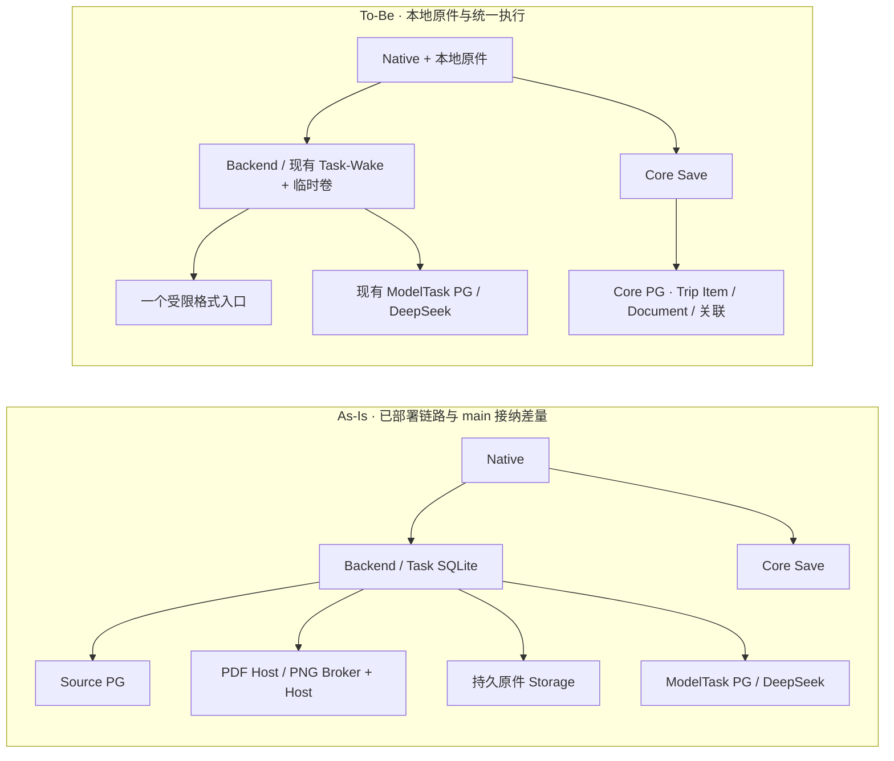
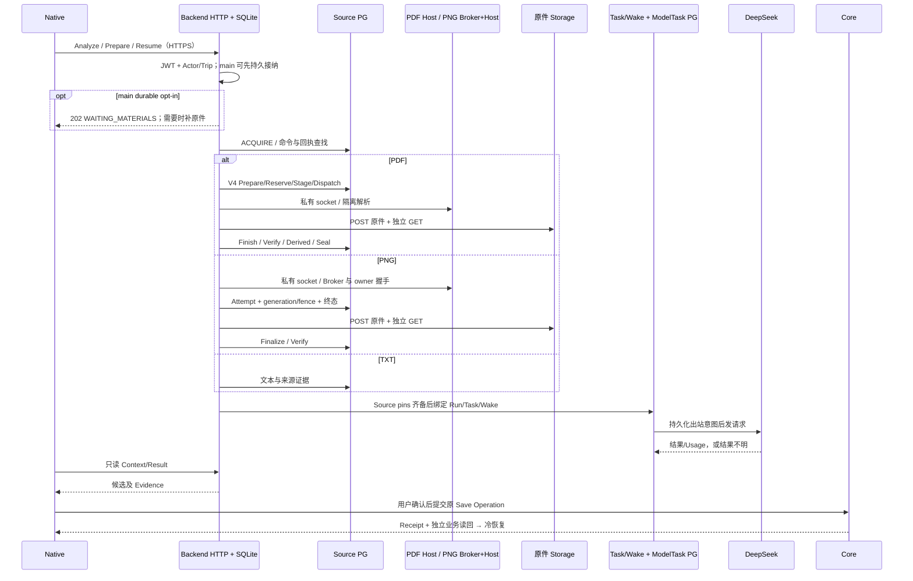
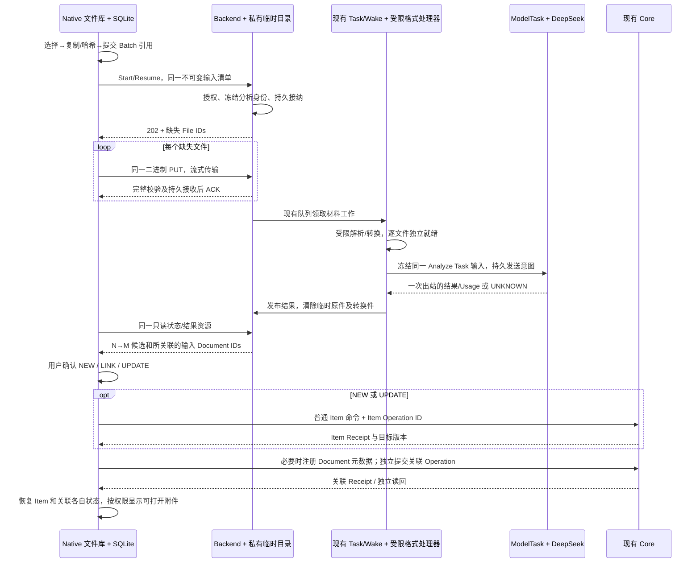

# OTR Universal Import 3.0 — Local-First Engineering Design

2026-11-09 NZDT · Owner Provenance 修订稿 · Root2 Design DRI · MC 协调 · Owner 已批准实施

## 1. 决策摘要

按 Owner 的 Provenance Simplification 决策，Import V3 从本地 Documents 提取建议。用户在 Review 中选择 NEW、LINK 或 UPDATE，再按现有 Core 业务合同保存。**Provenance 的全部产品含义是 Document ↔ Trip Item 的关联。** 关联说明某份文件参与了这次用户确认，无需证明哪个字段来自哪个字、哪一页或哪片像素。

App 长期保存原件，Document 默认 `LOCAL_ONLY`，云端原件为 `NOT_UPLOADED`。云端同步最小 Document 元数据和多对多关联。一次最多 5 个附件，PDF 提取多页文本，同批多图合入一次 DeepSeek 请求。Backend 临时接收，处理后清理，不转换 HEIC/HEIF、BMP、TIFF。重启或失败后允许用户主动重新上传，Provider UNKNOWN 保留原身份且不自动重发。未来 Ticket/Document 文件同步与存储区域策略独立。

删除上一稿的 `LOCAL_ORIGINAL`、Source Evidence Snapshot、Representation VERIFIED、字段/页/像素证明和新 Core Source Proof Admission。保留现有 Core 业务校验、用户确认、权限、版本与幂等 Receipt。现有 Core **可以直接保存已支持的人工确认 Item 命令，也可关联已存在的 Document**。本地原件目前不能用现有 `CREATE_DOCUMENT` 直接注册云端元数据，最小适配见 §8。旧 Source、Receipt、UNKNOWN 继续原样读取。Owner 已批准 V3 实施。最新验证范围见当前状态。

## 2. 基线与时序差异

GitHub main 固定为 [ec282ce65858f9a9857011b225ed08fce8c8d360](https://github.com/xoery83/OTR-mobile/commit/ec282ce65858f9a9857011b225ed08fce8c8d360)。留存的共享 DEV 安装回执为 Backend `6f6b3224…`、PNG Worker `f73d3326…`，以默认关闭状态安装。main 的 `WAITING_MATERIALS` 与普通 Source 会话复用未见该包部署证据。隔离测量和历史 DEV 回执不外推为当前真 Provider PASS。沿用 Root2 已完成的 PDF/PNG Worker 实现对比和前一份服务端审计；以下区分源码已确认、DEV 留存观察、设计提案和 UNKNOWN。 [既有服务端审计](IMPORT_SERVER_ARCHITECTURE_REVIEW.md) · [DEV 安装回执](/private/tmp/otr-qa176-release.zmgvnd/closure.json) · [main 接收进度](https://github.com/xoery83/OTR-mobile/blob/ec282ce65858f9a9857011b225ed08fce8c8d360/docs/CURRENT_IMPLEMENTATION_STATE.md#L1-L32)

### As-Is

main 接纳行存的是 manifest 摘要及进度。脱离 HTTP 的继续动作仍在 Backend 进程内且依赖当次授权；丢进程后需要授权的 manifest-only Start 重对账。PDF/PNG 实际都由 Backend 写 Storage，Worker 做隔离处理。PNG Broker 的额外 PG owner 握手属于既有上传执行合同。旧 Worker marker、Source 状态、Receipt 与 QA176 UNKNOWN 保留。 [现有 intake 状态](https://github.com/xoery83/OTR-mobile/blob/ec282ce65858f9a9857011b225ed08fce8c8d360/backend/src/universalMaterialIntake.ts#L21-L137) · [旧执行链及 Worker 对比](IMPORT_SERVER_ARCHITECTURE_REVIEW.md#2-pdf-与-png-的-worker-职责)

### To-Be

新路一次 Start/Resume 指一个用户动作及一次接纳请求，尚未传输的原件仍各需一个 PUT，GET 负责状态读取。正式 Save 不经过 Analyze 写接口。HTTP 确认、临时文件确认、Provider 回执和 Core Receipt 各自证明不同事实。

## 3. Native Local File Repository

| 数据 | 归属与身份 |
| --- | --- |
| 原件和本地定位 | Local-private。账户命名空间下稳定 `localFileId`、SHA-256、字节数、验证后的 MIME、原始显示名、复制时间及相对路径。显示名不参与路径选择；同一 digest 只在同一账户内复用。 |
| Batch 输入边 | Draft。现有 Batch/Input 标识、顺序、`localFileId`、角色和类型提示。删除 Batch 不改变任何云端对象。已关联的 Document 可继续用其本地引用。 |
| 临时转换及上传 | Transient。按 `analysisId + fileId + transformVersion` 区分，原件路径只读。转换件不参与本地备份或长期引用。 |
| 正式 Item、Document 元数据、关联及 Receipt | Cloud-shared，仍按现有 Trip 和对象权限投影。保留稳定 Document ID 和关联，不上传设备路径、原件、摘录或位置证明。本地文件存在状态只在 Native 记录。 |

使用已有 Capture repository/SQLite 与 Expo/iOS 文件接口。Picker 只给临时访问，优先在已有 `OTRCaptureFiles` lease 中完成复制；若当前 bridge 只能分块 Base64，新增的设计差量是原生同目录复制或流式二进制读取，避免把原件全部搬进 JS。选中后即在 App `Application Support/ImportOriginals/<account namespace>` 写同目录随机 `.part`；需要时在 security-scoped access 内协调读并平衡 start/stop。流式哈希、大小预算、类型探测；完成后同步文件并同卷不覆盖提交，使用稳定的相对路径。SQLite 事务随后提交元数据和 Batch 边。文件先于 SQLite 提交，避免 DB 宣称不存在的原件已接收。崩溃窗口由既有初始化/文件清理路径处理。SQLite 已有行而文件缺失时置缺件，不把引用迁到不同摘要。升级按版本读取相对路径；系统容器路径变化不影响身份。 [当前文件 lease](https://github.com/xoery83/OTR-mobile/blob/ec282ce65858f9a9857011b225ed08fce8c8d360/src/native/captureFileLease.ts#L31-L121) · [当前 Picker](https://github.com/xoery83/OTR-mobile/blob/ec282ce65858f9a9857011b225ed08fce8c8d360/src/native/capturePicker.ts) · [Apple 文件访问](https://developer.apple.com/documentation/foundation/url/startaccessingsecurityscopedresource%28%29)

- **重复文件。** 按账户内 `sha256 + byteCount` 唯一；比较已有文件存在性和字节完整性。并发复制只保留一个正式物理文件。引用计数从 SQLite 有效边计算，避免额外计数真值。相同原件可用于多个 Batch 或 Type-Scoped，不等于复用不同目的的 AI 结果。
- **重启和空间。** 活动复制的 `.part` 未成为可上传输入。初始化按登记状态对账；过期无引用残片或复制完成但未提交的孤儿可以清理，清理不触碰已登记原件。空间不足提示重选或主动清理，保留既有原件。丢失或损坏时可重新选择同 digest 原件恢复同一 File ID，不匹配的文件只能作为新修订。
- **删除。** 从 Batch 移除只释放该输入边。删除 Trip 先按现有业务语义处理 Trip，再释放相应本地引用，不连带其他 Trip 或账户。默认保留已登记原件，零引用也不自动逐出。用户主动清理可在确认后删除零引用原件；明确删除仍被引用的原件时保留 Document 身份与关联，并标记本地不可用。正在上传时先让出该本地读取，迟到响应按原分析身份归属。
- **数据保护与设备迁移。** 默认建议 `completeUntilFirstUserAuthentication`，让首次解锁后受控后台任务可读；首次解锁前等待，已保存 Trip 继续遵守现有离线策略。原件备份策略独立决定，建议默认排除系统备份并在原件移动/恢复后重新设置排除属性。设备丢失、卸载或换设备时，OTR 不提供原件恢复承诺。即便 Owner 选择允许系统备份，是否成功恢复取决于设备和系统策略。 [Apple 数据保护](https://developer.apple.com/documentation/foundation/nsdata/writingoptions/completefileprotectionuntilfirstuserauthentication) · [Apple 备份设置](https://developer.apple.com/documentation/foundation/optimizing-your-app-s-data-for-icloud-backup)
- **原件缺失。** 正式 Trip Item、Document 关联和 Receipt 仍按现有 SQLite/云端读回使用。对拥有原件的用户，换设备后可显示“原件在导入设备，此设备不可用”；该提示不呈现为可点击附件。其他 Member 无权打开云端副本且没有可合法打开的本地原件时，默认隐藏附件入口，保留业务关联。未来同步以稳定 Document ID 关联获授权的本地原件，独立于 Import 临时文件。

## 4. 统一 Intake 与格式适配

沿用现有 `/v2/import-batches/{executionBatchId}/interpretations` 路由族。新路的 `executionBatchId` 就是 `analysisId`，继续占用现有 owning Batch 唯一键。下列路径与字段是提案，版本分流见 §12。

| 接口 | 合同 |
| --- | --- |
| `POST .../prepare` | 新版本 manifest 由 `analysisId` 幂等。字段含 Trip、Batch、`UNIVERSAL / TYPE_SCOPED`（后者含稳定类型/目标上下文）、有序输入 `fileId/documentId/ordinal/sha256/length/mediaType` 及处理策略版本。Universal 返回支持类型的多对象结果；Type-Scoped 绑定已授权的字段/类型范围，Backend 在候选投影时限制类型和范围，正式保存继续走 Core 业务校验。两者用同一文件身份和 intake。不接收 URL、路径或 Provider 凭据。已确认的接纳返回 202 及 `analysisId, state, missingFiles, statusUrl`。同键不同 manifest 409。重复同请求返回当前状态或原结果。 |
| `PUT .../intake/files/{fileId}` | 原始二进制，固定 Content-Length 和 SHA-256，与已接纳 manifest 核对。相同 File 的重复 PUT 若已确认直接 ACK，不再次落盘；在途并发只允许一个写者。不存在的身份、未获权或异摘要拒绝。对同 Batch 多文件逐个 PUT，可有限并行，无按 MIME 拆路由。 |
| `GET .../intake` | 只读状态、缺件、文件级原因及有权访问的结果；`REVIEW_READY` 带稳定的 Task 和 candidate handles。可用现有 ETag；GET 不排队或重发。 |
| Save | 现有 Core 命令、正式 Item Receipt 与独立读回。Document 元数据及关联分别使用稳定 Operation ID；不调用 Source Plan。 |

建议首轮限额，均为设计初值而非已验证 SLA。每次最多 5 个附件，合计 48 MiB；TXT 1 MiB，图片 12 MiB，PDF 24 MiB/40 页。manifest ≤64 KiB。单账户最多 2 个上传、1 个活动分析，服务端初始 8 个上传、2 个受限解析槽，容量低时拒绝新接纳并保留原批次；使用现有资源限制而非新框架。文件上传不做字节范围续传，断线只重传那个未完成文件，用户不用重复操作。限制校验既读声明也数实际字节。Backend HTTP 必须在当前通用 JSON 聚合前分出该路由，边读边 hash/计数写私有限额目录。客户端按文件流或原生上传 API 发送，正式选择以当前 Expo 版本、前后台行为和设备内存验证；不把整个文件转 Base64。

同卷 `.part` 完成后比较长度、SHA 与 magic，再不可覆盖提交，随后用 SQLite CAS 绑定 `RECEIVED` 与该固定 blob。ACK 只在文件与 SQLite 都可恢复后返回。进程丢失时先对账持久接收记录和实际文件，再允许同身份续传；同摘要落盘先于 DB 时可重新验证后补记。收到全部字节也不意味着类型/内容已处理。只在必要文件通过准备或用户显式修改 manifest、当前授权和一次发送条件均成立时才派发。

### 图片与 PDF 处理

用户明确点击 Analyze 后，已选批次内受支持的图片直接进入 V3 分析。App 不执行逐图本机 OCR、相关性判断或确认；单独的照片上传入口和旧 Import 路径沿用原规则。

Backend 复用一个受限、无网络、无业务凭据的准备入口。PDF 使用现有提取工具逐页取文本，跨页保持顺序，标明提取不完整。扫描页缺文字时明确提醒改用有文本的 PDF 或选取单独支持的图片，不把自动栅格化、视觉 OCR 或页级证明纳入默认路径。JPEG、PNG、WebP、GIF 用有界签名/解码检查及必要的静态化、方向和尺寸处理。临时处理只服务模型输入，结果不保存页码、字符偏移或像素区域证明。

本地实现选用独立镜像内固定的 Sharp/libvips，由同一个无网络、无挂载的短进程解码上述四种格式。依赖仅安装在该镜像内。输入最多 12 MiB、16 MP、单边 8,192 px。副本去除元数据并按 EXIF 自动校正方向，非透明内容输出至多 1,536 px 的 JPEG，透明内容输出至多 1,024 px 的 PNG，单份最多 2 MiB。动画及格式不匹配会拒绝；原件保留。这个取舍限制内存与 Provider 请求体，同时增加一个需要封存的隔离镜像制品。历史 PNG Worker 的镜像与合同沿用原路径。 [Sharp 输入合同](https://sharp.pixelplumbing.com/api-constructor/) · [Sharp 元数据合同](https://sharp.pixelplumbing.com/api-input/)

| 格式 | 新路径行为 | 限额或失败体验 |
| --- | --- | --- |
| TXT | 解码为 UTF-8 文本，必要时处理 UTF-16 BOM | ≤1 MiB；坏编码提示另存 UTF-8 |
| PDF | 多页有界文本提取，不发送 PDF 原件 | ≤24 MiB/40 页；加密、损坏、无可提取文字、超页或超文本限额时明确提示，不静默截断 |
| JPEG/JPG、PNG | 验真并按需调整方向、尺寸和色彩；透明 PNG 优先保留透明 | 原件 ≤12 MiB；模型副本按 profile 限额 |
| WebP、GIF、APNG | 支持的静态输入先验证；多帧时请用户选取静态帧或另存，显示分析范围 | 检测到超限或不支持的帧结构时保留原件并提示 |
| HEIC/HEIF、BMP、TIFF | 原件可长期本地保留，Backend 不转换；请用户选用已有的受支持副本或手动另存 JPEG/PNG | 默认不送这些格式给模型，不把未处理的 TIFF 多页或 HEIC 多图标为已分析 |

建议图片单帧 ≤40 MP、每边 ≤12,000 px，模型副本每边 ≤2,048 px、单份 ≤2 MiB，整请求 ≤24 MiB，并受实际路由 profile 的更低上限约束。至多 5 个附件中的图片作为**一次** DeepSeek 请求的多个部分，文本/PDF 提取结果按输入顺序合并。现有 builder 只有单图，需做最小多图适配并后续验证实际路由；不可用时给出明确失败或用户缩小范围入口，不拆成多次计费请求。Native→Backend 保持二进制，Provider 内联编码沿现有 bounded JSON。 [现有请求构造](https://github.com/xoery83/OTR-mobile/blob/ec282ce65858f9a9857011b225ed08fce8c8d360/backend/src/universalProviderRequest.ts#L7-L73) · [DeepSeek Vision](https://api-docs.deepseek.com/guides/vision/)

## 5. Analyze 状态、身份与重启

| 身份或事实 | 唯一持久位置 / 作用 |
| --- | --- |
| `BatchId` | Native Capture 的用户可见分组。包含多个输入和可明确区分的分析修订。首次 V3 分析复用新 Batch ID，后续显式修订有独立执行身份。 |
| `analysisId` | 一次显式 Analyze 意图。Native 在发请求前写入本地，Backend 在现有 Task SQLite intake 绑定 Account/Actor/Trip、执行 Batch、版本、mode、manifest 和摘要。V3 使用该执行 Batch ID 绑定分析 Task，不创建旧 Source Run。重复点击、断线、刷新或同清单 Resume 复用它。 |
| `FileId` | manifest 输入标识，映射本地 stable ID。原始 SHA/长度与顺序被冻结。同一字节可在同批占多个角色，本地只存一份，服务端只在同一分析内对相同 bytes 合并。转换另有 SHA/version。 |
| 材料工作 | 同一 SQLite 中现有 Wake 队列的有版本准备操作，key 为 analysisId，记录工作 claim 与已提交输入事实。排队/等待槽使用既有队列字段。没有独立 pre-Run Task 表、定时器或恢复扫描器。 |
| `TaskId` | 文件准备齐备后进入现有 Provider Task/Wake，以同一个 analysisId 和请求摘要绑定。复用现有 Attempt、用量和结果机制。若当前 adapter 入口硬绑定 Source Run，只调整 V3 在该边界的输入，不创建占位 Run。 |
| `AttemptId / callId` | 现有 Task/ModelTask 记录一次外部派发、持久发送意图、Usage、完整响应或 UNKNOWN。Source 旧 Upload Attempt 是另一合同。 |
| Candidate、Document、Operation | 候选固定到分析结果及输入 Document ID 集。用户确认值走普通 Core 命令。Item、Document 元数据和关联有各自固定 Operation 与正式 Receipt。 |

保留现有 SQLite `(account_id,batch_id)` 唯一范围，用每个显式分析修订各自的执行 Batch ID。旧 Source 约束保持原样。扩展**同一** intake 行保存 canonical manifest 而非只有摘要，分文件的最小接收索引保存 spool 引用、原始和转换摘要、准备结果/错误、到期时间。落盘状态可由这些事实推导，进度 API 不是另一份可更新的任务真值。最后一个缺件确认与准备 Wake 插入在同一 SQLite 事务，若直接复用的队列 API 无法使用调用者事务，复用已有确定性 operation key，并在现有队列启动接管入口对本版本已具备材料、尚无 operation 的行补入一次。无需跨数据库事务。保留现有任务前的持久意图，禁止仅在内存启动。现有 targeted drain 是否可安全消费该准备操作是实现验证项，不能从“支持特定旧 Task 恢复”推导已支持 V3。 [现有 SQLite schema](https://github.com/xoery83/OTR-mobile/blob/ec282ce65858f9a9857011b225ed08fce8c8d360/backend/src/universalTaskBootstrap.ts#L89-L120) · [现有内存 continuation](https://github.com/xoery83/OTR-mobile/blob/ec282ce65858f9a9857011b225ed08fce8c8d360/backend/src/universalContinuousRuntime.ts#L751-L782)

| 对外状态 | 来源 / 合法转换 |
| --- | --- |
| `WAITING_INPUT` | intake 已提交但有缺件，或已确认未发送而 spool 丢失/过期。接收完成进入 PROCESSING；摘要不符保持原身份并提示。 |
| `PROCESSING` | 所需输入齐全，现有准备/Provider Wake 已可运行；排队、解析、短等待、Provider 推理是阶段而非新增持久状态。到 REVIEW_READY、NEEDS_ACTION 或 OUTCOME_UNKNOWN。 |
| `NEEDS_ACTION` | 缺新的可验证用户会话、材料不支持、权限撤销、需选页/帧、永久错误等。权限合法恢复且 manifest 不变时 Resume。同一 bytes 可补传；换文件、选页、排除文件或处理语义改变建立新的明确分析身份。 |
| `REVIEW_READY` | 发布具有固定 digest 的结果；可含零候选、部分可识别和 unresolved。Analyze 至此完成，Save 是独立操作。 |
| `OUTCOME_UNKNOWN` | 外部发送可能已发生而权威结果缺失。只读对账可收敛为结果或确定失败；等待不自动出站。显式付费重分析需新 analysisId，原 UNKNOWN 留存。 |

`ACCEPTED` 是持久接纳后的 202，不额外存状态。202 区分 manifest 接纳与文件接收。Native 重开时先读原 analysisId；已完成则读取结果，未提交可用同键重提。Backend 重启或准备失败时，用户可以主动重新上传。同清单、尚可证明未派发时续接原分析；换材料用新修订。没有可重查的当前授权时返回 `NEEDS_ACTION/AUTH_REFRESH`，通过已有合法会话恢复，不保存 JWT 或借服务角色冒用。存在派发意图且结果不明时保持 UNKNOWN；用户明确选择另起分析时显示可能再收费并分配新身份，原 Attempt 只读对账。

一份失败不会撤销同批其他已接收文件；解析槽和文件状态独立。初版保留“所有选定输入就绪才发”的既有业务语义。用户若接受缩小范围，明确显示哪些文件/页未送并创建分析修订，避免把选择范围变化隐匿在重试。App 重开从本地 Batch/analysisId 读 GET，已保存业务数据仍由既有本地/Cloud 读回恢复。修改文件或分析目标要创建新 revision；打开既有结果、相同点击及上传重试不重复收费。

## 6. DeepSeek 派发、恢复及成本

**现状已确认。** 现有请求由 `universalProviderRequest.ts` 构造，`universalRuntime → universalDeepSeekProvider → flightHttpsTransport` 使用原生 fetch 访问 `https://api.deepseek.com/chat/completions`，不是 OpenAI SDK。当前模型字段 `deepseek-flash`。Root2 核对现有 builder 上限为 64 Sources、1 张≤4 MiB 图片、文本 32 KiB、max_tokens 4096、结构化 JSON；transport 30 秒、外层 60 秒，取先到的限制，响应最多 128 KiB。官方文档支持混合视觉输入不等于该 OTR builder 支持多图或 PDF file part。 [请求构造](https://github.com/xoery83/OTR-mobile/blob/ec282ce65858f9a9857011b225ed08fce8c8d360/backend/src/universalProviderRequest.ts#L7-L78) · [Provider adapter](https://github.com/xoery83/OTR-mobile/blob/ec282ce65858f9a9857011b225ed08fce8c8d360/backend/src/universalDeepSeekProvider.ts#L132-L267) · [HTTPS transport](https://github.com/xoery83/OTR-mobile/blob/ec282ce65858f9a9857011b225ed08fce8c8d360/backend/src/flightHttpsTransport.ts)

- **请求与隐私。** 以 manifest ordinal、页/帧号构建确定顺序，每部分用 opaque source handle 标注；固定 Actor/Trip/analysisId/Task、分析模式、原始和转换摘要、prompt/schema/model/route 版本形成本地 request digest。Provider 只收到最小所需文本/模型副本及业务提示，不发送本地路径、名字、会话或原件附件；明确用户同意 AI 处理。密钥只在现有 Provider transport 获准发送时使用，不进 Worker、Native、状态或日志。只接预配置出站目标，不把模型输出当指令/URL。结构校验与必要脱敏仍在 Backend。候选可引用本批 Document ID，只代表文件关联；服务端验证它属于当前清单。
- **多模态与实际限制。** 按 Owner 决策，同批多图合并进一次 DeepSeek 调用。现有单图 builder 需要最小多图适配，先用模拟 transport 校验顺序、内容和容量，再按现有授权验证当前合成 DEV 路由。多页 PDF 合并提取文本。失败时提示换件或明确缩小范围，保持一次派发策略。Provider 费用沿用现有环境政策。

- **外部 exactly-once 边界。** 本地幂等键只约束 OTR。发送前用既有持久 receipt 检查，确认未发送且无可能跨界才自动排队；写入发送意图后到 HTTP 真正发出之间崩溃也可能误判为未知，代价是避免重复计费。完整响应先由现有接收/结算路径持久绑定原 ID，再解码/发布；若响应已到而 durable receipt 未写成功，按 UNKNOWN。DeepSeek 返回的 response ID 有用来对账的价值，当前 OTR Chat 路由无已核验的按自定义 key 去重或取回丢失结果能力；官方 Responses 是无状态、`store:false`，不能借换 API 推断可恢复。 [持久派发](https://github.com/xoery83/OTR-mobile/blob/ec282ce65858f9a9857011b225ed08fce8c8d360/backend/src/universalPersistenceHost.ts#L369-L435) · [DeepSeek Chat](https://api-docs.deepseek.com/api/create-chat-completion/) · [DeepSeek Responses](https://api-docs.deepseek.com/guides/responses_api/)

| 发送情形 | 允许动作 |
| --- | --- |
| 在出站意图前的可证实本地失败 | 在当前授权和幂等键下继续同一任务，重做可逆本地准备；保持一次外部派发。 |
| 429 或明确拒收 | 仅在当前路由能证明未执行且无费用时，采用受限退避并保留同一意图；当前未验证，默认显示需用户决定，不自动重发。 |
| 5xx、超时、连接丢失或重启时已有出站意图 | 只读原 call/Usage/持久回执。无法证明结果时保留 UNKNOWN；用户如主动再分析，需明确可能另收费并使用新身份。 |
| 完整响应和用量已留存 | 仅恢复解码、发布或结算。结构化内容无效时记录已发生用量并给解释，禁自动换 prompt/模型或重发。 |
| 零或部分有效候选 | 零候选是合法 abstain。可识别子集绑定真实覆盖范围；低置信和未支持字段保持 unresolved，不能绕开 Review 或把模型推断标成已确认值。用量不明独立显示与对账，不发第二次调用。 |

## 7. Auth、PG、临时文件与运行边界

| 边界 | 谁做什么 / 持久与 I/O |
| --- | --- |
| HTTP 接纳、上传、读回 | 现有 Backend Auth + normal Actor/Trip；请求内相同 scope 可共享 verified context。每个独立请求重新核权；访问文件、Provider 派发、展示结果和 Save 需要各自当前权限。普通入口拒绝任意 URL、路径和未登记的 File ID。 |
| 领取与异步授权 | 现有队列以持久 Account/Actor/Trip/analysisId 做 scope 及 claim CAS，使用正式授权重查；JWT 只在现请求内存短暂存在。没有新后台超级用户或可跨 Trip 票据。拒绝撤销后派发或披露结果。 |
| Core PG | 用户确认后，现有 Core principal 写 Item、Document 元数据与关联，各用短事务和既有 ACL/CAS。新 Analyze 无 Source PG 写入或 Source Gateway 前置；历史读取沿旧 principal。 |
| Task SQLite 与 ModelTask PG | SQLite 写 intake、队列和可恢复引用；ModelTask PG 持有真正派发/用量事实。不同存储只通过稳定 ID 和 owning receipt 对账，不复制“已发送”成第二个真值。|
| 本地/外部 I/O | 文件写入、hash、解码和 Provider 等待都不持有 PG lease。Provider 外发在事务 commit 之后，返回后另开短事务。Core 在正式保存阶段校验业务值、目标版本和权限，不持 PG 锁等待文件 I/O 或解析。 |
| Spool | 复用现有 Backend 私有挂载，服务目录 0700、文件 0600、no-follow、同卷不可覆盖提交；使用卷现有静态加密能力，禁进备份/CDN。未证实加密的环境不接收真实文件。按当前已有资源条件，首版单 Backend 数据卷接管；跨宿主丢卷时从本地重传，不引入共享对象库。 |
| 格式执行 | 同一受限处理入口，单文件独立进程/容器/目录，默认无网络、无凭据，设 CPU/内存/磁盘/墙钟限额。解析器只读输入、输出临时模型材料，不能发 Provider 或写 Canonical。 |

建议 TTL 从最后已确认接收起 60 分钟，硬上限从首次接纳起 2 小时，半文件 15 分钟。准备/派发所需文件受活动 claim 保护，但 job deadline 不得延长硬上限；到期先停止该任务的访问，确认处理退出再删除隔离目录。完整结果持久后立即删临时 bytes。UNKNOWN 时保留 original digest、出站意图和有权使用的现有 receipt 元数据，不为可能重放而保留原件。Backend 的既有启动清理/有界清理点负责，文件删除只按归属路径和当前句柄验证，日志仅记录阶段和数字。Provider 的留存/删除条款需在真实素材 rollout 前由 Owner 确认，OTR 的 spool 清理不代表外部 Provider 已删除数据。

## 8. Document ↔ Trip Item 与 Core Save

### 最小数据模型

| 记录 | 最小字段与身份 | 归属和行为 |
| --- | --- | --- |
| Native 原件 | `accountId`、`localFileId`、相对路径、SHA-256、长度、MIME；本设备是否可读 | Local-private。哈希用于本地去重及重传完整性。删除原件或退出账号时更新本地可用性，云端 Document 和关联继续存在。 |
| 云端 Document | 稳定 UUID `documentId`、`tripId`、owner、现有 ACL/版本、显示标题及现有基础媒体元数据；默认 `custody=LOCAL_ONLY` | 复用 `trip_operational_documents`。首次选择时生成并保存 Document ID，后续同 Trip 明确复用该 Document 时沿用 ID。用户确认将 Document 导入 Trip 后，元数据进入现有同步队列；未确认的选择仍是本地草稿。Native 映射 `accountId + documentId → localFileId`。跨 Trip 可复用本地 bytes，云端使用该 Trip 自己的 Document ID。 |
| 云端副本状态 | 云端控制的 `cloudCopyStatus=NOT_UPLOADED`，由既有 Storage/custody 元数据在读侧独立投影 | 与 Native 的文件存在状态无关。本轮的 LOCAL_ONLY 元数据注册不创建 Storage key、URL、Source Representation 或 custody receipt。未来文件同步另行确定策略。 |
| Document ↔ Trip Item | 同 Trip 内 `(itemId, documentId)`，沿用 active、linked_by、linked_at | 复用 `trip_item_document_links` 及现有双端 ACL 和同 Trip 外键。一份 Document 可以链接多项，一个 Item 可以链接多份。解除关联不等于删除原件。 |

现有 Document schema 要求媒体类型、长度及文件 SHA，可继续存注册时声明的这些基础元数据，SHA 仅用于内容身份/完整性提示。它不构成云端原件核验、字段来源证明、业务授权或跨账户查询键。Native 文件路径、AI 输入、提取文本、页/字符/区域定位、模型副本和本地存在标记不作为云端 Document 字段。 [现有 Document 与关联表](https://github.com/xoery83/OTR-mobile/blob/ec282ce65858f9a9857011b225ed08fce8c8d360/supabase/migrations/20261011000100_trip_core_v2_foundation.sql#L258-L279) · [关联表](https://github.com/xoery83/OTR-mobile/blob/ec282ce65858f9a9857011b225ed08fce8c8d360/supabase/migrations/20261011000100_trip_core_v2_foundation.sql#L357-L365) · [同 Trip 外键](https://github.com/xoery83/OTR-mobile/blob/ec282ce65858f9a9857011b225ed08fce8c8d360/supabase/migrations/20261011000100_trip_core_v2_foundation.sql#L562-L566)

### 复用界面与最小必要适配

1. **NEW/UPDATE 可复用已有普通业务命令。** Review 将用户最终确认的值送到现有 `POST /v2/trips/{tripId}/core/commands`，复用 Native `submit`、原 `operationId`、`baseVector`、现有角色与业务校验，以及 Receipt/独立读回。仅使用目前允许用户手工保存的命令/字段，`MANUAL` 语义对应用户显式确认。当前只允许 owning Source 或其他正式能力的特定命令，例如 `QUALIFY_FLIGHT`、`UPDATE_FLIGHT_FACTS`，不改成 MANUAL 绕过；该类候选只映射可手动提交的值，其他保留 unresolved 或引导使用现有业务流程。无需新增 Item Save 接口。 [普通 Core 提交与回执](https://github.com/xoery83/OTR-mobile/blob/ec282ce65858f9a9857011b225ed08fce8c8d360/src/data/api/tripCoreV2Transport.ts#L361-L388) · [现有 MANUAL 边界](https://github.com/xoery83/OTR-mobile/blob/ec282ce65858f9a9857011b225ed08fce8c8d360/src/domain/trip/tripCoreV2Commands.ts#L449-L470)
2. **LINK 可复用已有多对多命令。** `RECONCILE_ITEM_DOCUMENTS` 在普通 Core 命令口绑定已存在、当前有权且同 Trip 的 Item 与 Document，并检查两端版本。LINK 选择现有 Item，只提交关联，不调用 Item Create 或 Update。NEW/UPDATE 保存成功后也复用同一关联命令。现有 Core 在相同 Operation/intent 下返回原 Receipt；不同 Operation 碰到已激活的边会返回 `DUPLICATE_LINK`。先独立读回同 Trip 的目标边，已存在则标记关联已完成，保留实际已有状态而不伪造新 Receipt。 [关联命令](https://github.com/xoery83/OTR-mobile/blob/ec282ce65858f9a9857011b225ed08fce8c8d360/src/domain/trip/tripCoreV2Mutation.ts#L1203-L1215) · [两端绑定与重复规则](https://github.com/xoery83/OTR-mobile/blob/ec282ce65858f9a9857011b225ed08fce8c8d360/src/domain/trip/tripCoreV2Mutation.ts#L426-L468) · [同意图回执](https://github.com/xoery83/OTR-mobile/blob/ec282ce65858f9a9857011b225ed08fce8c8d360/backend/src/tripCoreV2Commands.ts#L99-L134)
3. **新本地 Document 的元数据注册需要窄适配。** 现有 `CREATE_DOCUMENT` 要求 `custodyProofId`，执行器要求已核验的 `PRIVATE_SOURCE_REFERENCE`，数据库 `custody_receipt_id` 非空。建议同一 Core 命令入口新增单一 `CREATE_DOCUMENT_METADATA` 命令，固定目标 DOCUMENT、普通用户确认、现有 Trip/对象权限、同一版本/Operation/Receipt 机制，只允许 `LOCAL_ONLY` 和基础元数据。只调整现有 Document schema/DTO，允许 LOCAL_ONLY 行的 Source、Storage 和 custody receipt 字段全为空，其余 custody 分支保留原约束。Cloud 状态只读投影，不让客户端写。支持版本按现有能力协商返回；无法解析 LOCAL_ONLY 的旧 DTO 可隐藏相应附件投影，保持 Item 和真实关联。复用现有 Core 写入角色、注册表与读路径，无新增表、Gateway、Proof Admission 或权限系统。未确认此命令或 DTO 已在 DEV 可用。 [当前创建命令](https://github.com/xoery83/OTR-mobile/blob/ec282ce65858f9a9857011b225ed08fce8c8d360/src/domain/trip/tripCoreV2Commands.ts#L319-L328) · [现有 custody 校验](https://github.com/xoery83/OTR-mobile/blob/ec282ce65858f9a9857011b225ed08fce8c8d360/src/domain/trip/tripCoreV2Mutation.ts#L1419-L1445)

**新旧路径选择。** V3 Analyze 输出 N→M 草稿、候选和同批 Document IDs。V3 Save 直接提交用户确认的普通命令，完全不进入历史 `REVIEWED_SOURCE`、Source Plan、Core Source Proof Admission 或 `finalizeSourceOperation`。无 `LOCAL_ORIGINAL`、Source Snapshot、Representation VERIFIED、页/字段/区域持久证明及 Storage POST/GET/Seal。现有 Provider 派发若调用了 Source-Run 守卫，仅在 V3 改为绑定当前授权、已接纳分析身份和固定请求摘要；保留现有持久派发和用量处理。历史入口与守卫仍照原合同读取 Source、Receipt 和 UNKNOWN；既有访问控制与旧状态解释沿用，不回填 Document、不改旧记录。 [历史 Source 检查位置](https://github.com/xoery83/OTR-mobile/blob/ec282ce65858f9a9857011b225ed08fce8c8d360/backend/src/universalP1SourcePg.ts#L526-L625)

### 部分成功与跨设备体验

- 用户确认时，Native 在已有耐久队列先固定目标 Item、所选 Document IDs、Item/元数据/关联各自的 Operation ID。NEW/UPDATE 以 Item 正式 Receipt 或权威读回确认提交后才派发关联。元数据可在有当前授权时单独同步，但目标 Item 未证实时不写关联。LINK 直接读取现有 Item，无 Item 写步骤。关联命令只加用户选中的边，不删除不相关边。
- Item 成功、Document 元数据或关联失败时，显示“行程已保存，附件关联待同步”；保留 Item 和原关联操作，重开 App 独立恢复。网络或结果不明先读原 Operation 及目标边；仍需补齐时按原请求和原 ID 续接。目标版本变更且原关联确认未提交时，只读新版本和权限，仍需关联才生成新的**关联**意图/Operation，不重做 Item。权限已撤销时提示关联失败，已合法保存的 Item 不回滚。
- 打开附件前，Native 分别检查当前账户合法可读的本地文件，以及云端副本是否存在并对当前 Member 开放。跨设备时 Document 关联可保持，且行程和 Receipt 仍可读。对上传者可显示非交互的本地不可用说明；其他 Member 无法打开时默认隐藏附件入口。不得因此删除、伪造、重新创建关联，或泄露受限 Document 元数据。

## 9. KEEP / DELETE / MODIFY 与安全必要性

| 处置 | 组件或状态 | 新路径与历史边界 |
| --- | --- | --- |
| KEEP | Native Capture repository、Backend、Task/Wake、ModelTask/Provider | 保留任务身份、当前授权、出站意图、用量及 UNKNOWN 只读对账。 |
| KEEP | Core 普通业务命令、ACL、目标版本、Receipt、独立读回；现有 Document 关联表与命令 | 继续使用，Item 与关系按各自 Operation 恢复。 |
| KEEP | 历史 Source、Representation、Receipt、UNKNOWN、旧 Worker 与 QA176 marker | 保留合法读取和已有维护边界，不迁移、不重放。 |
| MODIFY | Native 本地文件库；Backend intake 与共享准备入口 | 稳定 Document ID、本地可用性、最多 5 附件、短期临时缓存、PDF 多页文本及单次多图。保留限额、摘要与 MIME 只为处理安全与完整性。 |
| MODIFY | Core 的 Document 元数据注册与读投影 | 单一 LOCAL_ONLY 命令差量。云端副本状态独立，隐藏不可打开入口。无新 Document Authority 或 Evidence Registry。 |
| DELETE | 新路径中的 Source Plan、Source Run/原件注册、LOCAL_ORIGINAL、Source Proof 与 Evidence Snapshot | 完全从 V3 Analyze 和 Save 移除。Document ↔ Item 关联是唯一来源语义。 |
| DELETE | 新路径中的 PNG Broker、格式专属 Worker 握手、永久 Storage POST/GET/Verify/Seal、普通 DEV 人工 Gate | 受限格式处理复用现有隔离能力，不接入旧 Worker 生命周期。旧运行的权限与历史读取继续沿用。 |

**安全必要性。** 继续执行 Account/Trip 和对象权限、用户确认、Core 幂等/版本校验、临时文件隔离/限额以及 Provider 出站防重。它们分别保护跨 Trip 数据、正式行程写入、进程和隐私资源、以及费用。上传摘要只校验字节传输，Document ACL 只管元数据与关联，均不变成新的证明或审批。V3 处理使用独立的 task/input sandbox，进程可证明退出后归还容量；孤儿只占其实际资源，不借旧 PNG 的共享 marker 或锁。QA176 仍单独维护。

## 10. 故障注入与恢复矩阵

下表的“自动”均以当前 Actor 权限、原身份和已有防重规则为前提。测试列是实施获批后的隔离计划，本轮未执行。

| Failure Point | Durable State | External Side Effect | Recovery Owner | Automatic Action | Forbidden Action | User Experience | Cleanup | Test |
| --- | --- | --- | --- | --- | --- | --- | --- | --- |
| 文件选择返回、复制前 App 崩溃 | 已有 Batch；无新文件边 | 无 | Native / 用户 | 重开恢复原 Batch | 当成已接收或复用过期 picker URL | 提示重新选择该件 | 无正式文件；系统清 picker 临时资源 | 选择回调后立即杀 App |
| 本地复制中断 | 私有 `.part`；未提交元数据 | 无 | Native | 重开清理已失主残片 | 把半文件登记为原件 | 该件未添加，可重新选 | 初始化清 stale `.part` | 在 50% 杀进程，查文件与 SQLite |
| 文件落盘后 SQLite 提交前崩溃 | 完整孤儿或原有同摘要文件 | 无 | Native | 校验后复用，或无引用过期后清除 | 误删其他 Batch 的引用文件 | 旧 Batch 完整，当前件需确认 | 按目录/引用对账 | 在 rename 与事务之间 kill |
| 本地缺件、digest 损坏、空间不足 | 元数据/原引用；新复制可能无 | 未发 Analyze 时无 | Native / 用户 | 标记缺失或损坏；相同 SHA 可找回 | 换不同 bytes 沿用旧 ID；删其他原件腾空间 | 已保存 Item 可看，缺件/空间原因可见 | 清临时；原件按用户决定 | 删除、改写原件、模拟 ENOSPC 各一次 |
| 重复选择或重复 Analyze | 同 digest 多引用或同 analysisId | 已接纳时最多原派发 | Native / Backend | 本地复用对象，读同意图进度 | 生成额外 Task 或用不同内容重用 key | 单次进度，重复选择可见 | 丢弃重复物理件 | 10 个并发请求，核对一份/一次 |
| iOS 后台终止 | 已复制原件、Batch 和 analysisId；在途上传未确认 | 可能 Backend 已接收；已派发时可计费 | Native / Backend | GET 缺件及状态，再传未完成项 | 把 APP 被杀当成取消已发模型 | 重开回到原批次和进度 | Backend TTL 管未完成 bytes | suspend/kill 在上传与响应后各一次 |
| App 升级或 SQLite 恢复 | 旧引用/正式回执；相对路径可迁移 | 无新增 | Native | 增量升级，读旧版本和缺件标记 | 扫描文件名猜归属；重分析旧 Batch | 历史数据仍可打开 | 迁移后只清已证实孤儿 | fixture 带旧 schema/文件、迁移中断重开 |
| 上传前断网 | 本地完整原件及分析意图；Backend 可能有 manifest | 无模型，除非已有任务 | Native | 恢复网后先查状态，重用同意图 | 另建 Batch 或自动反复点击 | 等待网络 | 无新 server 文件 | 首次 PUT 前断网 |
| 上传 10% 时断网 | manifest、未完整 `.part` | 未完成接收；无外部调用 | Backend / Native | 阻断半件接纳；重传该件 | 用半件派发识别 | 显示该件待上传 | owner 结束或半文件 TTL 清 | 注入 10% socket reset |
| 上传 50% 时断网 | 同上，其他文件可已确认 | 已确认其他件保留 | Backend / Native | 只重传该未完成件 | 重置整批、删其他件 | 已完成件保留进度 | 只清失败临时文件 | 注入 50%，同时上传另一件 |
| 上传 99% 时断网 | 可能未提交，或最后字节已落盘尚未 ACK | 临时接收可能已发生 | Backend / Native | GET/同 PUT 查 owning digest，再决定 | 把写完 TCP 当成已提交 | 短暂确认中，不重复提示收费 | 校验落盘与 SQLite CAS，清未绑定件 | 在尾字节前后分别断开 |
| Backend 完整确认后响应丢失 | blob 与接收索引已持久 | 可能已有后续派发 | Backend / Native | 同键返回当前状态/原 ACK | 再写相同文件或发第二个 Wake | 自动恢复到已有进度 | 正常 TTL/结果清理 | commit 后 drop ACK |
| 重复上传、MIME/长度/摘要冲突 | manifest、已确认字节/在途写者 | 无第二原件或模型派发 | Backend | 同 SHA 返回已有 ACK；超限/冲突拒绝 | 以覆盖存储纠正摘要；信任客户端 MIME | 提示大小、格式或完整性 | 删除当前失败 `.part` | 同件并发、声明过小、错误 MIME、错误 hash |
| PDF 文本提取失败或加密 | 完整原件已接收；每页处理状态 | 未派发 | Backend / 用户 | 限时失败，提示补清晰未加密件 | 把解析错误当空 PDF | 显示文件及失败页 | 回收解析槽；原件按 TTL | 坏 xref、加密和解析超时 |
| PDF 扫描页无文本或混合 | 原件和已核对页文本 | 只在有权限且材料就绪时一次调用 | Backend / 用户 | 提取可读文本并明确缺失；提示换有文本版本或补支持图片 | 静默丢扫描页或自动多次计费 | 显示覆盖范围或选择页 | 清临时文本及接收件 | 全扫描、混合文本与扫描页、超页数 |
| HEIC/HEIF、BMP、TIFF 被选作输入 | 本地 Document 与原件 | 无 | Native / 用户 | 保留本地文件，提示选择支持的副本 | Backend 自动转换或覆盖原件 | 此格式需要另存或换件 | 无 Backend 副本；保留原件 | 三类输入均不触发转换和派发 |
| 大图、GIF/APNG/WebP 多帧失败 | 原件、已识别的页/帧元数据 | 未自动送余下部分 | Backend / 用户 | 限时/限像素，允许显式选择 | 静默丢页/帧；超过额度反复解码 | 显示有效页帧或超限 | 终止对应 sandbox，回收副本 | 压缩炸弹、帧超限、损坏 WebP |
| 临时文件丢失或过期 | 有接收索引，spool 不可用 | 已发送时可能有模型费用 | Backend / Native | 先看出站意图；未发送退回缺件 | 发缓存残片或已发送后重传重发 | 待补件或结果未确认 | 失效索引和孤儿目录按 owner 处理 | 删 blob/丢卷，分别在发送前后 |
| 接纳提交前 Backend 崩溃 | Native 有 analysisId；无已提交接纳 | 无 | Backend / Native | 同键重提 | 分配第二分析身份 | 重试后恢复接纳 | 清孤儿 `.part` | 在 SQLite COMMIT 前 kill |
| 接纳后、Provider 前崩溃 | manifest、已接收索引、Wake/确定性键 | 仅可能已有同一任务或出站意图 | Backend | 恢复同一队列与 analysisId；按当前会话要求续接 | 仅凭崩溃断定未派发；持久化 JWT | 恢复处理中或需连接账户 | 释放已退出资源，未退出隔离 | 在 Wake 插入、Task 绑定和出站意图前分别 kill |
| 多文件部分准备、Task 重复领取 | 每件结果、同一 queue op/claim | 可能已提交同一文件接收/Task 状态 | Backend | 成功项保留；CAS 拒旧 owner；隔离单槽故障 | 所有件重做；共用永久 marker；双模型调用 | 逐件进度，显示具体失败 | 只回收失效 task 资源 | 双 runner、旧 owner 迟到、单 PNG orphan 同时跑后续图片 |
| Backend 部署或重启 | SQLite 及 spool 卷、原 operation keys | 原有工作可能已送 | Backend | 先判未知、再接管无外发的工作；不支持 session 重查则等合法 Resume | 跨版本盲改 manifest 或 replay | 原批次保持可查询 | 新版接管前确认卷/当前 claim | 滚动重启、丢卷、兼容版本回退 |
| Trip 权限或会话被撤销 | 原接纳、可能已准备或派发 | 已发出不可自动取消 | Backend / 用户 | 阻止新派发及披露；必要时仅内部结算原 Call | 使用旧 token 或服务角色冒充；继续 Save | 无权访问/需登录，仍可用已合法缓存内容按现有规则 | 按 TTL 清副本 | 接纳后、发送前、响应后分别撤销 |
| Provider 发送前可证实本地失败 | 无发送意图，或 owning 证明明确未出站 | 无 | Backend | 有界恢复同 Task，先复核权限/预算 | 用新 call 重跑同意图 | 继续处理 | 回收死 lease | 在 send intent 之前注入 transport failure |
| Provider 可能收到后响应丢失 | MAY_HAVE_STARTED、原 Call/摘要 | 可能已推理、计费或留存 | Backend / 用户 | 只查原回执及用量，未知需用户决定 | 自动 POST、换 route/模型试一次 | 显示结果未确认、可能计费 | 清原件及转换副本，保留对账元数据 | 模拟 Provider 接收后断开 |
| 429、5xx、超时 | 原发送意图、可用的 status/响应头 | 429 若未证明拒收也未知，5xx/超时同 | Backend / 用户 | 只有明确不计费拒收时有限退避，当前默认不重发 | 仅凭 status 将费用视为零 | 显示限流或暂无法确认，区分可否重试 | 清临时；保留最小诊断 | 模拟 429/500/503/timeout，断言请求次数 |
| Provider 响应无效 JSON | 完整响应/已知用量或其摘要 | 已调用，可能已计费 | Backend | 记录解析失败和已知用量；保留原身份 | 自动换 prompt、重发或保存猜测值 | 明确识别失败 | 按原 retention 清响应/临时件 | 正常 usage + 损坏 JSON |
| Provider 返回零/部分有效候选 | 固定结果、coverage、Usage | 已发生一次调用 | Backend / 用户 | 合法 abstain 或展示通过结构与业务范围校验的候选 | 把未覆盖内容报告成已识别；自动保存 | 显示未找到或待确认字段 | 结果持久后清临时件 | 0 candidate、混合有效与低置信字段 |
| Provider 用量回执不明 | 原 call ID、已知响应或未知字段 | 可能计费 | Backend | 只读 usage 对账，保持已知结果与未知费用分开 | 写零费用或为重取 usage 再调用 | 结果可见时显示，费用可未确认 | 保留必要账务记录 | 结果齐全但 usage 无/截断 |
| 用户 Review 中退出 | 已发布结果、尚无正式 Operation 或仅本地草稿 | 无新 Save | Native | 只读恢复结果/草稿 | 后台自动 Save | 原 Review 可继续 | 清 UI 临时状态 | 切后台、杀进程、重开 |
| Review 时本地原件被删 | 结果、Document 元数据和本地引用 | 无新增 | Native / 用户 | 保留结果和关联。用户可按可见值确认，或在需要时重选原件 | 显示无法打开的附件入口；删已保存 Item 或关联 | 说明原件不可用，正式业务仍可读 | 清本地残片，留引用身份 | Review 前删原件，跨设备读取 |
| 目标被改、NEW/LINK/UPDATE 冲突 | 原 review、目标版本、原保存意图 | Core 按冲突语义无静默覆盖 | Core / 用户 | 读当前 revision 回 Review，保留原 Operation | 覆盖他人修改或改原 key 的 intent | 展示冲突和当前值，用户再确认 | 不删旧候选或 Receipt | NEW 目标已存在、LINK 权限变、UPDATE version 改 |
| Save 已提交但 HTTP 丢失 | Core canonical 状态及 owning Receipt | 业务写已发生一次 | Native / Core | 按原 Operation 读 Receipt、独立 Readback、恢复 SQLite | 换 Operation 再 Save | 显示正在确认，最终还原保存结果 | 仅清已对账本地临时意图 | Core commit 后断响应 |
| 已有 Core Receipt 再提交 | 原 intent、Receipt 及目标版本 | 不重复写 | Core | 同 intent 返回原 receipt，异 intent 拒绝 | 覆盖旧 receipt 或追加重复 LINK | 一次保存结果 | 原审计保留 | 重复确认与变更字段重用 key |
| Item 已保存，Document 元数据或关联失败 | Item Receipt、各自原 Operation、Document ID | Item 已写；关系可能已提交 | Native / Core | 读原元数据/关联回执与目标边；补原操作 | 重建 Item、删已保存行程或伪造关联 Receipt | 行程已保存，附件关联待同步 | 保留原意图，确认后清队列项 | 在元数据和关系各自提交前后断线 |
| 其他 Member 或换设备无法打开原件 | 云端 Document 及关系；本设备无可读原件/云副本 | 无 | Native | 分别检查本地与云端权限；隐藏不可打开入口 | 删除关联或泄露未授权元数据 | Item 正常可见，上传者可获本地缺件说明 | 无业务清理 | 另一设备及无云文件 ACL 的 Member 读回 |
| Native SQLite 冷恢复 | 已保存业务/Receipt 或原 Operation ID | 无新 Save/Provider | Native | 恢复持久字段和只读 reconcile；离线读取已有正式数据 | 冷恢复自动派发或假设有原件 | 已保存数据可看，缺件有提示 | 维护缓存与索引 | 断网冷启动，再联网只读确认 |

## 11. 性能、成本、观测与 Complexity Budget

以下是小文件工程预算，按 1–2 MiB 单文件、正常联网、热进程、已具备授权和容量估算。多页/多文件、冷连接和低端设备另测。分段预算用于定位瓶颈，不能将逐段 p95 直接相加推导总体 SLA。

| 阶段 | 已有文件/已就绪预算 | 首次上传/不同格式 |
| --- | --- | --- |
| Native 复制/读取/hash | 已持久化、metadata 命中目标 ≤0.2 s | 流式复制小件目标 0.2–0.8 s；选择阶段记录，不与 Analyze 计时混淆 |
| 传输 | 已在该分析 spool 时 0 | 小文件预算 1–4 s；需按 bytes/RTT/吞吐分层，低速网络可超过 10 s |
| 接纳、Auth、PG | Start 收据 ≤2 s p95；同角色短连接/事务 | 目标热路径 Auth+PG 合计 ≤1 s，独立观察冷连及权限重查 |
| 检查与转换 | 复用同版本临时证明时接近 0；新 TXT ≤0.2 s | 单静态图目标 0.4–1.5 s；小文本 PDF 0.5–2.5 s；多页单独测量，扫描件返回文字不可提取 |
| Provider Dispatch | Analyze→出站 p95 ≤5 s | 含首次上传先争取 ≤10 s；分别测准备队列和实际发送 |
| Provider 推理 | 另计，实测未知；沿现有 30/60 秒策略 | 记录开始、首字节/完成、429/UNKNOWN，不能拿超时当正常耗时 |
| Results/Review | Provider 完整响应至发布/GET 目标 ≤1 s，设备渲染另测 | 按结果/候选数采样；Core Save 不混入 Analyze 指标 |

Trace 使用现有 request ID 与结构化日志，关联 `BatchId → analysisId → FileId → Task → Attempt/callId → Candidate/Document → Item 与关联 Operation`，记录每个阶段起止、字节/格式/页数、结果码、是否复用和绑定 ID。只记录必要标识及计量，日志不留正文、文件名、Key、JWT、Base64 或用户输入。沿用已有 usage/cost；临时卷按 `48 MiB × 活动批次数 + 部分上传及转换上限` 配硬配额。解析消耗 CPU/内存，模型费用来自输入 token/图与输出 token。未来 Document Sync 的存储、传输及配额是独立产品成本。现有隔离 8.5 ms/317.6 ms 和旧 DEV 142.479 s 均不等于 V3 p95；指标不成为设计审批或首轮 E2E 的新门禁。 [现有隔离基线](https://github.com/xoery83/OTR-mobile/blob/ec282ce65858f9a9857011b225ed08fce8c8d360/docs/CURRENT_IMPLEMENTATION_STATE.md#L1-L52)

### Complexity Budget

| 指标 | As-Is | To-Be | 减少量 |
| --- | --- | --- | --- |
| Analyze HTTP | 老 Native 调 Context、Source/格式步骤、Prepare/Resume 与 Result；main 有 Start/补件/GET | 1 Start + 每缺失附件 1 PUT，最多 5；状态 GET 独立 | 去除客户端逐步 Source/格式调用；同样本精确差额未知 |
| 持久状态 | pre-Run intake + Source/Representation/各格式上传 + Task/Attempt | 现有 intake/Task/Attempt；Document 元数据和关系仅在业务侧同步 | 删除 V3 Source/原件证明状态和既有 Source Run 依赖；保留真实派发状态 |
| 格式专属协议 | PDF、PNG 两套 | 统一二进制入口 | 2 → 0 套专属协议 |
| Worker/Broker/Gateway | 2 格式 Host Worker、1 PNG Broker、Source Gateway 参与正常路径 | 1 个共享受限准备入口、0 Broker、0 Source Gateway 前置 | 少 1 格式入口及 1 Broker；历史 Gateway 保留 |
| 必经永久 Storage I/O | 每份旧二进制原件至少 1 POST + 1 独立 GET，另有 Verify/Seal | 0；临时文件和本地原件 | 至少 −2 次/旧二进制原件 |
| PG 和 Save | Source 注册、上传、核验、Source Plan/Admission 与 Core Save | Analyze 无 Source PG。普通 Item 保存后按需 Document 注册及关系写入，关系步骤不阻塞 Item 成功 | 移除所有 V3 Source Proof 读写；新增/保留的 Document 业务写次数按已存在 Document 数计，真实 PG 差额待测 |
| 人工恢复 | 旧路径存在 SSH、Writer、权限窗口及历史 Attempt 处理 | 普通新路径无人工 DEV 窗口；用户可主动补件，UNKNOWN 只读 | 移除 V3 对历史隔离流程的依赖 |
| 用户错误 | 格式、Source/Proof、Task、Save 等 | 缺件/不支持、授权、UNKNOWN、Item 冲突、关联待同步 | 移除文件证明错误；Item 与关联可分别完成 |

## 12. Migration、Rollout、Rollback

1. **隔离验证。** 扩 Native 本地 Document 映射、统一 intake、多图 builder 和现有 Core 元数据合同。只使用合成 fixture 验证普通 Item Save 无 Source Proof 调用、同一 Document 多 Item/同一 Item 多 Document、关联失败与补齐、旧 DTO 兼容及历史读回。沿用已通过的旧保存/恢复证据，不重跑无变化的历史链。
2. **有界 DEV E2E。** 新旧路径在首次接纳时固定 `legacy / local-first` 和执行身份，复用现有唯一键，拒绝同意图走两次。新客户端读取旧 Batch 走历史合同；旧客户端无法理解新 Batch 时返回版本不支持，不能降级重新派发。以一组合成材料验证单次多图、PDF 多页文本、Review、Item Receipt、关联 Receipt/读回和跨设备冷恢复。实际 DEV、Provider、权限按现有批准执行。
3. **回退与旧数据。** 关闭新接纳及新 Document 元数据写入，保留已接纳分析、原 Item/关联的安全读回及合法补齐能力。已落 LOCAL_ONLY 元数据的环境保留兼容读和数据库约束，禁止用旧回退包解释或清除新记录。历史 Source、Receipt、UNKNOWN 不回填、不改写，历史读路由继续独立。旧 Worker 正向能力只有在旧客户端和合法未决操作收敛后才另行退役。

## 13. 工作量与风险

去掉 Source Proof、Evidence Admission 和格式专属恢复后，剩余四块：Native Document 与恢复、统一 intake/临时处理和单次多图、Core 元数据窄适配、跨设备与失败验证。可并行实施。上一稿包含 Source Proof 的工期估算已作废，待核实元数据及多图差量后重新估算。关键不确定性是多图 Provider 路由的实际能力、现有 Core 手动命令在目标环境的可用范围，以及 LOCAL_ONLY 元数据对旧 DTO 的兼容。§11 性能仍是设计目标。

## 14. Owner Architecture Approval

Owner 已确定 Document 关联是唯一来源语义，以及 LOCAL_ONLY / NOT_UPLOADED、5 附件、多页 PDF 文本、单次多图、禁 Backend 转换 HEIC/BMP/TIFF、用户主动重传、UNKNOWN 不自动重发。上一稿关于 Source Proof、长期共享证据、扫描 PDF 默认视觉路径的提案撤回。系统备份范围、未来 Document/Ticket 文件同步和存储区域策略保留独立决策。Owner 已批准此架构实施。共享 DEV 部署和真实 Provider 验证仍沿用既有授权边界。
