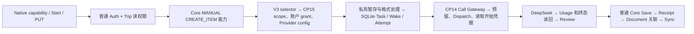
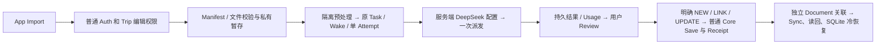

# OTR Universal Import V3 · 简化 Backend 设计

Owner 于 2026-11-10 批准实施。本文保留设计时的现状和取舍。内部 DEV 和邀请制 Beta 在商业化前共用一条正常 Import 路径。最新部署和验收结果见当前状态。 [Local-First 设计](IMPORT_V3_LOCAL_FIRST_ENGINEERING_DESIGN.md) · [当前状态](../CURRENT_IMPLEMENTATION_STATE.md)

## 1. 当前链路与真实阻塞

- **源码确认。** `universalV3IntakeBoundary` 经正常 App Auth 和 Trip 可见性，`app.ts` 的 `available` 再把 Core `MANUAL + CREATE_ITEM` 和 Provider 选择设成 Analyze 前置。现有 `provision` 会重新核对同一普通账号和 Trip，但只查读权限。其 SQL `universal_import_select_v3` 只接受 Call Gateway `session_user`，调用 `universal_import_select_continuous`，再验证 V3 图片 Profile。旧 selector 需要有效 scope/grant、启用的集成、Provider 配置及非 OFF 时的有效价表。 `AI_COST_GUARD_ENABLED=false` 去掉价表和费用预留分支后，仍需要 scope/grant、Call Gateway、Provider 配置、Dispatch 和完成读回。 [HTTP 入口](../../backend/src/app.ts#L2713) · [Runtime](../../backend/src/universalContinuousRuntime.ts#L751) · [V3 Provider SQL](../../backend/sql/universal_v3_provider_admission_candidate.sql#L17) · [CP15 基础合同](../../backend/sql/universal_sustained_provider_candidate.sql#L43)
- **源码确认。** `CONFIG_ADMIN` 用于 `external_integration_price_append` 和 `intelligence_provider_config_append`，`SECURITY_ADMIN` 用于 `flight_activation_select` 和 `flight_activation_account_grant`。Admin Gateway 的登录、签发及撤收是旧受控发布准备。Analyze 本身使用 `TRUSTED_WORKLOAD` 的 Call Gateway，`cp14_context` 核验实际 `session_user`、命令摘要、身份、期限及撤销，不需要用户持管理员权限。现有流程仍会因尚无管理员登记的 scope/config 等而间接受阻。两种 Gateway 权限必须分开，不能用放开角色登录或移除共享签名校验解决。 [持久化 Gateway](../../backend/src/universalContinuousRuntime.ts#L215) · [已装 Scope SQL](/private/tmp/otr-v3-db-autonomy.tBmmoO/01_SCOPE_FORWARD.sql)
- **DEV 回执。** 源码 `78c0d76`、镜像 `3ced7878` 已闭态安装，原生 amd64 四格式探针通过。阶段一六份 SQL 已提交并独立读回。阶段二只读观测显示 Admin Gateway NOLOGIN、无会话，scope 关闭、grant 已撤销、Provider/price 为零。没有真实 DeepSeek、Review/Save 或 iPad 冷恢复回执。隔离回执使用模拟 Provider，证明的范围止于隔离。 [当前状态](../CURRENT_IMPLEMENTATION_STATE.md) · [六份 SQL 现场回执](/private/tmp/otr-v3-stage1.22s28n/STAGE_ONE_RECEIPT.json) · [阶段二只读](/private/tmp/otr-v3-stage2-readonly.BHGe96/independent-pg.json)

## 2. 目标链路

同一正常 Actor/Trip 绑定贯穿全程。Start/PUT 和真正出站前核验 Trip 编辑资格，既有结果只读仍按原拥有者、Trip 可见性和协议检查。文件不进入永久云端 Storage。仅将当前分析所需内容发给服务端配置的 DeepSeek。Provider 返回的是建议，只有用户在 Review 明确确认后进入现有 Core 命令。后台临时字节按现有短期保留和清理规则处理，Native 私有原件长期保留。 [Intake](../../backend/src/universalV3Intake.ts#L335) · [Core Review](../../src/data/operations/universalV3Review.ts#L275)

## 3. 保留、移除与延后

| 类别 | V3 正常路径 | 范围 |
| --- | --- | --- |
| 保留 | 正常登录与 Trip 读/编辑、租户隔离及 RLS、原 Task/Wake claim 与持久单次派发、原 ID 的 UNKNOWN 只读对账、Core 权限/版本/幂等/Receipt、Document 稳定 ID 与本地原件 | 继续复用现有各责任边界 |
| 保留 | 最多 5 附件、格式/长度/哈希、隔离解码、暂存 TTL、资源并发、固定 HTTPS、超时、请求/响应与输出上限、必要 Usage 和安全日志 | 保护内存、CPU、磁盘、连接和用户数据，和商业费用规则分离 |
| 移除 | 新 V3 对 CP14/CP15 价格、成本预估、费用预留、管理签发、合成 scope/grant、QA 帐号/Trip/Run/Release ID、人工窗口、V2 Watchdog、联合执行包及逐次 DBA 的依赖 | 只移出新 V3 请求链，共用函数、角色、配置及历史数据留在其原用途 |
| 延后 | Token 商业计费、价表、订阅、预算与审批、商业配额和 Account/Trip 商业限制 | 正常 V3 不调用相关模块，无占位价表、无限额行、虚假预算、Beta 管理入口或额外 Gate |

## 4. 最小改动和不可删除的调用

| 现有入口与具体阻塞 | 替代及必须保留 | 迁移和影响 |
| --- | --- | --- |
| `app.ts` V3 `available` 先查 Core 资格，再调 `universalV3Execution.available` → `selectProvider`。能力探测、上传完毕和真正 Start 会多次进入旧资格链。 | 能力端点表达协议兼容和 Backend 是否具备实际运行依赖。V3 新 POST/PUT 和派发前复用 Backend 的普通 `validateAccessToken` 与 `canWriteTrip`，保留现有账户与 Trip 绑定。读旧状态沿用 `canReadTrip` 和原分析所有者检查。无编辑权的成员只能读其已有合法内容。只在授权边界重新查权限，避免每个内部子步骤重复查同一身份。 | 仅改 V3 HTTP/Runtime，现有 Native 协议和旧 Import 不变。不改 Auth/RLS。Core 能力只在 Review/Save 使用，原权限依旧生效。 [路由](../../backend/src/app.ts#L2713) · [Trip 权限](../../backend/src/supabaseGateway.ts#L925) |
| `loadDevUniversalContinuousRuntime` 把 V3 和 V2 Source、`taskPg`、固定 DEV Project、`finiteNative`、`qaExecutionFence` 等组合在一起。 | 在现有 `serverCapture` 装配处让 V3 使用普通 Auth/Trip、现有持久 Task SQLite/私有目录、已装解码器、服务端 Provider 配置。复用 `initializeUniversalTaskDatabase` 和 `createFlightPrivateCustody`，旧连续运行装配留给旧功能。Backend 的环境配置提供 Key、允许的 model、技术超时/长度/并发；锁定 DeepSeek HTTPS 目的地，禁止从客户端覆盖 URL、Key 或模型。以不含秘密的实际配置和 request SHA 固定新 Attempt。 | 仅 Backend 装配和部署配置。相同协议无 Native 重签、无 SQL 预置需求。环境身份和运行依赖仍必须正确，保持普通健康检查、发布 Writer 和可核验回退。 [启动装配](../../backend/src/serverCapture.ts#L39) · [配置](../../backend/src/universalContinuousConfig.ts#L23) · [Task DB](../../backend/src/universalContinuousRuntime.ts#L100) |
| `buildUniversalV3TaskDraft` 从 selector 填价表、预算和 Provider 选择，`bindUniversalV3ModelTask` 还强制 USD 和正预算；`createUniversalPersistenceHost` 多次读 `universal_import_read_continuous_scope`，调用 `flight_activation_reserve_call`（有价）或 `universal_activation_reserve_call`（无价），再 `external_integration_mark_dispatch`、`external_integration_usage_append`、`external_integration_observe_call`；`universalTaskReceipt` 读 `model_task_read_universal_v3_receipt` 校验旧 PG Admission。 | 新 V3 从服务端实际配置固定 provider/model/adapter、Profile、manifest、request 与原身份。既有 Task schema 已支持预算字段为 null。仅在新 V3 Draft 不调用依赖预算的旧 PG binder，原 binder 继续处理旧合同。新 Draft 保留同一 V3 Profile、输出 schema、隐私声明、技术期限与单 Attempt 限制。使用 V3 专用、窄的现有 Provider custody 接线保存真实结果和 Usage。复用 `runUniversalV3Wake`、`reserveAttempt`、`beginExecution`、`admitExecution`、`observeAttempt`、`installResult`。先在既有 Task store 持久化同一 Attempt 和请求摘要，再提交当前 Wake/revision/fence 后单次派发。技术性开始/完成记录由已提交的真实状态证明，不伪造计费凭据，不跳过本地 CAS。 | 优先零 SQL，复用现有 Attempt、Usage 字段和私有结果存储。若当前 Attempt 合同将 `START_DURABLE` 必然解释为 CP14 远端账本，须在现有 owning repository 内做仅 V3 的最小适配，明确区分持久技术意图，不放宽 Flight/V2 的合同。旧已登记的 Call/Usage/Receipt 保持原读取。 [V3 Draft](../../backend/src/universalV3TaskDraft.ts#L19) · [旧 Binder](../../backend/src/universalV3Profile.ts#L28) · [派发/Usage](../../backend/src/universalPersistenceHost.ts#L337) · [Wake](../../backend/src/universalV3Wake.ts#L24) · [CAS](../../src/data/repositories/intelligenceContinuationRepository.ts#L534) |
| `createUniversalDeepSeekProvider` 取得 Key、校验绑定、发送并保留原始响应；有价时在 `decodeUniversalDeepSeekResponse` 计算成本，`settle` 还依赖 price/hold/usage 对账。 | 复用请求构造、HTTPS、解码及必要 Usage，不在 V3 计算价格。记录 provider request ID、稳定 Attempt、请求/响应摘要、实际 token 数或 UNKNOWN、时间和结果。来源、请求绑定与结构已验证的响应可进入 Review，Usage 或价表缺失不会单独阻断；有可用 Usage 则保存，缺失保持 UNKNOWN，不填估算值，不泄露 Key、原件、prompt 或内容。派发失败或响应不明不发第二次。 | 新 V3 接线影响 Backend。其他模块原有 `settle` 和费用行为原样保留。无需改 Provider SQL、Native 或 Core Receipt。 [Provider](../../backend/src/universalDeepSeekProvider.ts#L132) · [现有 Usage 持久字段](../../src/domain/intelligence/persistence.ts#L79) |
| 旧配置绑定合成 Actor/Trip、固定 Run、QA178 Build、Host 窗口及 Watchdog；现有 Core 的文档 guard 还调用 `trip_sustained_dev_scope_allowed(...,'CORE')`。 | 分离两类 scope。Analyze 仅需正常 Auth/Trip 编辑、真实运行依赖及资源控制，删其 QA 绑定。Save 仍需普通 Core 业务权限、目标对象 ACL、并发版本及幂等。QA178 只表示客户端构建；服务端依据协议版本和能力，正常测试用合法账号/Trip。 | 不为 Analyze 写 SQL。若目标环境普通 Core 仍只有 DEV 按 Actor 注册和 Trip 创建来源约束，Save 属于 Core 兼容缺项。核对普通 Core 命令入口、read-state/Receipt/Document guards 后，仅沿现有 MANUAL 权限做独立最小兼容，不用取消 SQL guard 或给 Import 提权来换取 Beta。 [普通 Core 范围合同](../../supabase/dev-forward/trip-sustained-sync/20261024000200_trip_sustained_dev.sql#L41) · [Document guard](../../backend/sql/core_v3_local_document_capabilities_candidate.sql#L29) |

`universalV3IntakeBoundary` 的有界输入、`prepareUniversalV3Materials` 的哈希和格式校验，以及 `admitExecution` 的最终事务和版本围栏不可删除。现有技术起点为 5 个文件、总计 48 MiB，文本 1 MiB、PDF 10 MiB、单图 12 MiB。另有限制 512 MiB 暂存、上传最多 8 并发/单账号 2、执行进程最多 2 并发/单账号 1、请求正文 24 MiB、Provider 60 秒和响应 128 KiB、输出 4,096 token。保留这些技术上限和短期清理；单账号并发用于资源公平，不形成计费或累计配额。 [Manifest](../../src/data/api/universalV3Contracts.ts#L13) · [Spool](../../backend/src/universalV3Intake.ts#L269) · [执行并发](../../backend/src/universalV3Execution.ts#L158) · [请求上限](../../backend/src/universalProviderRequest.ts#L88)

**派发证明。** 当前 `runUniversalV3Wake` 先 `reserveAttempt`，再 `assertDurableStart`，然后 `beginExecution(START_DURABLE)`。共享 `admitExecution` 只接受 `START_DURABLE`，在出站前以同一 Task/Attempt、Wake、revision 和 publication fence 消费本地 CAS。新 V3 仅替换 owning port 的 `assertDurableStart`。用现有私有持久存储按原 Attempt 的 request-material reference 写入并回读小型发送意图，绑定 Account/Trip、Task、Wake、Attempt、请求和 manifest 摘要及 fence。核对与同一已提交 Attempt 一致后，才进入既有 `beginExecution` 和 `admitExecution`。预留行、意图、CAS 均不能当作已物理发送的回执；共享 CAS 与旧 PG 计费证明保持原合同。 [V3 Wake](../../backend/src/universalV3Wake.ts#L44) · [共享 CAS](../../src/data/repositories/intelligenceContinuationRepository.ts#L534) · [私有持久存储](../../backend/src/flightPrivateCustody.ts#L212)

**完成证明。** 当前 V3 仅接受 Provider `SETTLED`，再用 `assertCompletion` 校验 PG 完成记录。新 V3 在相同位置使用仅内部的 `RESPONSE_VERIFIED` 完成事实。现有 TLS/固定目的地、HTTP 200、无重定向、完整有界响应、允许的模型、请求/响应摘要和结构都需通过；原始响应经现有私有存储写入并按同一 Attempt/请求摘要重新读回后，才允许安装候选。记录实际 Usage，缺失则记 UNKNOWN，保持成本字段 null。保留历史 `SETTLED` 的原含义，禁止用假计费终态发布新结果。客户端状态和 Review DTO 不变。 [现有响应验证](../../backend/src/universalDeepSeekProvider.ts#L197) · [现有完成检查](../../backend/src/universalTaskReceipt.ts#L97) · [结果安装](../../backend/src/universalV3Wake.ts#L78)

持久责任仍归现有 Task DB。单实例持续使用同一持久卷，软件回退或替换时保留旧状态；禁止把丢失的库当成空库后重新派发。出现超时、连接失联或派发后崩溃时按原分析/Attempt/Provider ID 对账，留存可证实的结果，无证据则 UNKNOWN。任意客户端重试必须沿同一 ID 读回，已入场的 Attempt 不得重新走 dispatch。未派发的文件或预处理失败可由用户主动继续原分析。若 Beta 现有部署要求多个可接受同一 ID 的独立实例，本地 SQLite 不能替代跨实例防重；须保留现有单责任部署，或复用已有能提供同一持久 CAS 的 owning store，经证明后才去掉旧远端围栏。 [Wake](../../backend/src/universalV3Wake.ts#L38) · [现有恢复判定](../../backend/src/universalV3Execution.ts#L102)

## 5. 已安装六份 SQL

| 现场顺序与文件 | 现有职责 | 简化后的处理 |
| --- | --- | --- |
| 1 · `01_SCOPE_FORWARD.sql` | 扩展 `cp14_context`、admin grant guard、`flight_activation_account_grant`、`universal_import_select_continuous`、`cp15_flight_admission` 和限定 QA 字段 | 留库且保持现状。新 V3 不读取也不要求启用这些管理和运行 grant。Flight 及其他路径继续保留现有保护，不逆迁或放宽登录。 |
| 2 · `20261014000200_trip_document_private_reference_custody.sql` | 既有私有 Document custody、RLS 和 `trip_document_bind_private_custody` | 保留，继续读合法旧 Document。新 LOCAL_ONLY 不创建云端原件或 custody 凭据。 |
| 3 · `20261110000100_trip_document_local_only_metadata.sql` | LOCAL_ONLY 约束和绑定函数兼容 | 保留，新 V3 正式依赖。 |
| 4 · `core_v3_local_document_capabilities_candidate.sql` | MANUAL 的 `CREATE_DOCUMENT_METADATA`、`RECONCILE_ITEM_DOCUMENTS`、Core write/read-state guard | 保留，新 V3 正式依赖；仅在普通 Beta Core 入口缺能力时由 Core 评估向前兼容。 |
| 5 · `universal_v3_task_read_candidate.sql` | `universal_import_v3_profile` 和旧 PG `model_task_read_universal_v3_receipt` | 保留 Profile 语义和原读回兼容。新 V3 用既有 Task/Attempt 和原请求摘要恢复，避免为新分析调用 SQL 收据读函数。 |
| 6 · `universal_v3_provider_admission_candidate.sql` | `universal_import_select_v3`，V3 Profile 的 scope/binding、admissions trigger 和 admitted price 补丁 | 保留兼容及现场状态，新 V3 不调用 selector、远端 scope、价表和计费持久化。不重跑、不逆迁、不批量修改旧记录。 |

已知安装 SQL 的实际顺序及提交状态以阶段一回执为准。Beta 的正常新路径仅需要环境中真实的 Core/Document 兼容合同。旧仅限 DEV 的 CP14/CP15 安装帧不成为 Beta 部署前置。 [现场回执](/private/tmp/otr-v3-stage1.22s28n/STAGE_ONE_RECEIPT.json) · [旧 custody](../../supabase/migrations/20261014000200_trip_document_private_reference_custody.sql) · [LOCAL_ONLY](../../supabase/migrations/20261110000100_trip_document_local_only_metadata.sql) · [Core 适配](../../backend/sql/core_v3_local_document_capabilities_candidate.sql) · [旧 V3 读回](../../backend/sql/universal_v3_task_read_candidate.sql) · [旧 V3 admission](../../backend/sql/universal_v3_provider_admission_candidate.sql)

## 6. Native、Core、Document 和其他模块

- **Native。** 保留现有 capability、POST manifest、缺件 PUT、状态 GET 和 `otr.import.local-first/1`。QA178 可继续验证当前协议，Build ID 无业务授权作用。保留现有 Auth。正常 V3 由用户一次明确点击 Analyze 处理批次内受支持图片，跳过逐图 OCR、相关性判断和确认；旧 Import 与独立照片上传保持各自流程。已开始的 V3 分析不可因 capability 探测暂时失败自动切旧链重传。历史 Source/Receipt 继续按原版本与原身份访问。 [Native transport](../../src/data/api/universalImportTransport.ts#L164) · [Native 入口](../../src/features/capture/useUniversalCapture.ts#L106)
- **Core。** Review 沿用 NEW/LINK/UPDATE 和普通队列。只写用户确认字段，按目标版本处理冲突，保留原 Operation ID、权威 Receipt 和独立 Readback。当前 P5 NEW、P2 title UPDATE 仍受正常 Core 合同限制，按实际可用命令呈现，未支持候选保持未解决。V3 无权扩大共享对象编辑权限。 [Review 操作](../../src/data/operations/universalV3Review.ts#L73)
- **Document。** 独立保存 LOCAL_ONLY 元数据和稳定 Document ↔ Item 关联。Item 已提交而关联失败时，只补原关联 Operation；其他设备没有原件时保留关联并隐藏无法打开的入口。同设备有文件还要通过现有身份、Trip、Document ID 和摘要核验。关联写入和读回均遵守现有 Core owner/ACL 及版本控制。 [Local-First Document](IMPORT_V3_LOCAL_FIRST_ENGINEERING_DESIGN.md#8-document--trip-item-与-core-save)
- **其他模块。** 共享 CP14/CP15、旧 Import/Flight、Auth、Ledger、MCP、RLS、只读历史和 QA176 UNKNOWN 原样保留。无数据重写、Storage 清理、权限扩张、角色切换或旧任务重放。

## 7. DEV 到邀请制 Beta

使用同一条代码和协议。各环境固定自身 Host、Auth/Supabase 项目、持久 Task 目录、Origin、Provider Secret 和日志归属，启动时检查相互匹配。Beta 使用现有邀请和普通业务角色；禁止借用 DEV 项目或设备会话，亦不增设 Import 专属邀请、商业权益或 QA grant。生产保护照旧。以现有 Compose/正式 Backend 发布入口执行镜像检查、独占部署 Writer、健康读回、可回滚验证。部署保护属于软件运维，普通用户 Analyze 不触发任何发布操作或单次审批。 [DEV 发布入口](../ops/DEV_BACKEND_RUNBOOK.md#closed-backend-release)

## 8. 最小实施与验收顺序

1. **移除请求依赖。** 按第 4 节仅改 V3 接线，用现有 SQLite、解码器、Provider HTTP 和正常 Auth/Trip 验证路径。隔离验证没有价表、无合成账户 grant、Admin Gateway 仍 NOLOGIN 时，合法普通账号能 Analyze，跨账号、无编辑权、错摘要、坏文件和超限会拒绝。重复点击、响应丢失、重启和原 ID 只读对账不得再次发送。新旧请求保持协议兼容。
2. **一次真实 DeepSeek。** 用标准 DEV 发布将最小 Backend 配置装好。由正常 iPad Import 提交手输文字、PDF、多图中的计划组合，在真实 DEV 观测一个 Attempt 和一次 Provider POST、实际响应及 Usage/UNKNOWN，形成 Review Ready。固定 App Build/Backend SHA、原 ID 和阶段时间作为回执，不作准入。
3. **完成真实 E2E。** Owner 按现有 Review 确认 NEW/LINK/UPDATE 中实际支持的命令。用同一分析和 Document ID 核对 Item/关联各自的 Receipt、独立 Cloud Readback、冷启动后 SQLite 恢复、私有原件以及关联故障后仅补原关联。拒绝错版本和越权，按实际支持范围记录 P1–P6。
4. **邀请制 Beta。** 用正常邀请用户与自己的 Trip 验证同一路径，以及账号/环境隔离和普通 Core Save 资格。复用适用的 DEV 证据。若 Core 的普通权限路径缺失，只修其 owning 命令/回执/Document 合同，不能把 QA grant 和临时管理签发作为 Beta 日常运行方式。

## 9. Owner 决策

NONE。现有 Owner 指令已定普通路径、商业计费延期及 Local-First 的产品边界。单持久 Task 责任和普通 Core 合同属于需要验证的技术条件。

## 10. Design Validation & Simplification Verdict

**结论。** Analyze 可以采用最短 Backend 路径。普通 Core Save 有独立的兼容缺口。以下取舍澄清第 4 节，以本节为准。

1. **Task/Wake 和单次派发。** **源码确认** `runUniversalV3Wake` 执行 `reserveAttempt → assertDurableStart → beginExecution(START_DURABLE) → admitExecution`。共享 `admitExecution` 只接受原 RUNNING Attempt 和 `START_DURABLE`，在物理发送前提交 revision/fence CAS。**设计结论** 保留现有 SQLite、Task、Wake、claim、单 Attempt、摘要和原子 CAS。V3 owning port 读回已提交的原 Task/Attempt 和当前 Wake，核对 Account/Trip、manifest/request 摘要及 fence，作为本地发送意图的证据；无需再写侧账或意图文件。沿用既有 `START_DURABLE` 和 begin/admit，预留或 CAS 均不表示已物理发送。TLS/固定目的地、HTTP 200、完整有界响应、模型和结构校验通过后，按原 Attempt 用现有私有存储写入并读回，再安装结果。第 4 节的 `RESPONSE_VERIFIED` 仅是内部校验事实，无需新增枚举、状态或协议。旧 `SETTLED` 仍由旧 PG 收据证明。**待验证** 重复点击、断连和重启时最多发一次，UNKNOWN 只按原 ID 读回且不重发。接受 CAS 提交后、物理发送前崩溃导致结果不可恢复，不承诺严格 exactly-once。 [V3 Wake](../../backend/src/universalV3Wake.ts#L38) · [提交 CAS](../../src/data/repositories/intelligenceContinuationRepository.ts#L534)
2. **普通 Beta 账号的 Core。** **源码确认** `canWriteTrip` 允许正常 Trip 编辑；Core MANUAL 能力另有门槛。sustained DEV 的 `readCoreGate → trip_sustained_core_capabilities → trip_sustained_dev_scope_allowed` 要求受限 Core Gateway、已启用且未撤销的 Actor 策略、linked owner 和同 Actor 在 cutoff 后的 V2 Trip 创建回执。已审源码的部分扩展 P 类型还绑固定 Actor/创建时间。已装 `trip_core_guard_write` 和 `trip_core_finite_read_state_guard` 对 LOCAL_ONLY/关联也调用该 CORE 谓词。独立的 `trip_document_bind_private_custody` 验证 MANUAL、Actor、Trip、Document 与 PRIVATE，必须保留。**设计结论** NEW 仅用已有正式命令。LINK/UPDATE 仍需同 Trip、目标所有者/对象权限与版本，分别只加边和修改确认字段。P5 NEW、P2 title UPDATE 和未接线字段留在 Review。P2 NEW 取决于现有稀疏 Flight 命令。LOCAL_ONLY 仍用 `CREATE_DOCUMENT_METADATA`、`RECONCILE_ITEM_DOCUMENTS` 和各自 Receipt；读回经原 graph/receipt 路径并按 ACL 过滤。若缺 Beta 普通资格，最小修复在 Core 自己的 MANUAL capability/命令和 read-state/receipt/graph 入口，复用现有 owning session、角色、对象 ACL 和版本约束。**待验证** 普通邀请账号对自己合法目标的 NEW/LINK/UPDATE、Document 写/读/关联、正式 Receipt；已装合同和隔离证据不证明真实 Beta。 [Core gate](../../backend/src/tripSustainedGate.ts#L3) · [Actor 与 Trip 来源](../../supabase/dev-forward/manual-cloud/20261029000300_manual_p6_additive_after_p5_dev.sql#L106) · [Document guards](../../backend/sql/core_v3_local_document_capabilities_candidate.sql#L29) · [Native Review](../../src/data/operations/universalV3Review.ts#L83)
3. **DEV 持久与部署。** **固定回执确认** `otr-dev-backend` 为 CID `0e935f26` / image `3ced7878`，闭态健康，原生四格式通过，连续 Import 关闭。已有 Docker Mounts 回执确认 Host 私有目录以 RW 挂到 `/var/lib/otr/universal-custody`；固定只读回执见 `continuations.db` 已存在，UID 10001、0600。基础 Compose 只有一个 Backend 和临时 `/tmp`，没声明该卷；实际发布保留原挂载。**设计结论** 一个 Backend 执行者、一份容器外 Task 库和现有私有资料目录足够。优先复用现场挂载，仅当标准部署入口无法携带时补上同一目录的挂载声明。接受短暂停机替换，旧实例退出后新实例接流。挂载、文件身份或库丢失时关闭派发。无需多实例、Redis、Kafka 或独立 Worker。**待验证** 新正常路径仍打开同一库与私有目录，且只有一个执行者，随后用同一分析实测 restart。闭态部署、解码探针和隔离 SQLite reopen 都未证明真实 V3 restart。 [现场容器回执](/private/tmp/otr-v3-closed-release.9Nfb1K/closure.json) · [实际 Mounts](/private/tmp/otr-v3-current-readonly.mbui2mbm/activation-inputs.json) · [Task 文件观察](/private/tmp/otr-v3-current-readonly.mbui2mbm/activation-derived-readonly.json) · [Compose](../../deploy/dev-backend/compose.yml)
4. **隐藏管理依赖。** **源码与固定回执确认** 旧 `available/selectProvider` 走 `universal_import_select_v3 → universal_import_select_continuous`，持久化走 `universal_import_read_continuous_scope`、reserve/mark/Usage/observe 与 `model_task_read_universal_v3_receipt`。费用 OFF 仍经过 CP15 scope/grant 与 CP14 Call Gateway 的实际 `session_user`。Admin Gateway 与 CONFIG_ADMIN/SECURITY_ADMIN 用在旧价表、Provider config、scope/grant 写入。另有旧 runtime 文件的 `qaExecutionFence`、Caddy 闭态和独立的 Core MANUAL 谓词。**设计结论** 新 V3 移出旧 Provider selector、计价、运维授权与 QA/Fence 链，复用服务端配置及标准部署。正常 V3 路由由现有发布入口启用一次，普通 Analyze 仅做业务授权。六份 SQL 全留，旧 V3/Source/Receipt、QA176、Flight 及其他模块继续现有路径。**待验证** Admin Gateway NOLOGIN、旧 scope/grant 关闭且无价表时，正常 V3 能到 Review，且不消费旧运维命令。 [闭态路由回执](/private/tmp/otr-v3-current-readonly.mbui2mbm/activation-derived-readonly.json) · [阶段二只读](/private/tmp/otr-v3-stage2-readonly.BHGe96/independent-pg.json) · [六 SQL 回执](/private/tmp/otr-v3-stage1.22s28n/STAGE_ONE_RECEIPT.json)
5. **复杂度与首次真实调用。** **设计取舍** 改现有 `serverCapture.ts` / `universalContinuousRuntime.ts` 的 V3 装配及 `app.ts` 的 V3 权限边界；在 `universalV3Execution.ts`、`universalV3TaskDraft.ts`、`universalV3Wake.ts` 替换旧 Provider 接线。若 Provider 返回类型仍耦合结算，仅在 `universalDeepSeekProvider.ts` 做窄的内部适配。复用任务库、私有存储、Native 和 HTTP 协议，旧 `universalPersistenceHost`、旧 binder、共享 CAS 保持。新增状态 **0**、对外接口 **0**、表/Repo **0**、服务/Worker/Gateway **0**。如普通 Core 路径缺资格，仅由 Core 修其 owning 入口。**首次真实 DeepSeek 前必须完成** 正常 Auth/Trip 编辑及路由、单持久库和唯一执行者、正确环境/Key/model/技术上限、隔离证明单次派发和 UNKNOWN 不重发，以及完整响应可持久并到达 Review。Core Save/Document 真权限、独立读回和冷恢复属于后续完整 E2E。**Owner 产品决策** NONE。 [现有 V3 执行](../../backend/src/universalV3Execution.ts#L151) · [标准发布](../ops/DEV_BACKEND_RUNBOOK.md#closed-backend-release)
