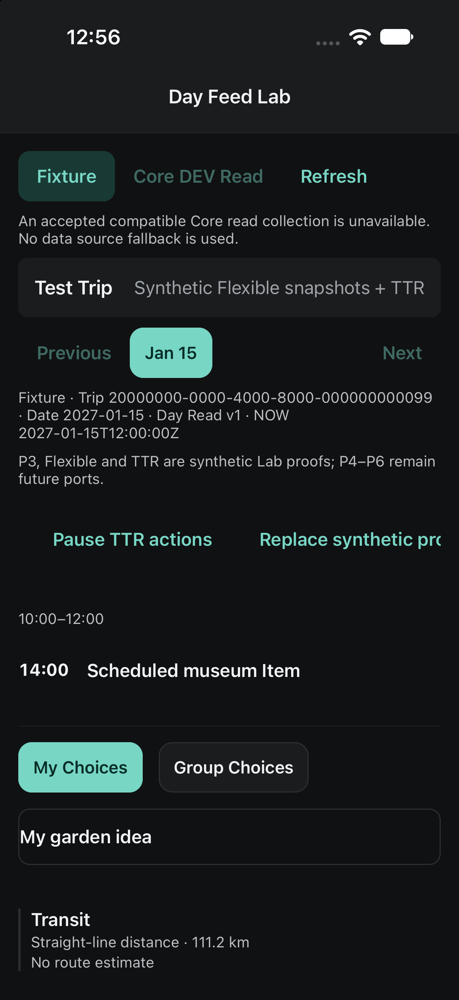

# G2-TTR-02 — Controller Bridge Owner Review

2026-10-13. **READY FOR OWNER REVIEW.** Synthetic DEV-only candidate on `codex/g2-ttr-02-controller-bridge` from verified canonical `e091b60e0527766bf6a055a4280e21f61933da5c`. No merge, push, Hosted operation or production activation.

## Source and ownership

Accepted TTR archive `6a1c80b0d327172c4bbc4ffa2257ab6473beebd9`, tree `0f27c49cdd992fc20e2d9bcb6cb6a6bb430f9e0e`, has 13 changed files. Twelve are adopted byte-for-byte in TTR-owned commit `4305054`; its older current-state file is excluded, preserving the newer shared handoff. The Owner-approved architecture is archived in [the decision](OTR_G2_TTR_02_ARCHITECTURE_DECISION.md) before implementation.

G2 implementation `122985a`, native corrections `37ffdf8`. G2 owns the additive bridge, DayFeed/DEV Modal wiring, immutable replacement, localized host copy and native failure driver. Existing Composer, Focus, NOW, fixture registry, Core, migrations, Admission, Sync and Provider sources are unchanged. The original 36 fixtures retain their order and Nelson default.

Canonical main subsequently advanced independently to `e9e4511c0bcbf668627a8bc99b02bb8962580a17` through Core readiness work. No runtime overlap with this candidate. The candidate remains pinned to the verified start baseline; later main integration must reconcile the shared handoff and validate the newer Core tree. Preflight dirty/untracked file hashes remain unchanged.

## Exact additive G2 API

`src/features/day-feed/ttrSessionBridge.ts` exports:

- `G2TtrScope`: readonly Account/Trip/localDate/generation/visitKey.
- `G2TtrActionability`: readonly key, full relation/occurrence identity, nullable input fingerprint, publication version, actionable flag and nullable reason.
- `G2TtrSession`: version `g2-ttr-session/1`, monotonic revision, scope and readonly transition vector.
- `G2TtrSessionPort`: scope, permitted, sheetOpen and `onChange(session): void`; optional additive `DayFeed.ttrSession` prop.
- `G2TtrInvalidation`: version `g2-ttr-invalidation/1`, revision, current scope, previous relation/actionability, nullable current relation/actionability and reason.
- `TtrOpenHandler`: unchanged `(intent: ComposedTransition["openTtr"], presentation: Pick<ComposedTransition, "key" | "inputFingerprint">) => void`.
- `composedTtrActionability(scope, composedStream, projections, permitted)` derives eligibility solely from the existing Composer's actual Transition output and overlay. Reasons include owning unavailable reason, `SCOPE_MISMATCH`, `PERMISSION`, `OVERLAY` and `NOT_COMPOSED`.
- `createG2TtrSessionBridge()` provides prepare/commit/accepts/current/dispose. Immutable committed-view identity prevents stale dispatch and A→B→A revival, including repeated equal input values. Exact occurrence identity, key, fingerprint and publication must match; the Sheet blocks background dispatch.

`src/features/day-feed-lab/useTtrSessionHost.ts` owns the adapter integration. It consumes current synthetic facts/scope/visit/permission; exposes projection, sessionPort, unchanged onOpenTtr, accepted adapter and Sheet state. DEV acceptance controls expose queued dispatch, rejection count, permission/projection invalidation, guarded Account denial and one-shot transaction failure injection. They add no business lifecycle.

Active scope/permission/nesting/publication loss produces a versioned invalidation record, updates the accepted adapter's authorization key/revision/actionability, calls its actual no-argument `invalidate()`, and closes the Modal. No invented payload overload is assumed. It never changes the saved personal choice or automatically reopens. `lastInvalidation` retains the G2 notification metadata for diagnostics.

## Confirm, storage and presentation

The existing Modal mounts TTR-owned `TtrLabSheetContent` with its canonical header and Preview/Confirm/Recover/Dismiss controls. G2 does not implement another controller. The accepted factory opens only `otr-ttr-native-lab-cp05a2-v1.db` through its DEV/synthetic/scope/generation guards; there are no Canonical table writes or startup registration.

Only the accepted controller's post-durable Confirm callback may replace presentation. G2 rechecks current source/scope/identity/anchors/action/version and accepts the owning reducer's current publication version, then clones/freezes the projection and feeds it to the same mounted Composer. Preview can advance the owning publication version; it cannot replace the feed or persist. Failed writes retain the prior presentation. The native test driver injects one SQL failure inside the accepted transaction without replacing Controller or repository semantics.

DayFeed's Trip/date key, shared Focus, NOW inputs and scroll state remain unchanged by Sheet open/close or accepted replacement. The Modal hides background accessibility and pointers while open. No new navigation stack or renderer.

## Validation

- Focused composition/Controller/repository/adapter/Sheet/Flexible/P1/P2/P3/Core read/UI regressions: final 430 PASS across 25 explicitly listed files; invalidation subset 54 PASS and native-normalization/driver subset 50 PASS.
- Candidate full regression (final two-worker run): 4,138 PASS, two failures, 52 skipped. Exact clean `e091b60`: 3,965 PASS, the same two failures, 52 skipped. Both failures are unchanged: navigationLayout missing tabBarActiveTintColor and architectureBoundary's LocalOperationsDiagnostics test import. Full-suite PASS is not claimed.
- Typecheck, dedicated TTR tsconfig, full lint/UI guard, changed-file Prettier and diff whitespace checks: results recorded in evidence.
- A simultaneous unrestricted repeat hit ten unrelated test timeouts during native compilation; the final two-worker run resolved all ten. That resource-contention log is retained externally. Hook harness results are automated integration evidence, not native SQLite evidence. Native status is recorded below separately.

## Native acceptance

Fresh anonymous iPhone 18 Pro/iOS 27 container `3582A5EB-9AC2-4E2C-A097-055CC382769C`, dedicated Debug bundle `com.xoery.otrmobile.g2ttr02`, Metro 8099. No protected Simulator or physical app was reused or cleared. Ignored private iOS project generation repairs do not alter tracked SDK/config dependencies. Fresh native build PASS. The copied generated project first failed iOS 27 scene adoption; applying the already canonical scene configuration and regenerating private Pods from installed packages resolved startup. One mistyped destination request was rejected automatically before execution; the verified owned UUID was used thereafter. No protected device action occurred.

The final native code is `37ffdf8`. Native Confirm exposed a G2 raw-input/schema-normalized object-order comparison mismatch; the existing TTR input schema now normalizes the source. A regression reproduces the failure before the correction. Accepted TTR bytes remain unchanged. The DEV controls now use one horizontal strip to preserve the Feed viewport.

| Native check                   | Evidence/result                                                                                                                                                                                                                      |
| ------------------------------ | ------------------------------------------------------------------------------------------------------------------------------------------------------------------------------------------------------------------------------------ |
| Owning Sheet, Preview, Dismiss | TTR-owned controls mount; Preview and Dismiss leave `ttr_selections` empty.                                                                                                                                                          |
| Durable Confirm                | Walking written for Trip005; same mounted Feed changes to Walking and retains NOW.                                                                                                                                                   |
| Failed Confirm/recovery        | One native INSERT failure rolls back Driving; Walking remains in SQLite and the Sheet. Recovery re-enables controls without false success.                                                                                           |
| Cold process reopen            | Existing SQLite survives terminate/launch; owning Sheet reads Confirmed Walking. Fresh synthetic Feed initially uses its supplied projection until explicit publication.                                                             |
| Account/Trip isolation         | Unknown synthetic Account rejected; Trip001 does not inherit Trip005 Walking. Final file contains only Trip005 Walking and Trip099 Transit, the exact nine columns and one table.                                                    |
| Queued stale/ABA               | Retained A tap, visit B, return A, dispatch: rejected count1, no Sheet.                                                                                                                                                              |
| Active invalidation            | Permission pause and projection replacement close the Sheet; resuming permission does not reopen it. Flexible anchor nesting closes the Sheet and removes the Transition.                                                            |
| Focus/date/nonzero scroll      | Selected My garden idea survives durable Transit Confirm; before/after screenshots show matching museum/Choice/Transition positions at nonzero scroll and the same Trip/date.                                                        |
| Flexible                       | My/Group filtering, nested fixed Item, Block Header→Immersive→Close remain usable.                                                                                                                                                   |
| NOW / Light-Dark               | NOW collision renders alongside Transition; owning Sheet inspected in both themes.                                                                                                                                                   |
| P1/P2/P3                       | P1 inline Focus/NOW, existing registered synthetic flight row, and P3 Stay checked natively. Detailed FlightRows geometry remains automated coverage; no new native flight gallery was registered.                                   |
| TTR 01–14                      | All14 selected and captured;06–09 unavailable relations hidden, current other presentations/mode/status/distance retained. Case14's current row can open; stale saved callbacks are exercised separately through the queue controls. |

Screenshots, native AX captures, database read evidence, source hashes and regression summaries are under [evidence/g2-ttr-02](evidence/g2-ttr-02/native-summary.json). Raw build/Metro/baseline/candidate logs remain `/private/tmp/g2-ttr-02-evidence`; no SQLite database, auth material, ignored native project or dependency tree is committed.

## Manifest and handoff

Exact changed-file ownership/hash inventory: [manifest.json](evidence/g2-ttr-02/manifest.json). Source adoption and G2 integration remain separate commits. Resume only after Owner Review; reconcile newer main without replacing the accepted TTR source or introducing Core/Provider authority. Production admission/storage, actual routing/ETA/cache and physical-device acceptance remain independent.

## Remaining gates

Owner Review is required before any integration. New-main reconciliation, authoritative Core execution, real Apple routing/ETA/cache, production Admission/storage/runtime and physical-device/real-data acceptance remain separate. No Flexible CP02 gestures or P3–P6 work was added.
