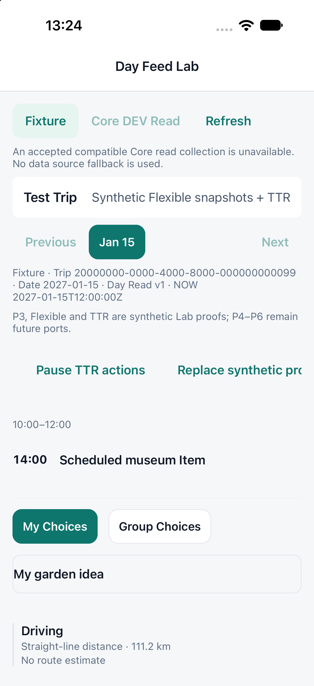

# G2-TTR-02 — Controlled Main Integration

2026-10-13. **Validated isolated integration.** Current-main baseline `e9e4511c0bcbf668627a8bc99b02bb8962580a17`; local tracking ref and live remote main matched. Accepted source `13b001e7d25c572394db5994548a78cfad9c70ae`, reviewed baseline `e091b60`. No push, Hosted operation, deployment or production activation.

## Integration and integrity

Normal merge `fa18238d4caed6d071d708956fbfbcee16068420`, parents `e9e4511` and `13b001e`, on `codex/g2-ttr-02-main-integration`. Accepted `4305054`, `122985a`, `37ffdf8`, `13b001e` history and source branch remain unchanged. G2-FLEX-02 `12eadff` and CP01B/G2 `22c0369` remain ancestors.

Only `docs/CURRENT_IMPLEMENTATION_STATE.md` overlaps. Both G2 and Core handoffs are retained; existing extra blank lines in this reconciled file were normalized for Prettier. No runtime correction. Every accepted candidate file except that handoff is byte-identical; every newer-main file except that handoff is byte-identical. Adopted twelve TTR files match archival `6a1c80b0d327172c4bbc4ffa2257ab6473beebd9` exactly (archive tree `0f27c49cdd992fc20e2d9bcb6cb6a6bb430f9e0e`; older thirteenth handoff remains excluded).

All131 worktrees were inventoried, including concurrent Core/Flight/Flexible CP02/TTR/G2. Main's five unrelated dirty/untracked files and index entries are fingerprinted for final preservation checks. No concurrent worktree files imported.

Exact integrated changed-file hashes/ownership: [manifest](evidence/g2-ttr-02-main-integration/manifest.json). Merge integrity and preflight summary are in the same evidence directory. The final sealed target SHA and guarded main-update result are recorded by the completion handoff and external execution record after this report is committed.

## Contract status

`g2-ttr-session/1`, `g2-ttr-invalidation/1`, `composedTtrActionability`, committed-view leases and the exact existing two-argument `onOpenTtr` signature are unchanged. Eligibility remains Composer-owned. Scope/visit, relation/occurrence, fingerprint, publication, permissions and overlays fence queued dispatch and active sessions. TTR-owned adapter cancellation closes the DEV host without changing saved selection or automatic reopening.

The existing host mounts accepted `TtrLabSheetContent`; durable-local Confirm/recovery uses the separate guarded DEV SQLite repository. Copied/frozen presentation replacement flows through the same mounted Feed. No second Controller/Composer/Focus, Core qualification or Provider call was added. One production Day Feed, NOW/TNS, all36 fixtures/order/Nelson default, all14 TTR cases, shared Flexible ports, nested uniqueness and Release isolation remain intact.

## Regression gates

- Fresh clean current-main full: **3,979 PASS / 2 FAIL / 54 SKIP**.
- Integrated full: **4,152 PASS / 2 FAIL / 54 SKIP**.
- Failure identities and entire normalized messages match exactly: navigationLayout missing tabBarActiveTintColor; architectureBoundary's unchanged LocalOperationsDiagnostics test import. No new persistent regression; full-suite PASS is not claimed.
- Initial simultaneous runs hit unrelated SQLite five-second timeouts (baseline9/integrated7 failures including the two existing failures). Final runs execute sequentially, two workers,30-second test timeout, with unchanged assertions. No repository test/config weakening.
- **430 focused tests /25 files PASS**, covering Bridge, Controller/repositories/adapter/Sheet, all14 TTR cases, F01–F14 registration/interactions, Snapshot/Focus, P1/P2/P3, NOW/TNS/scroll and Core v1/v2 Day Read.
- Typecheck, dedicated TTR TypeScript, full lint/UI guard, changed-file Prettier and diff/whitespace checks PASS. Architecture-boundary debt is the exact clean-main failure above and is not repaired by unrelated edits.

[Normalized regression evidence](evidence/g2-ttr-02-main-integration/regression-summary.json).

## Integrated Native gate

Reused accepted anonymous iPhone18Pro/iOS27 Debug binary, bundle `com.xoery.otrmobile.g2ttr02`, container `3582A5EB-9AC2-4E2C-A097-055CC382769C`, Metro8099 serving this integration worktree. **Integrated JS reload, not a new native build.** Protected Simulators/physical apps were not overwritten or cleared.

Repeated Lab/default and owning Sheet, Preview/Dismiss without persistence, Trip001 durable Driving Confirm, failed Transit transaction rollback, cold reopen Driving, Account denial/Trip isolation, A→B→A rejection, active permission/publication loss without reopen, Flexible nesting invalidation, NOW collision and Light/Dark. Selected My garden idea, Trip/date and nonzero scroll retain matching geometry through durable Driving replacement. Native SQL evidence contains only authorized synthetic selections; no database or auth material is committed.

Accepted byte-identical runtime evidence for all14 TTR fixtures and P1/registered synthetic flight row/P3/Flexible is retained unchanged, supplemented by the integrated key repeats. Detailed FlightRows geometry remains automated coverage; no new native flight gallery or physical/narrow-device repeat.

[Integrated native results](evidence/g2-ttr-02-main-integration/native-summary.json).

## Main advance and remaining gates

Evaluate the existing approval gate only after sealing this exact validated target and rechecking unchanged current main. Use guarded non-forced local fast-forward; if exact-target Owner approval is required, leave canonical main unchanged and request it. No bypass, force update or source rewrite.

After approved local advancement, G2 returns to shared Experience maintenance. Real Core routing/consumer execution, Apple routing/ETA/cache, production Admission/storage/runtime, Hosted/Provider and physical/real-data acceptance remain separate and CLOSED.
