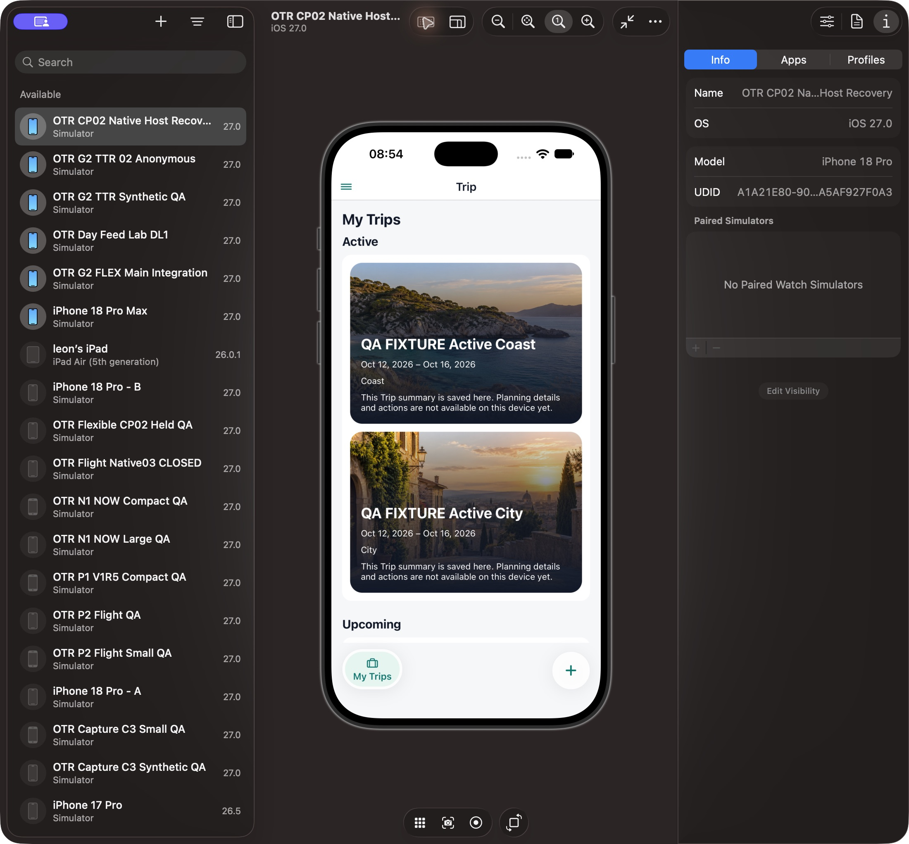
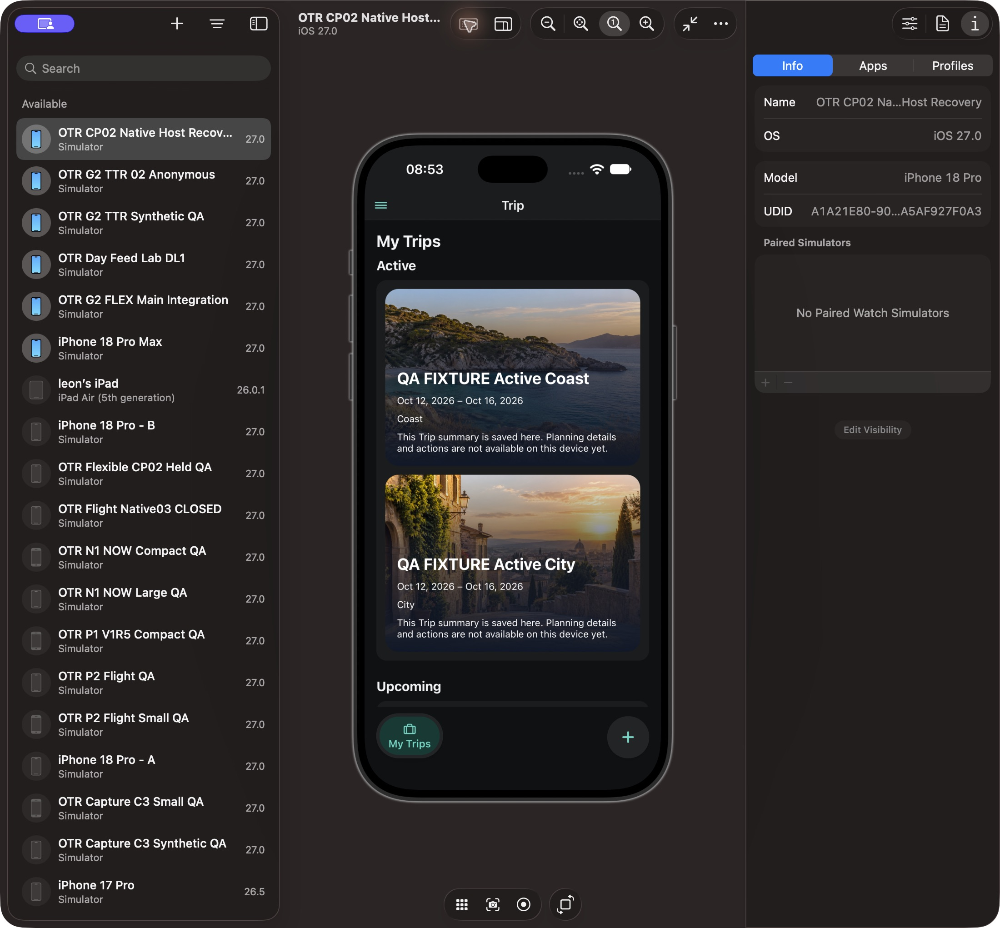
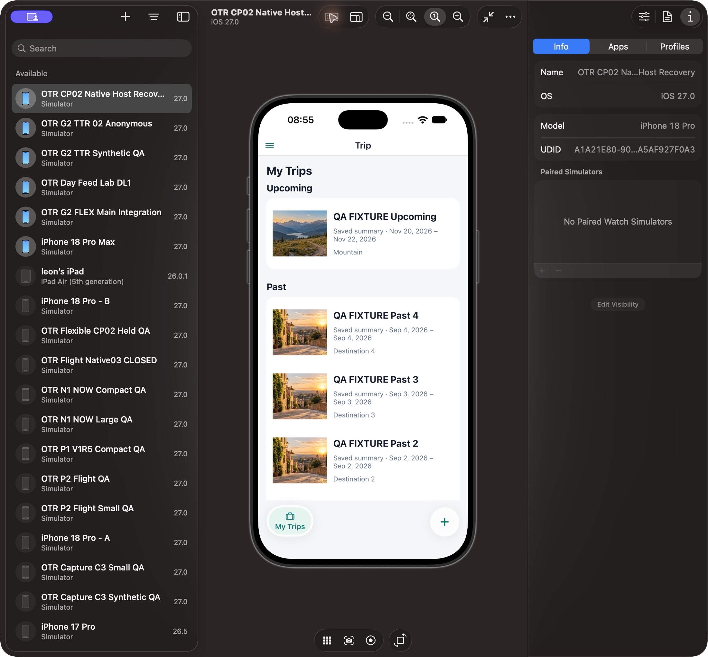
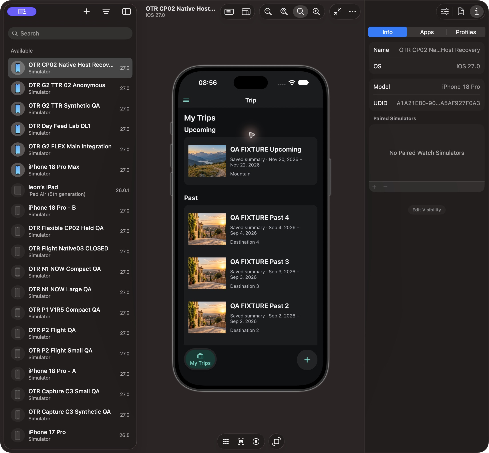
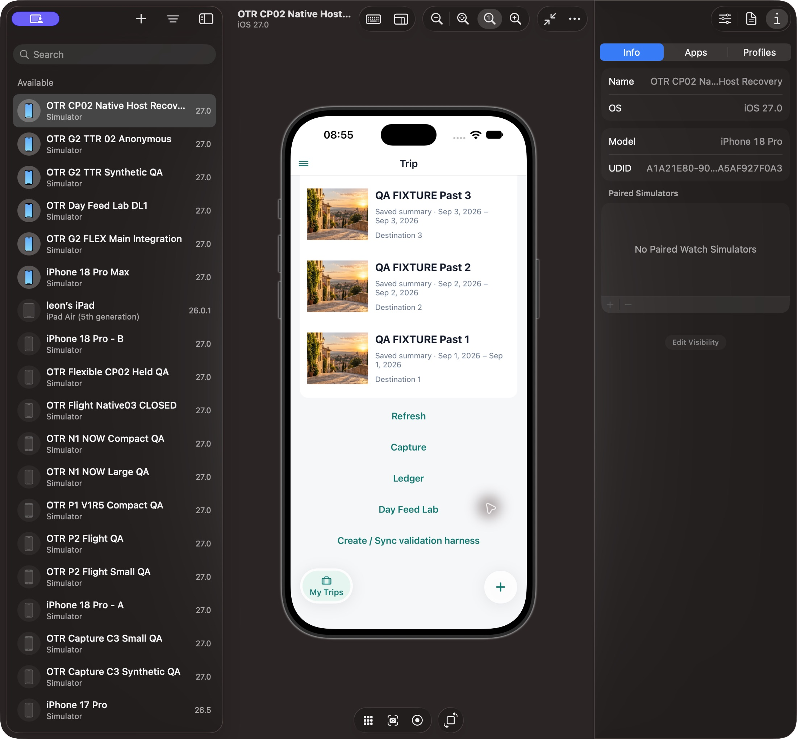
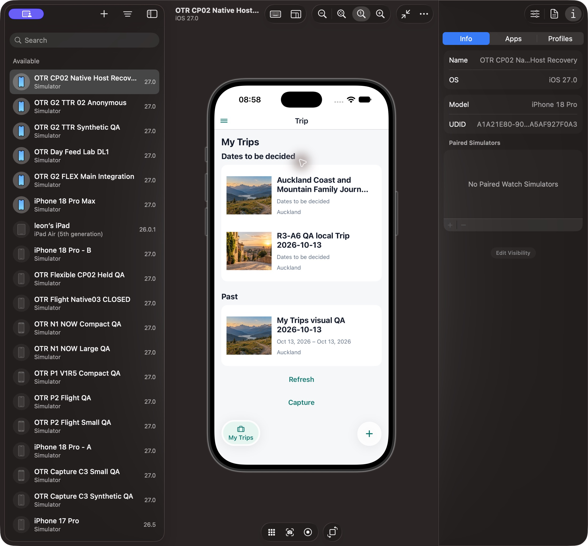
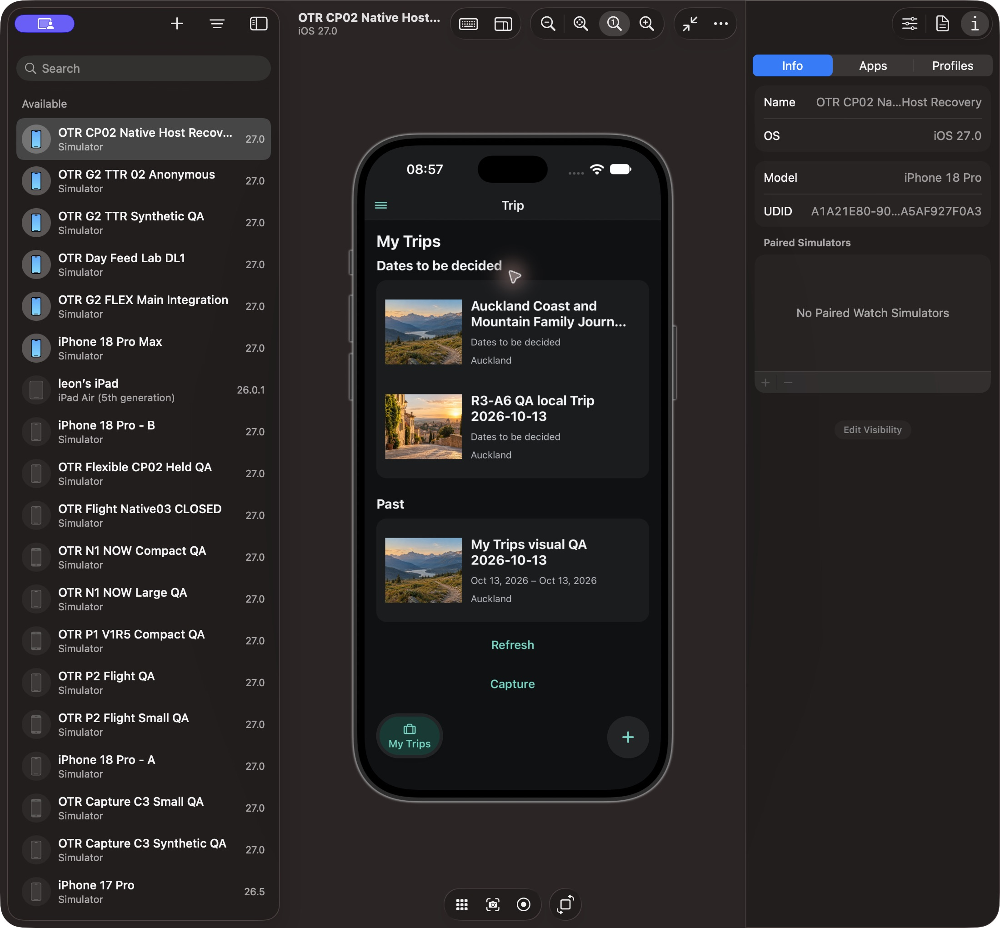
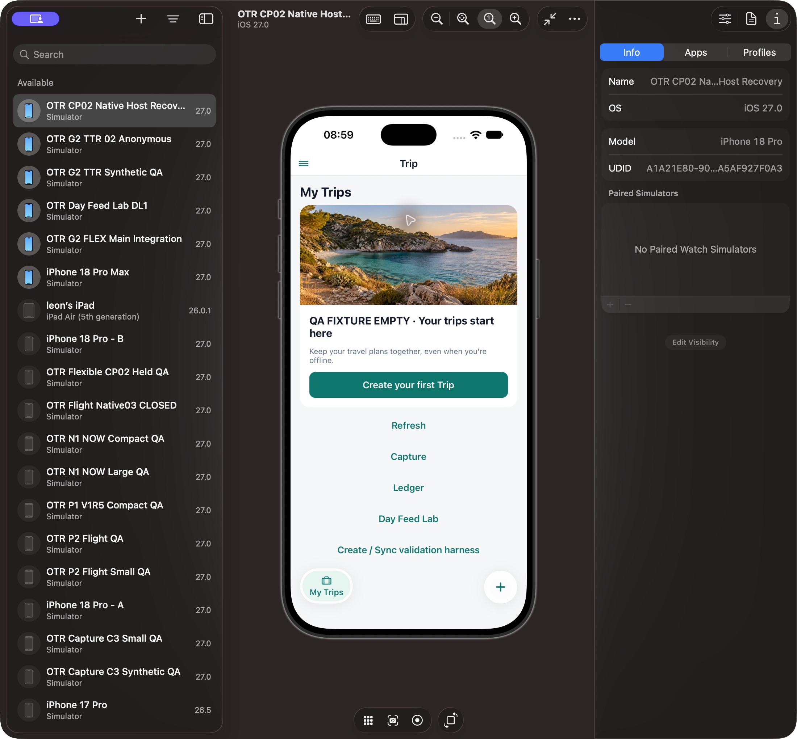
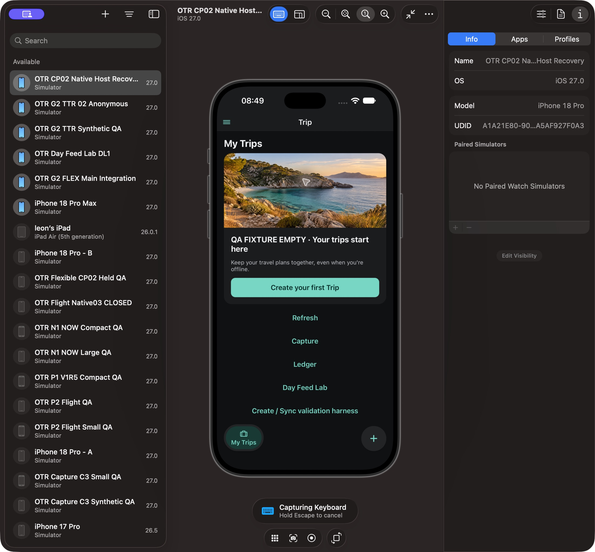

# My Trips — independent Level 1 visual report, 2026-10-14

**Level 1 INCOMPLETE. Cover-crop repair is verified on r3; hot Dynamic Type remains FIX. Level 2 NOT READY, ProductUXAccepted not granted.**

## A. Scope and verdicts

Independent reviewer: p4_visual_61, not the implementation author. Snapshot 2026-10-13T20:02:12.879861+00:00. This isolated report supersedes the earlier no-pixels report only for the observations identified below. Source alone adopts reports/code.

Exact candidate: Trips/Shell revision3, base `005e35c10af3f8814bebb02d362b9b0794c2a077`, manifest SHA256 `5be10f9f0a04f19f0f3b2fb4c4f697798a005ffd76d452a5b1e431d4db1226ee`. Revision2 is preserved separately; its manifest is `5315953165d5533e5db223fbc1c01e5d04256b8c15774cfd0b4555ec01096d03`. R3 changes only TripCoverVisual Image sizing; other ten files are unchanged. All eleven hashes matched the served QA clone, and all four temporary marker/fixture overlays are restored byte-exact: [source/restoration receipt](../../../source-restoration.json).

Existing installed OTR Mobile0.1.0 / `com.xoery.otrmobile`, A1A21E80-9007-4D69-87A4-2A5AF927F0A3, iPhone18 Pro / iOS27.0. Device Hub ordinary Info/Apps verified the identity. No newly compiled binary was installed; native build number is NOT OBSERVED. A visible `QA r2 531595` Shell label established exact r2 JS attachment, then was restored. R3's one hashed change was served by the same Metro and visibly corrected the image layout. Earlier resumed host pixels with unknown JS and pre-resume unavailable screenshots are not candidate evidence.

Real images show the existing approved account's local pending Trips. Synthetic images use Source-approved generation-fenced in-memory cached summaries with names QA FIXTURE, or a props-only zero-array empty view. Fixtures confer no Account/current rights/accepted Day, perform no business writes and are not real runtime acceptance. No originals/private gallery, Auth change, install, protected provider or Hosted activation was performed. Existing ambient app discovery timeout logs were seen; this report does not claim all startup networking was disabled.

Authority: Owner TRIPS01–14/twelve scenes, latest no-Search handoff, BD49 two-island IA, and the two Owner App Store style references. References are design directions only, never acceptance screenshots. Latest Active-card instruction requires existing lawful primary actions at the bottom overlay; no fake action is introduced.

| Layer                        | Verdict                           | Basis / limit                                                                                                                          |
| ---------------------------- | --------------------------------- | -------------------------------------------------------------------------------------------------------------------------------------- |
| Functional                   | PASS, bounded code                | Source's independent r2 29 tests and r3 exact delta receipt trusted; no duplicate code review.                                         |
| Product Conformance          | PARTIAL                           | Observed lifecycle hierarchy, card forms, truthful cached summaries and Search omission conform; real positive Today still unobserved. |
| Native Visual                | PARTIAL / FIX                     | Real and synthetic current screenshots below; r3 photo framing repaired; hot OS text-size transition clips.                            |
| Runtime / data / permissions | NOT VERIFIED for complete journey | Existing local account read/reopen only; real accepted Day/current discovery rights/offline/revocation unobserved.                     |
| Level 1                      | INCOMPLETE                        | Required positive Today, offline and full accessibility matrix are absent; hot-size defect remains.                                    |
| Level 2                      | NOT READY                         | Report delivered for engineering evidence; no Owner acceptance inferred.                                                               |

## B. Twelve required scenes

Every link is an actual PNG from Device Hub. R2 images are identified before-fix evidence and never substituted for r3 scenes. NOT OBSERVED is explicit where current proof is unavailable.

| Scene | Required state                                                           | Actual / evidence                                                                                                                                                                                                                                 | Verdict                          |
| ----- | ------------------------------------------------------------------------ | ------------------------------------------------------------------------------------------------------------------------------------------------------------------------------------------------------------------------------------------------- | -------------------------------- |
| 1     | Two Active hero cards, eligible Today per Trip, Upcoming below           | Two simultaneous **cached-only fixture** heroes Light/Dark; Today deliberately absent. [Light](assets/mytrips-r3-fixture-active-light.png), [Dark](assets/mytrips-r3-fixture-active-dark.png). Real eligible Today NOT OBSERVED.                  | PARTIAL                          |
| 2     | Upcoming / undated / Past compact rows                                   | Fixture Upcoming/Past [Light](assets/mytrips-r3-fixture-compact-past3-light.png), [Dark](assets/mytrips-r3-fixture-compact-past3-dark.png); real undated/Past [Light](assets/mytrips-r3-real-light.png), [Dark](assets/mytrips-r3-real-dark.png). | PASS for observed presentation   |
| 3     | Body opens matching Home; separate valid Today; invalid hides            | Real long-title Home and cached Upcoming Home opened matching content. [Real Home](assets/trip-home-r3-real-longname-light.png), [cached Home](assets/trip-home-r3-fixture-cached-light.png). Positive Today NOT OBSERVED.                        | PARTIAL                          |
| 4     | Four Past; initial3 then See all                                         | Explicit fixture initially Past4/3/2; See all revealed Past1, scroll reachable. [Initial](assets/mytrips-r3-fixture-compact-past3-light.png), [expanded](assets/mytrips-r3-fixture-past-all-light.png).                                           | PASS synthetic                   |
| 5     | Date/destination and truthful optional stats                             | Known destinations retained in compact row's second metadata group. Dates wrap at this width; no unavailable counts/amounts fabricated. Same compact evidence.                                                                                    | PASS bounded                     |
| 6     | Offline new undated Trip, stable cover/manual cold persistence           | Existing undated local covers visible; fresh offline creation/manual selection/cold persistence NOT OBSERVED. Historical trusted SQLite60 proof not reused as current screenshot.                                                                 | NOT VERIFIED                     |
| 7     | Real empty; loading/error distinct                                       | Explicit props-only empty [Light](assets/mytrips-r3-fixture-empty-light.png), [Dark](assets/mytrips-r3-fixture-empty-dark.png). Real account empty and loading/error NOT OBSERVED. CTA unused.                                                    | PARTIAL                          |
| 8     | Right + create required name, success Home/failure stays                 | Real r2 form route opened without submission [Dark](assets/create-r2-real-dark.png); unchanged r3 form not retaken, success/failure NOT OBSERVED.                                                                                                 | PARTIAL                          |
| 9     | Account/revocation/offline isolation                                     | NOT OBSERVED; trusted generation/repository contracts retained, no Auth exercise.                                                                                                                                                                 | NOT VERIFIED                     |
| 10    | Selected contextual Ledger/deep links/existing Day                       | Local route retained; no contextual privileges in cached Home. Positive Day/selected Ledger/deep-link transitions NOT OBSERVED in this matrix.                                                                                                    | NOT VERIFIED                     |
| 11    | Latest no invalid Search / no Trips-only Search                          | Native list and Shell omit Search, as directly instructed. Global design DEFERRED.                                                                                                                                                                | PASS omission / DEFERRED feature |
| 12    | Light/Dark, long EN/ZH, hot/cold large type, VoiceOver/targets/safe-area | Both themes and EN long title observed, Shell visible above safe area; hot five-step text-size clips, same-size reload reads correctly. ZH/VoiceOver/exact target measurements and cold restart NOT OBSERVED.                                     | FIX / PARTIAL                    |

### Current r3 illustrations

Synthetic two Active Trips, no rights or Today action:

Synthetic compact Upcoming/Past3 and expanded history:

Real account-local list, existing pending data:

Explicit synthetic empty; no claim that this Account has zero Trips:

## C. Decision / Expected / Actual

| ID      | Expected                                    | Actual                                                                                            | Verdict                      |
| ------- | ------------------------------------------- | ------------------------------------------------------------------------------------------------- | ---------------------------- |
| TRIPS01 | Active→Upcoming→undated→Past                | Unified lifecycle source and observed fixture/local groups                                        | PASS bounded                 |
| TRIPS02 | Active full-photo; others compact           | Both forms observed, correct r3 photo framing                                                     | PASS presentation            |
| TRIPS03 | Stable built-in cover and fallback          | Embedded Coast/City/Mountain framed correctly; image-error and manual cold persistence unobserved | PARTIAL                      |
| TRIPS04 | Unified selection/context Ledger/deep links | Existing authority/routes retained; positive context not exercised                                | PARTIAL                      |
| TRIPS05 | Body opens correct Home                     | Matching real local and synthetic cached Home observed                                            | PASS bounded                 |
| TRIPS06 | Eligible own Today, bottom action overlay   | Structurally gated bottom overlay retained; real positive Today NOT OBSERVED                      | NOT VERIFIED                 |
| TRIPS07 | All Active, undated separate                | Two fixture Active plus real undated grouping observed                                            | PASS bounded                 |
| TRIPS08 | Polished first-trip CTA and +               | Explicit empty fixture shows image/explanation/CTA; real empty NV                                 | PARTIAL                      |
| TRIPS09 | Vertical separate Active cards              | Two fixture heroes observed, no fabricated privileges                                             | PASS presentation            |
| TRIPS10 | Latest Owner no invalid Search              | No Search entry                                                                                   | DEFERRED / omission conforms |
| TRIPS11 | Past3 + full history                        | Four fixture records, initial3 and expansion observed                                             | PASS synthetic               |
| TRIPS12 | Right + and capsule Shell                   | Visible icon/label selected pill and edge shadow; true native glass absent                        | PARTIAL                      |
| TRIPS13 | Compact trustworthy memory metadata         | Dates/destination retained; unknown stats omitted                                                 | PASS bounded                 |
| TRIPS14 | Create success Home/error stays             | Trusted code unchanged; current submission not exercised                                          | NOT VERIFIED Native          |

## D. Defects, before / after

F1 — **FIXED for observed r3 surfaces**. R2 absolute Image style retained intrinsic dimensions, exposing a magnified corner instead of normal cover framing. Author's sole Image100% dimensions repair preserves Coast water/beach, City town and Mountain scene in r3 Active, empty, compact and Home screenshots. No candidate-wide Visual PASS follows.

F2 — **FIX, separate P0 author lane**. Five actual Device Hub Increase Text Size increments while Dark synthetic empty was mounted caused clipped native Trip heading, empty body/CTA and Shell label. At the same enlarged setting ordinary Cmd-R reload restored readable layout. Starting/ending category labels and reactive fontScale events were not measured. Five decreases and reload restored the initial size. R3's image-only delta cannot be credited with a typography repair.

Prior ordinary cached destination/gradient findings are closed in r2 source. Search is deferred by the latest Owner, not a missing disabled entry.

## E. Dependencies / unobservable scope

Positive Today requires an existing accepted same-Trip/day context; none was supplied. Offline/revocation/current remote rights and original/user-photo cover capabilities remain separate owning proof. Optional missing counts do not block baseline hierarchy. Native surface is recovered; the blocker is now missing required lawful states plus hot-size correctness, not unavailable screenshots. No Dashboard or global Search implementation is introduced.

## F. Level 2

INCOMPLETE; NOT Level2-ready and not WAITING_OWNER_UX_REVIEW. Delivering this illustrated checkpoint does not request a new Owner gate. Finish the ordinary hot-size repair and scoped required observations, then notify Owner/domain chat with the complete module/version report. ProductUXAccepted remains ungranted.

Skipped: repeat trusted code tests, broad audit, fabricated permission/data, installation and private originals. Risk: presentation fixtures establish layout only.
