# P3 Accommodation — independent Level 1 visual report, 2026-10-14

**Baseline synthetic Native presentation PASS for the observed nine states in Light/Dark at default text size. Full product Level1 remains INCOMPLETE, Product Conformance PARTIAL, real Runtime NOT VERIFIED and Level2 NOT READY.** No ProductUXAccepted claim. Reviewer p4_visual_61 is not the P3 renderer or consumer author; Source alone adopts.

## A. Scope, source and separate verdicts

Snapshot 2026-10-13T20:57:49.754199+00:00. Authority: Owner approved P3 Delta SHA256e1ba268b554f70619e08892569832b948ab7fcbc2d06cab7e56b7410f7ccfd0f. Prior no-pixels report is a historical snapshot, superseded here only for observed current states. At that observation snapshot, main was report-only Push50 and did not contain these wiring/UI candidates. Current bounded technical integration is Push55 `3fb13390` ([receipt](/private/tmp/otr-beta-push55-receipt.json)): exactly the existing P1/P3 reader and guarded Stay renderer links/test are I. The Hot mixed17 composition remains an isolated QA source; these screenshots still do not exercise real accepted-v2 runtime.

Source composition is explicit: standalone Hotr2 exact15 (manifest20b82b43) plus Source-reviewed P3 reader3b62004c/test7eac9a and merged TripScreen85328c65 from mixed manifestd9a1f06d. All17 path hashes match the served QA clone; no Photos migration/helper/Workspace mount is applied. The merged TripScreen retains P3 registration and UiText rather than copying an older screen over it. [Composition evidence](evidence/p3-20261014-source-composition.json). Trusted P3 renderer64 and P3 consumer26 functional receipts remain unchanged; Source's exact mixed composition function review is separate.

Existing A1A21E80-9007-4D69-87A4-2A5AF927F0A3, iPhone18 Pro / iOS27.0; installed OTR Mobile0.1.0, bundle com.xoery.otrmobile verified by ordinary Device Hub Info/Apps. Native build number/new binary provenance NOT OBSERVED; no installation. Exact r2 feature JS marker established the persistent Metro attachment earlier; current component/consumer bytes are hashed separately. No current accepted Core v2 Trip exists on this account; the Lab displays that condition and disables Core DEV Read.

Every image below is an actual current PNG on the approved host, explicitly synthetic. Existing Synthetic P3 Stay c0000000-0000-4000-8000-000000000003 / canonical event…0013, Jan15–18 2027 / three nights. Only the existing fixture instant was temporarily set Jan16T12UTC so Jan15 is Past, Jan16 Today and Jan17 Future; no synthetic actor/certificate/current grant was created. The existing Lab's v1 StayRow binder is exercised. It does **not** execute the changed real accepted-v2 reader/callsite; that is a specific residual Native risk, with independent structural/function proof only. The fixture instant is restored byte-exact and17 hashes reverified. [Overlay receipt](evidence/p3-20261014-fixture-overlay.json). No business writes, private originals/gallery, Auth, network-provider or protected runtime activation occurred.

| Layer               | Verdict                                      | Meaning                                                                                                                                                                    |
| ------------------- | -------------------------------------------- | -------------------------------------------------------------------------------------------------------------------------------------------------------------------------- |
| Functional          | PASS bounded                                 | Trusted renderer64 and Source consumer26/mixed receipts; owning module delivery remains partial.                                                                           |
| Product Conformance | PARTIAL                                      | Observed role/date/shared identity/honest absence conforms; original instructions/documents, guests and permitted management/Add inputs are not delivered by this fixture. |
| Native Visual       | PASS bounded baseline; full coverage PARTIAL | Nine default-size states in both themes have actual images; large type, dense ordering and owning positive states remain NV.                                               |
| Runtime             | NOT VERIFIED                                 | Actual accepted Stay read/mount, originals/offline/capability enforcement and complete real journey not certified.                                                         |
| Level1              | INCOMPLETE                                   | Full fourteen-scenario/product capabilities are not all observed/delivered. This does not block finite baseline renderer presentation intake.                              |
| Level2              | NOT READY                                    | Not WAITING_OWNER_UX_REVIEW; no Owner/domain acceptance inferred.                                                                                                          |

## B. Required state matrix

| Context / depth  | Light actual fixture                        | Dark actual fixture                        | Observed result                                                 |
| ---------------- | ------------------------------------------- | ------------------------------------------ | --------------------------------------------------------------- |
| Future Browse    | [PNG](assets/p3-future-browse-light.png)    | [PNG](assets/p3-future-browse-dark.png)    | PASS baseline layout; owning positive capabilities NOT OBSERVED |
| Future Focus     | [PNG](assets/p3-future-focus-light.png)     | [PNG](assets/p3-future-focus-dark.png)     | PASS baseline layout; owning positive capabilities NOT OBSERVED |
| Future Immersive | [PNG](assets/p3-future-immersive-light.png) | [PNG](assets/p3-future-immersive-dark.png) | PASS baseline layout; owning positive capabilities NOT OBSERVED |
| Today Browse     | [PNG](assets/p3-today-browse-light.png)     | [PNG](assets/p3-today-browse-dark.png)     | PASS baseline layout; owning positive capabilities NOT OBSERVED |
| Today Focus      | [PNG](assets/p3-today-focus-light.png)      | [PNG](assets/p3-today-focus-dark.png)      | PASS baseline layout; owning positive capabilities NOT OBSERVED |
| Today Immersive  | [PNG](assets/p3-today-immersive-light.png)  | [PNG](assets/p3-today-immersive-dark.png)  | PASS baseline layout; owning positive capabilities NOT OBSERVED |
| Past Browse      | [PNG](assets/p3-past-browse-light.png)      | [PNG](assets/p3-past-browse-dark.png)      | PASS baseline layout; owning positive capabilities NOT OBSERVED |
| Past Focus       | [PNG](assets/p3-past-focus-light.png)       | [PNG](assets/p3-past-focus-dark.png)       | PASS baseline layout; owning positive capabilities NOT OBSERVED |
| Past Immersive   | [PNG](assets/p3-past-immersive-light.png)   | [PNG](assets/p3-past-immersive-dark.png)   | PASS baseline layout; owning positive capabilities NOT OBSERVED |

Past Jan15 is the Check-in appearance; Today Jan16 and Future Jan17 are Daily Base. An additional Jan18 Check-out Browse is observed. No synthetic14:00/10:00/20:00 clock is invented. Full dates and3 nights appear in Focus/Immersive; unavailable map/document/contact/count actions are omitted. Close returned to the same expanded Focus and selected date in each sequence. No repeated Booking card or extra controller appears.

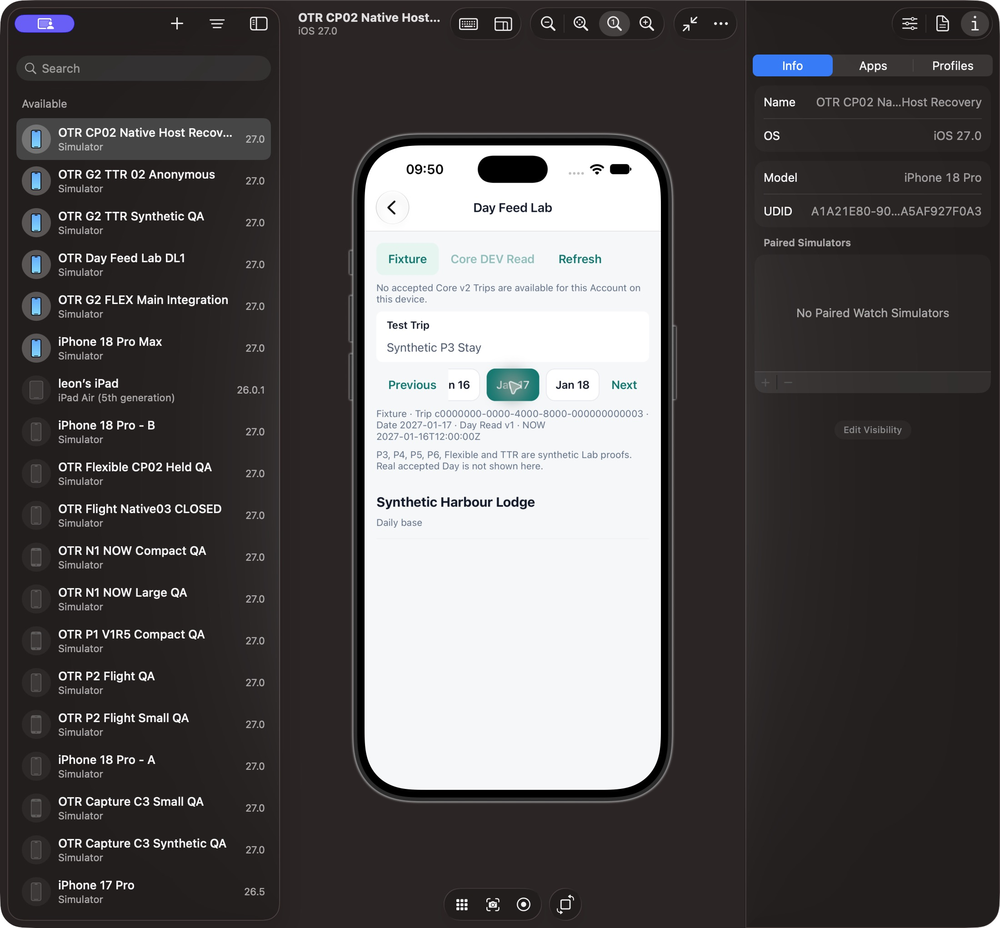

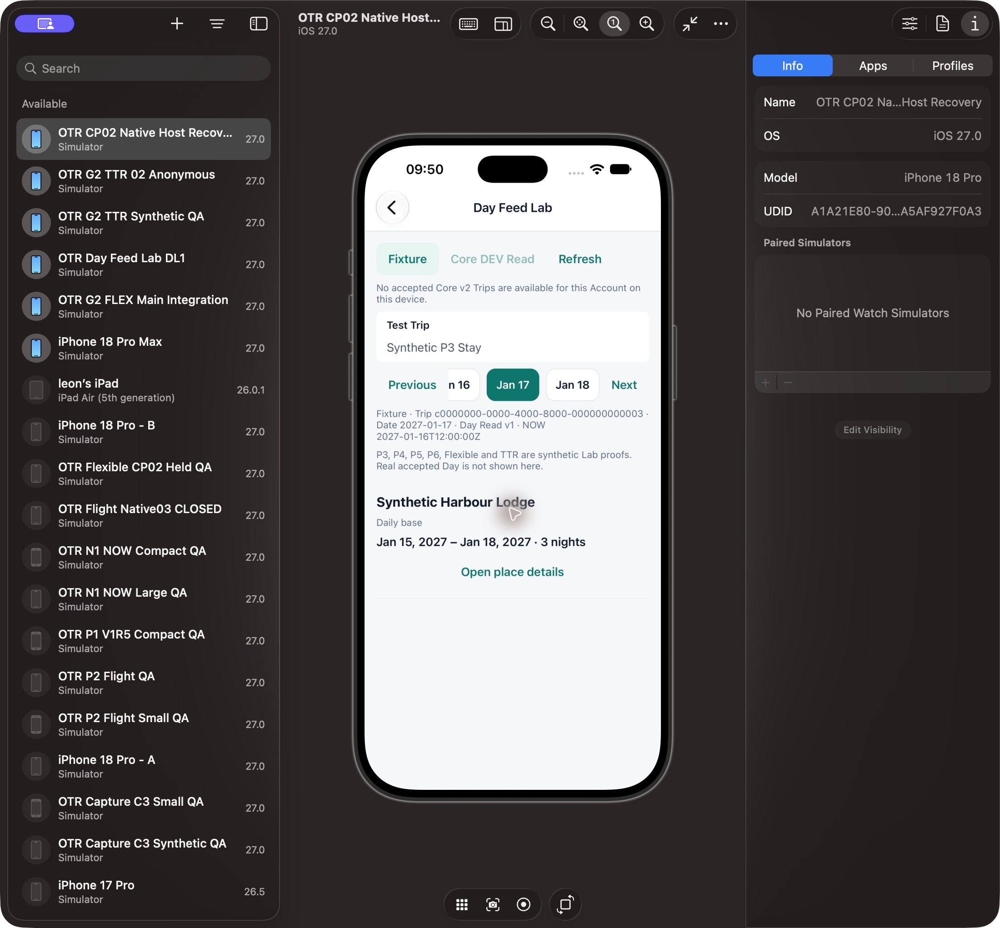

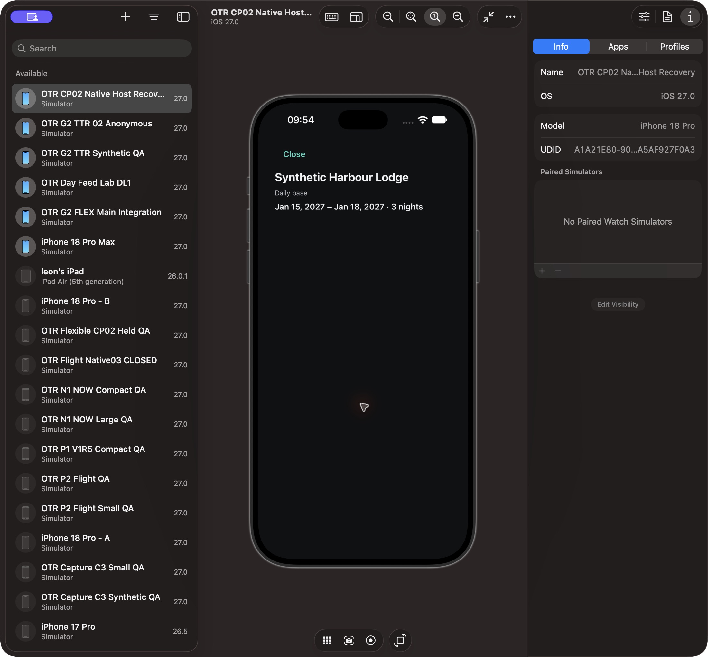

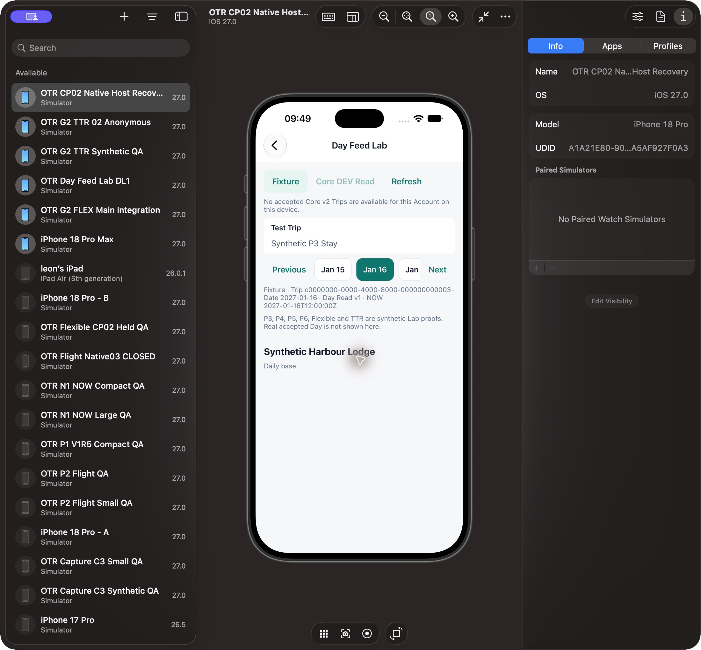

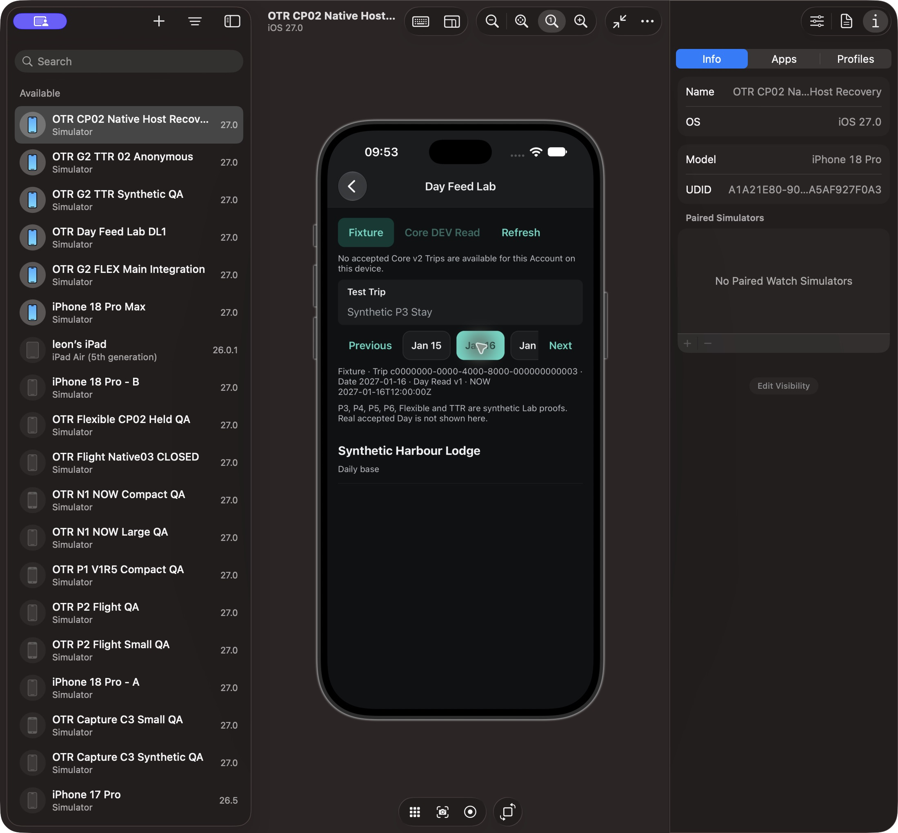

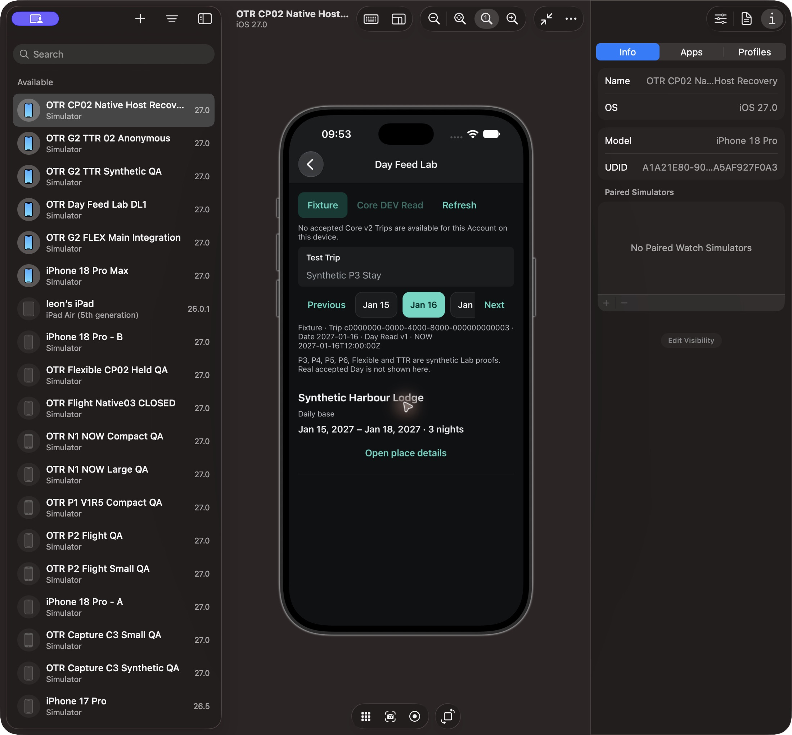

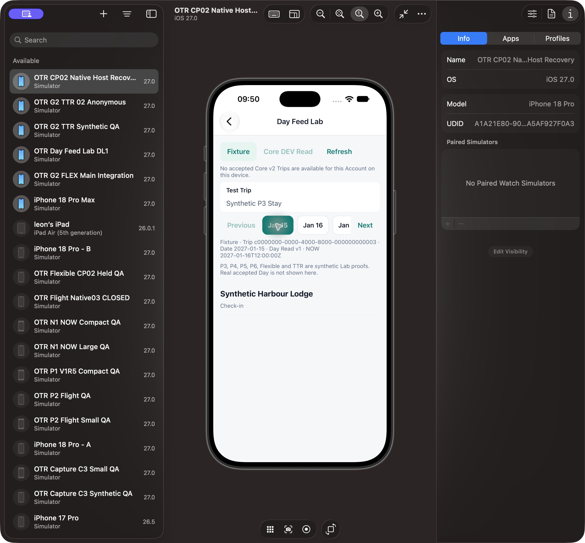

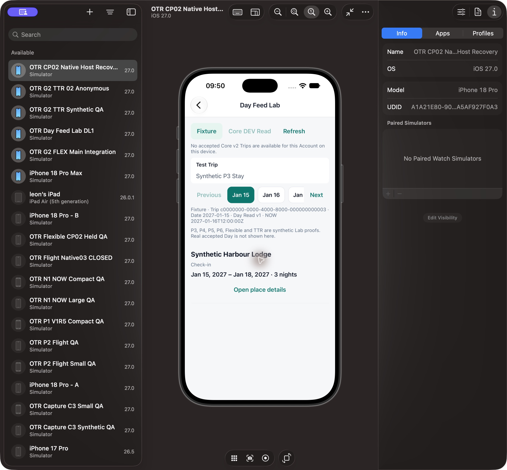

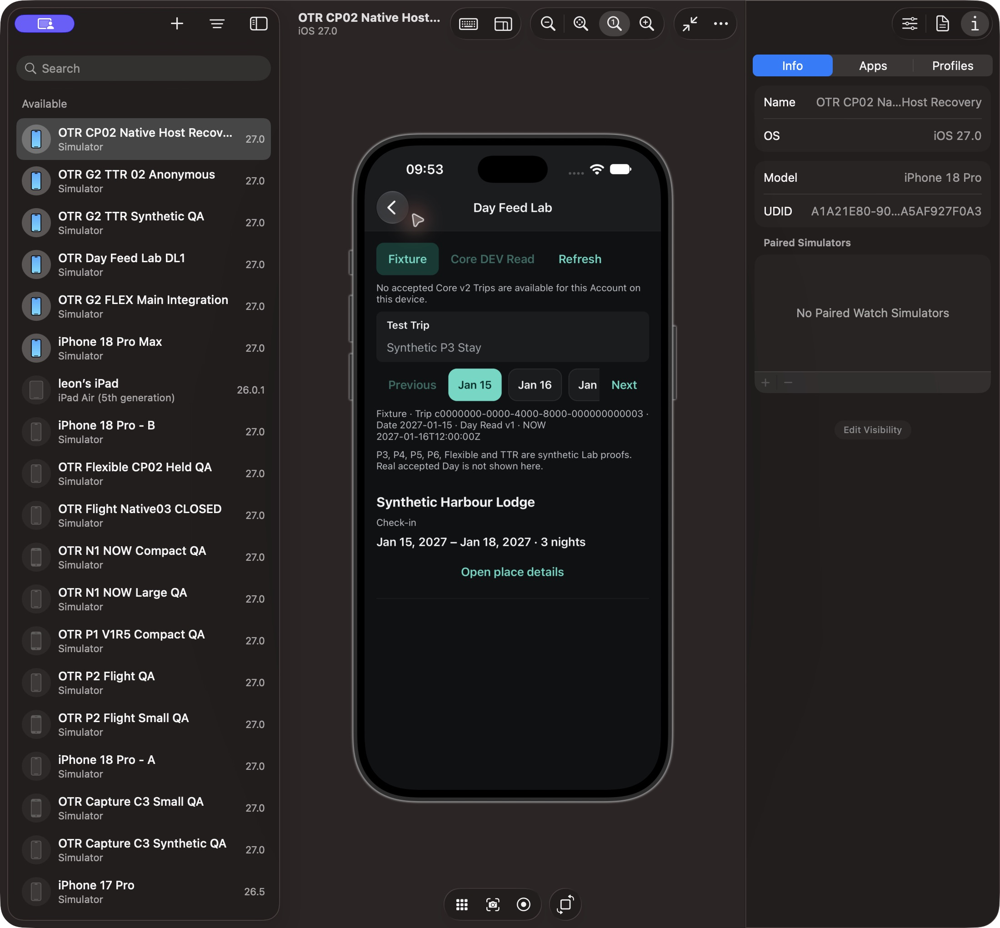

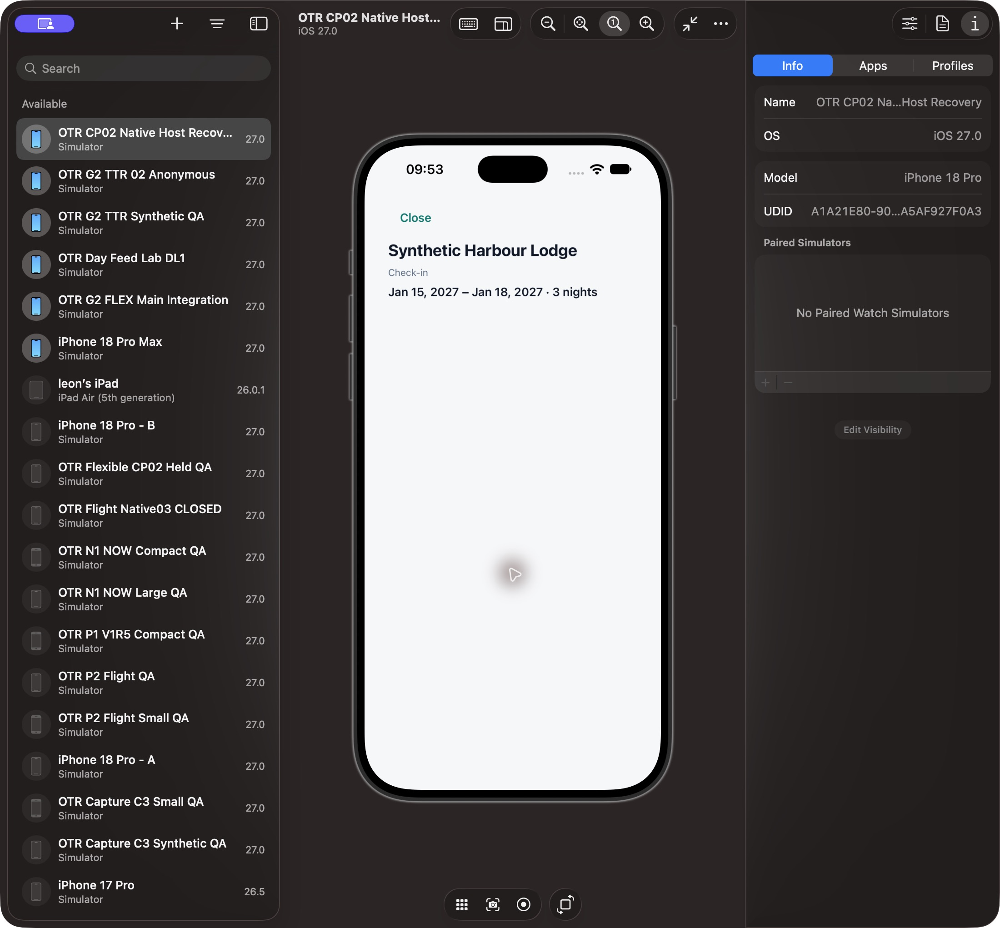

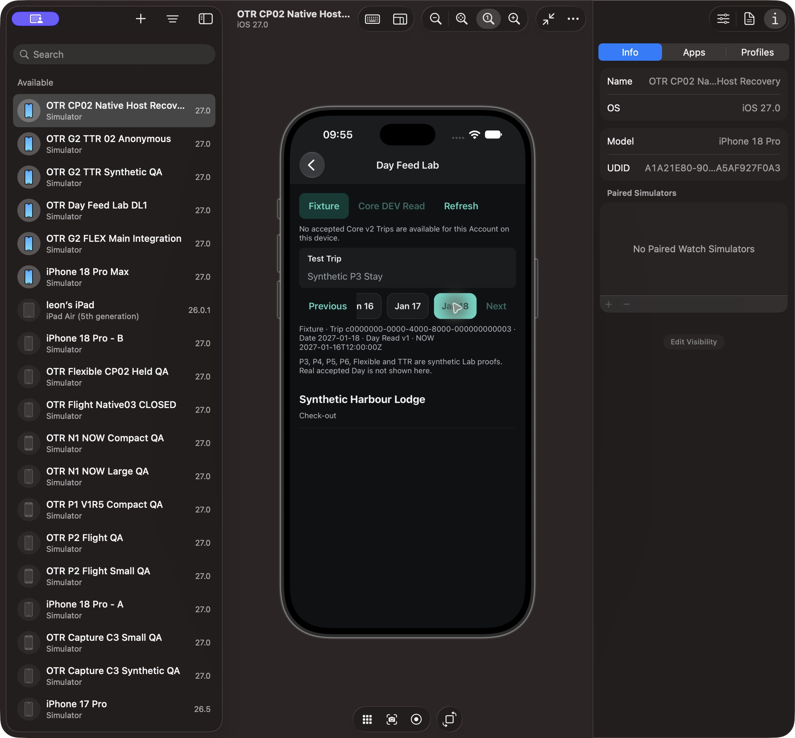

The sparse fixture cannot prove nonzero-scroll return/dense activity ordering or NOW anchors. Dates are known but clock times/location/owning documents are absent. No screenshot is offered for a real accepted Day, registered guests, original instructions or positive photo/Ledger counts.

## C. Fourteen approved scenarios — expected / actual

| Scenario | Expected                                                    | Actual                                                                      | Verdict                                                       |
| -------- | ----------------------------------------------------------- | --------------------------------------------------------------------------- | ------------------------------------------------------------- |
| 1        | Check-in / nightly Base / Check-out share Stay              | Three-night date-role appearances visible; same name/full range throughout  | PASS baseline; dense end-of-activities ordering NV            |
| 2        | Same-day two Hotels / single-night roles distinct           | Unchanged trusted role tests; no current multi-Stay Native fixture observed | NOT VERIFIED Native                                           |
| 3        | Unknown clock never invented                                | Date/role only, no clock in fixture row                                     | PASS synthetic                                                |
| 4        | Future full range and authorized original/chooser           | Range/night count observed; original/chooser producer absent                | PARTIAL                                                       |
| 5        | Confirmed only evidence; no invented Pending                | No fake Confirmed/Pending/Not booked label                                  | PASS absent-evidence case; positive evidence NV               |
| 6        | Precise/name-only Maps intent                               | Fixture location missing; no empty map or fake precision                    | PARTIAL; positive Maps NV                                     |
| 7        | Original Instructions internal-first/fallback; no empty/AI  | Missing original yields no empty entry/AI summary                           | PARTIAL; actual original opening NV                           |
| 8        | Permitted sourced guests; room/Booking distinctions         | No guest names invented; source absent                                      | PARTIAL / owning Beta0 gap                                    |
| 9        | Authorized Past count only; no attendance inference         | No photo/expense count invented when absent                                 | PASS absence; positive linked data DEFERRED owning dependency |
| 10       | Past≤3 photos+View all or no empty gallery                  | No gallery when zero supplied photos                                        | PASS absence; positive gallery DEFERRED                       |
| 11       | Paired Ledger/per-night/currency groups; no fabricated zero | No money/zero fabricated; owning summary not supplied                       | DEFERRED owning Ledger; NOT DELIVERED positive                |
| 12       | Permission-based Add; no cascading delete                   | No unsupported Add/manage/lifecycle controls invented                       | PARTIAL; owning Beta0 actions absent, lifecycle Native NV     |
| 13       | Offline original honest availability; no hidden LLM         | No AI path in unchanged source; current offline/original proof absent       | NOT VERIFIED Runtime                                          |
| 14       | Focus/NOW/date/scroll/P1/P2/TTR preserved                   | Date switch resets Focus; Close restores same Focus; no TTR activation      | PARTIAL; nonzero scroll/NOW/P1/P2 transitions NV              |

## D. Ordinary issues and fixes

The prior production wiring omission is repaired in the reviewed isolated consumer: existing accepted-local P1/P3 reader and guardedv2 Stay renderer registration; P2/v1 and account/certificate gates are retained. Static callsite proof and26 tests establish that seam, while this pureLab sequence proves StayRow presentation only. It cannot certify actual accepted-v2 execution.

No new ordinary visual defect was observed in these default-size P3 fixture states. Global hot Trip-header failure is separately isolated in the MyTrips/Shell hot report; it is not claimed fixed here or used to halt P3. Missing owning originals/guest/manage capabilities are accurate delivery gaps, not permission to invent them.

## E. Dependencies and boundaries

Beta0 baseline role/range/unified Stay renderer can progress independently. Actual original Booking/Instructions opener/current rights, sourced registered guests and legal management/Add still require owning producers to complete the approved product. Linked Photos/Ledger positive data are DEFERRED owning dependencies for this finite presentation; absent data is never marked delivered. Beta1 synthesized Access Facts, nearby/embedded map and supplier monitoring remain DEFERRED/rejected per approved Delta. No new design, controller, native install or permission is introduced.

## F. Level2 delivery

This illustrated baseline packet is reviewable engineering evidence, not a complete product L1 or ProductUXAccepted. L1 INCOMPLETE / Level2 NOT READY. Root's later notification requires the complete module/version report; ordinary repairs are handled author-to-reviewer first. Real Runtime remains NV without imposing real Core activation as a prerequisite on finite synthetic renderer presentation intake.

Skipped: repeat trusted renderer review/tests, fake screenshots/certificates, protected runtime and broad audit. Risk: the Lab v1 path does not exercise changed productionv2 consumer behavior or the missing positive owning cases.

Technical qualification receipt: unchanged accepted StayRow/Core adapter64, independently reviewed production links26/guarded binding and exact17 default-size fixture Native evidence adequately support the existing renderer/readers assembly under the original presentation grant. No concrete new layout/callback defect was observed in that bounded assembly. Real acceptedv2 execution remains a Runtime NV limit, not a new prerequisite on finite technical intake. Full14 owning capabilities/L1, dense nonzero-scroll and separate global header P0 remain incomplete; no Ops activation or ProductUXAccepted follows.
