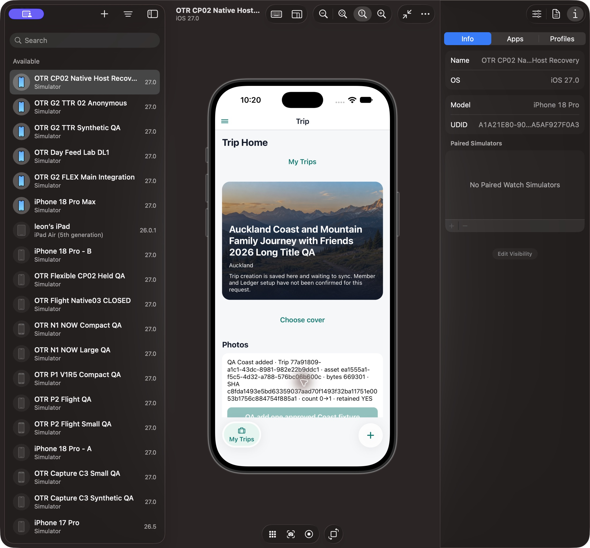
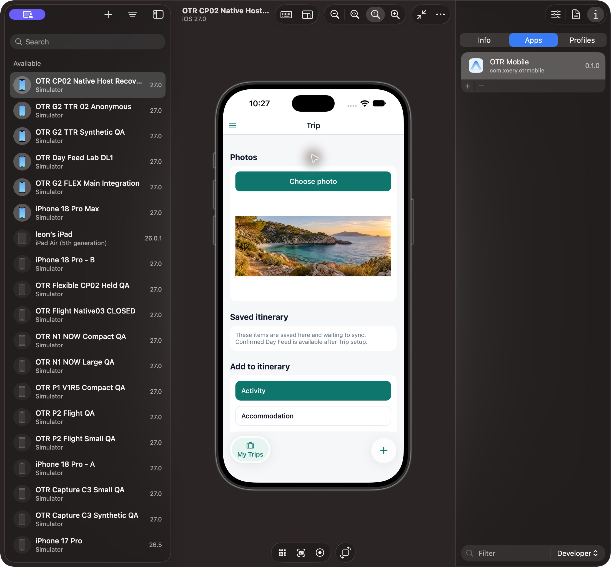
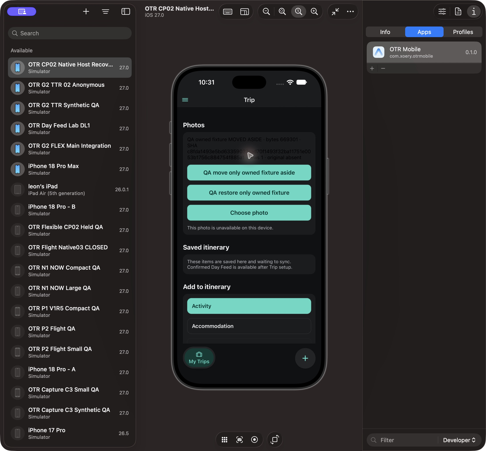
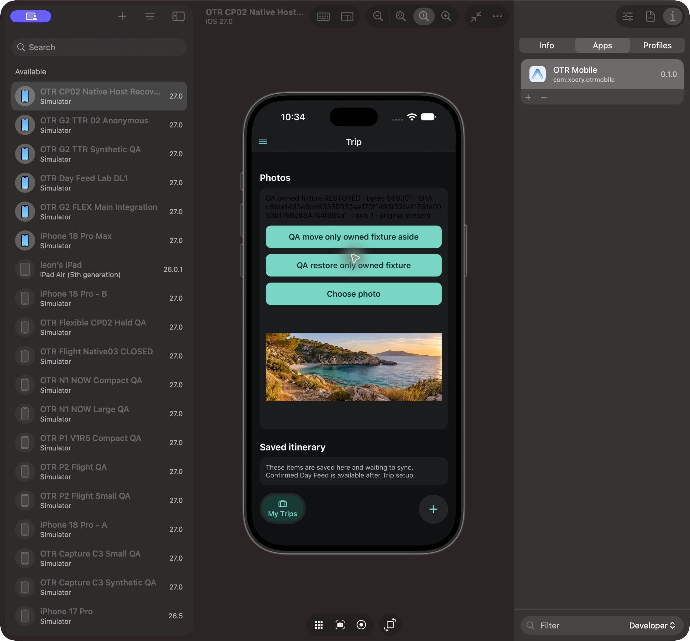
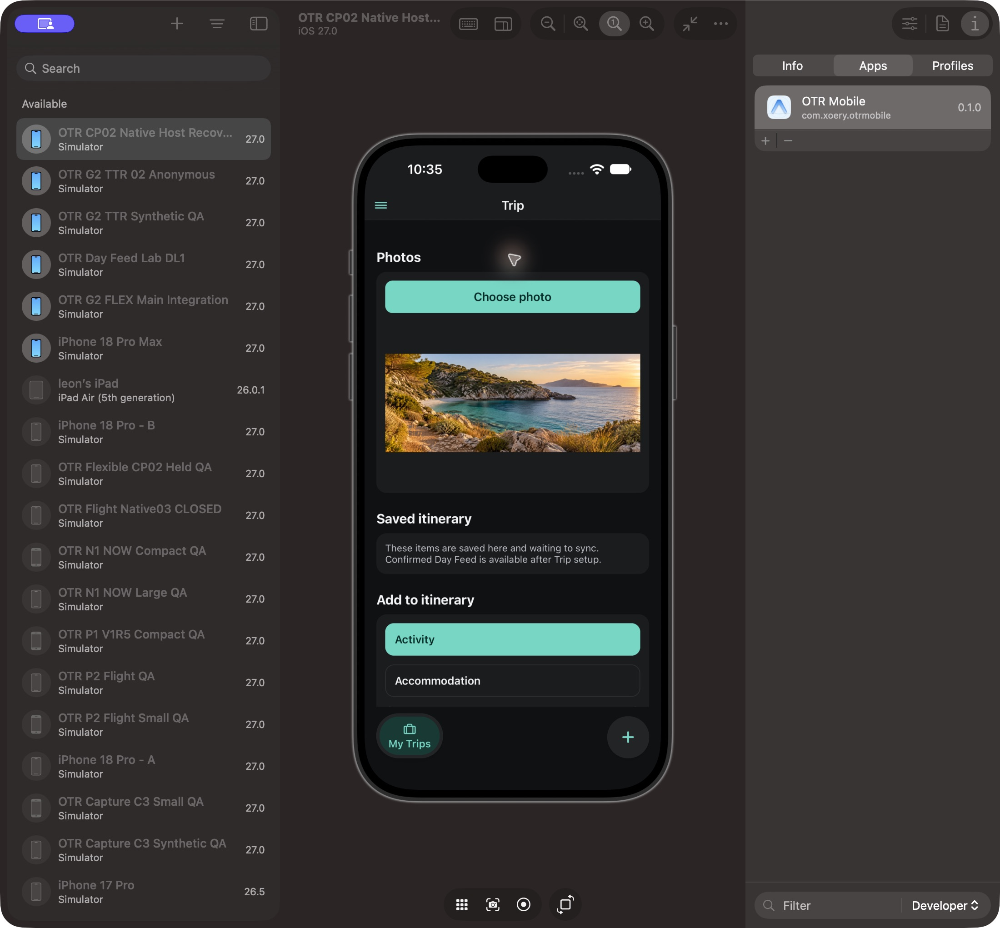
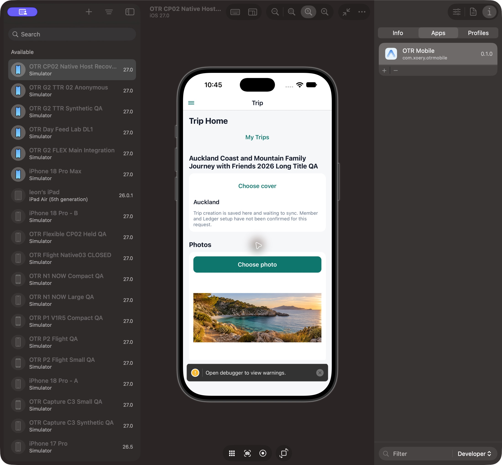

# OTR Photos visual acceptance — 2026-10-14

Current technical integration: Push58 `2ffe48fd5052c6a0f8bafb8296617436d3666066`, exact minimum14 from main950af914. Independent source/runtime applicability receipt7ba3c12e verifies the unchanged owning data/helper/Photos bytes against the earlier observed mixed28 receipt5c44ceee. The surrounding r3/Hot candidate was excluded from intake. Fresh main38 tests/five suites/typecheck/UI guard/touched lint/format passed. This report is the current standing Level1 entry; [original independent Native receipt](OTR_TRIP_PHOTOS_NATIVE_ACCEPTANCE_REPORT_2026-10-14.md) retains the earlier exact28 chronology and verdicts without duplicate narrative.

**Function: PASS bounded. Product Conformance: PARTIAL. Visual: PASS bounded default-size. Runtime: PARTIAL. Full Level1: INCOMPLETE. Level2: NOT READY.** Real existing account/local Trip, synthetic bundled Coast media. No ProductUXAccepted or WAITING_OWNER_UX_REVIEW claim.

| Coverage                                            | Actual result                                                              |
| --------------------------------------------------- | -------------------------------------------------------------------------- |
| Owning normal repository add                        | 0→1, bytes retained before association; one approved bundled Coast fixture |
| Same local Trip product list/current-main minimum14 | Observed and readable; Source62 registry and owning repository preserved   |
| Normal cold app restart/list                        | PASS; unchanged owning paths, no repeated add                              |
| Default-size Light/Dark image                       | PASS bounded                                                               |
| Exact new owned file missing                        | Row1 retained, honest unavailable fallback                                 |
| Reversible byte restoration                         | Same669301 bytes/SHA c8fda149; file and image restored                     |
| System picker/permission/cancel/error               | NOT OBSERVED; public Asset/File repository probe is not picker provenance  |
| Cached-only/account transition/offline positives    | NOT OBSERVED Native; structural/unit boundaries remain separate            |
| Full product/accepted Core Day                      | INCOMPLETE / NOT VERIFIED                                                  |

A1A21E80-9007-4D69-87A4-2A5AF927F0A3 / com.xoery.otrmobile0.1.0; binary build UNKNOWN. Actual local Trip77a91809-a1c1-43dc-8981-982e22b9ddc1; newly owned fixture association ea1555a1-f5c5-4d32-a788-576bc06b600c. Existing R3 rows were preserved. No new account/Auth, private gallery/container, direct SQL association write or false permission/certificate. The fixture association/file remain; missing-byte probing restored only that new owned file. Global Hot header FIX belongs to its failed isolated UI scope. A development warning toast in the minimum14 observation has UNKNOWN cause; this report makes no warning-free claim.

## Actual screenshots

[Original five-image directory](photos-native-61-assets/) and [minimum-current-main image directory](evidence/otr-beta-photos-minimal-native-61/assets/). QA labels identify transient overlays; they are not production UI copy. Source/restoration records are linked by the original receipt and [minimum independent review](evidence/otr-beta-photos-minimal-native-61/review.md).

Owning add with explicit fixture, transient QA probe:

Product Light after normal cold restart, helper removed:

Missing newly owned file, product fallback and explicit transient probe:

Exact same bytes restored, transient proof:

Product Dark with helper removed:

Exact current-main plus minimum14, same existing fixture, no extra add/write:

This is a valuable partial illustrated checkpoint. Missing picker/offline/account/full-product scenarios remain the next lawful QA prerequisites; generated media is fixture input, while these six images are actual Native observations. SQLite62 must remain present when changing QA source; no downgrade or cleanup is authorized.
