# My Trips compact known-fact readability — affected Native acceptance, 2026-10-14

Independent reviewer p4_visual_61. Exact Source-reviewed compact manifest8d701dae36000295b82f6b4f677873a912b5c116d2243efc5ca428e53e5ac679; composed28 hashes verified. New scope only MyTripsList4c3a38acdf64345c7eb4f9c1277f1d411a17cbf0330b7d7c2a4e8945fd7fd467 and testcb919d1bd897befe9a7d13c0ca8efc0ce1a578fa026b2ccdfb482afb49de3130 atop reviewed unframed75aba. No new header hypothesis. Existing62/Photos/P3 app inputs retained; currentmain backendDoc101 untouched. Source independently reviewed exact2 delta and sealed13/static PASS.

Functional: bounded PASS (Source13/static plus ordinary observed SeeAll/card/return). Product Conformance: PASS for compact repair, combined MyTrips/Shell PARTIAL. Visual: PASS for affected default/largest compact states. Runtime: PARTIAL (actual Native UI, explicit no-right presentation fixtures; real acceptedDay/current rights NV). WholeL1 INCOMPLETE / Level2 NOT READY / no ProductUXAccepted. Inherited hot header P0 remains separately FAIL; true nativeglass remains themedfallback PARTIAL.375 NOT OBSERVED.

## Source and observation scope

Approved A1A21E80-9007-4D69-87A4-2A5AF927F0A3 / com.xoery.otrmobile app0.1.0, native build UNKNOWN, iOS27.0 / approved logical402. Same eight explicitly labeled account-fenced readMerged presentation fixtures as prior P1b/unframed; no accepted certificate/Actor/right forged, no SQLite or business writes. Actual existing local summaries coexist. Previous Metro54463 expired across SAFE handoff; actual normalreload showed development-server unavailable. Existing CLI restarted through authorized proper escalation as EXPO_OFFLINE=1/localhost8081/devclient, new owned59454; visible knownfixtures and source28 identity verified. No install/download/private metadata/Auth/gallery. CLI rejects simultaneous --offline+--localhost, so installed documented EXPO_OFFLINE flag was used. Existing ambient warning/network behavior is not certified warning-free or offline runtime.

## Required affected matrix

| State / expected | Actual | Verdict / image |
|---|---|---|
| Default Upcoming/Undated, same fields/2auxlines | Normal row remains compact with start/end dates and partial long city within2lines; no extra field/action |PASS01/09 Light/Dark |
| Largest nominal2.143 Upcoming Light, dates+knowncity readable | Intrinsic row grows: Nov20,2026 / Nov22,2026 / Sydney Harbour and Northern Beaches fully readable; thumbnail/chevron clear |PASS03 |
| Matched largest Upcoming Dark | Same fullfacts, clear contrast and chevron |PASS04 |
| Largest local Undated and cached Chinese Undated | Dates undecided honest; actualAuckland and explicit奥克兰与皇后镇 fully wrap, cached Saved summary caveat retained |PASS05/06 |
| Past3→SeeAll5 / final card / Shell | Full5 verified AX after first expansion; last PastLongEnglish fixture opens correct cachedTripHome; return and bottom controls/Shell reachable |PASS07/08 |
| Restore smaller size | Five OS decreases restore nominal1; default row compact again |PASS09/restoration |
| Header,375, real eligibleOpenToday, realacceptedDay, offline/revocation/systempicker | Header inheritedP0 FAIL (no re-experiment); other positives NOT OBSERVED |WholeL1 INCOMPLETE |

Before10/11 from unframed75aba show startdate followed by ellipsis with enddate/city lost. After03/04 preserve both dates and full city via intrinsic growth at fontScale>1. Default remains capped2lines; title still deliberately max2lines. No new stats, copied rights or action callbacks. Thumbnail/chevron align in the grown card without overlap. Native window/sidebar inventory height changed since before captures; app/device logical viewport remained approved402, no device/viewport mutation was made.

Image02 is intermediate scroll position (Chinese Active hero and Upcoming start), not full metadata proof.09 is baseline restored;08 shows bottom controls and default3/SeeAll after return, not persistent expansion. Expansion-to5 proof is in expanded-past-ax.txt and finalTrip navigation07. Source shadow and all product preimages restored byteexact; all28 priorP1b hashes match, font1/Light/captureoff. SQLite62 and prior approved Coast association/file preserved. Original25 and old header failure receipts remain byte-identical. Bounded known-fact repair qualifies independently; full product acceptance still incomplete.

## Matched before / after

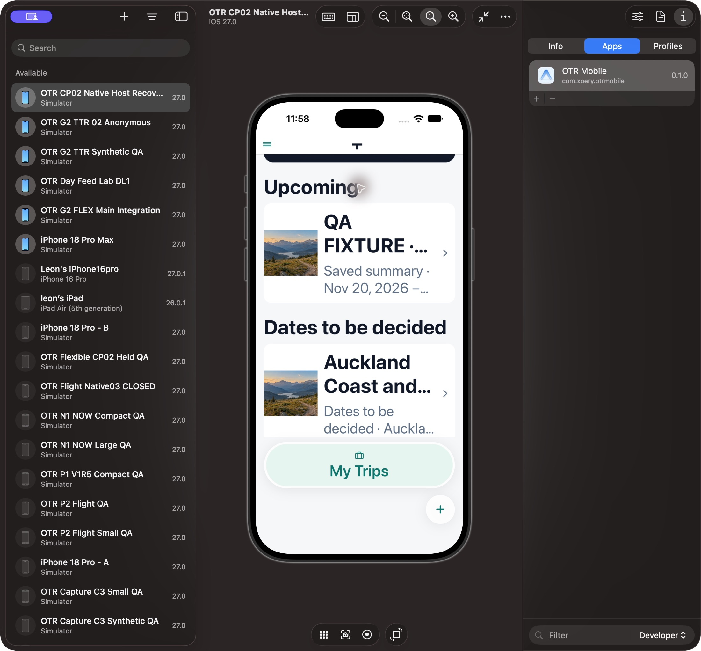

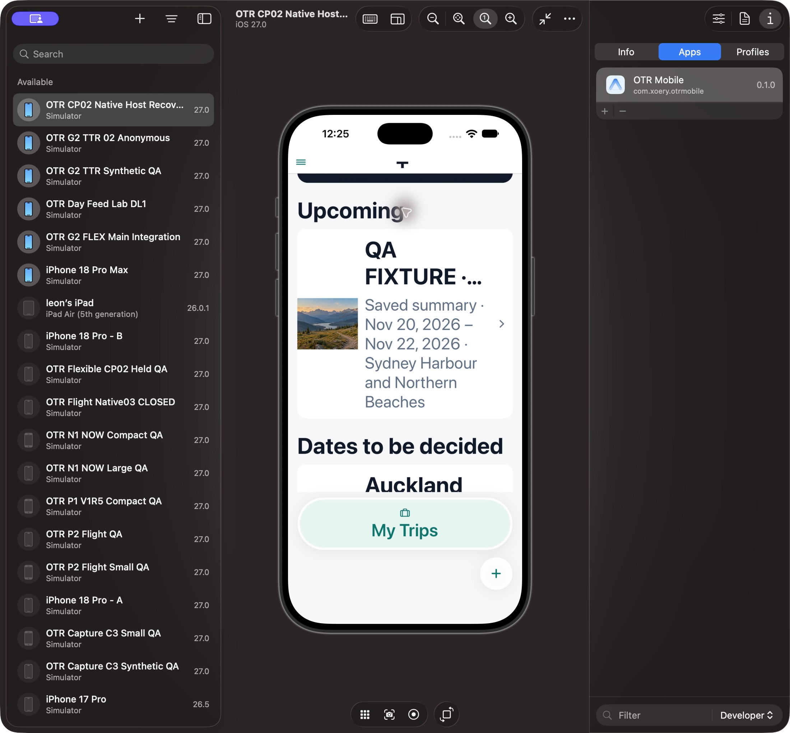

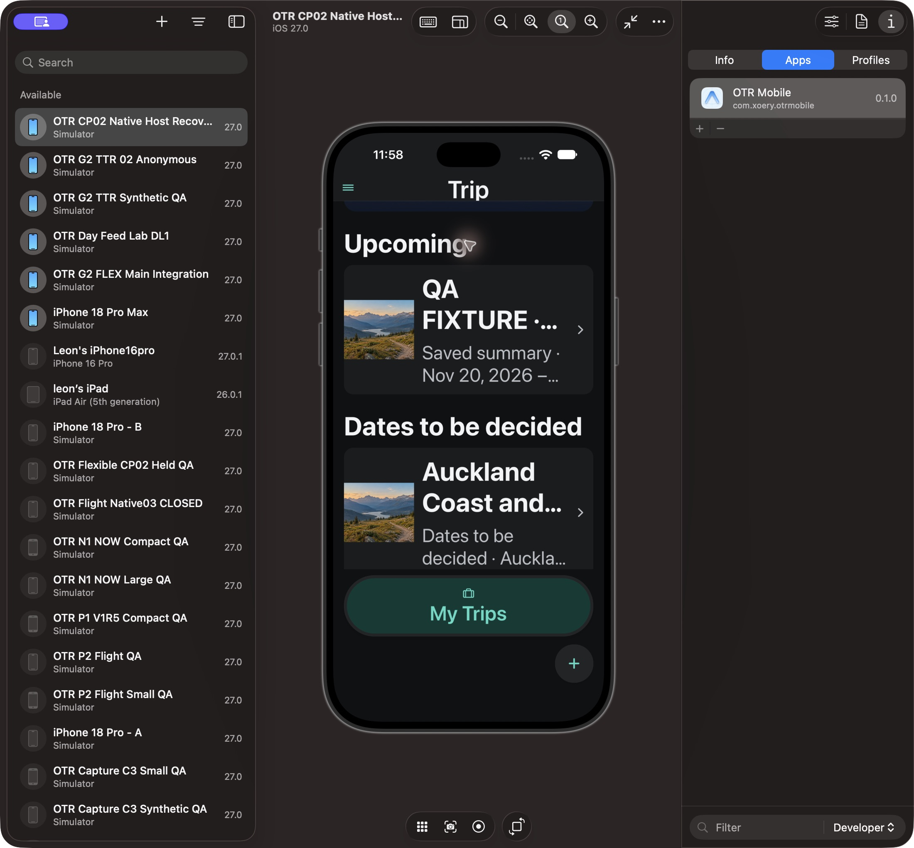

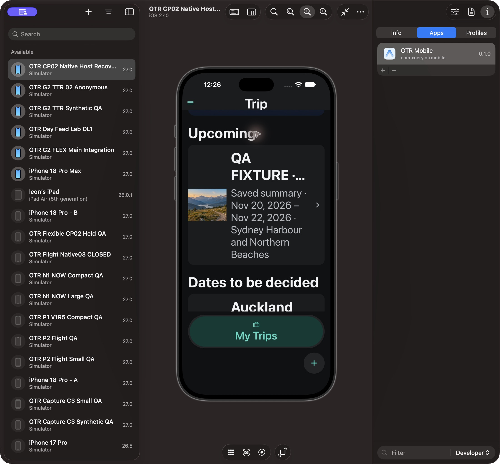

## Other affected actual captures

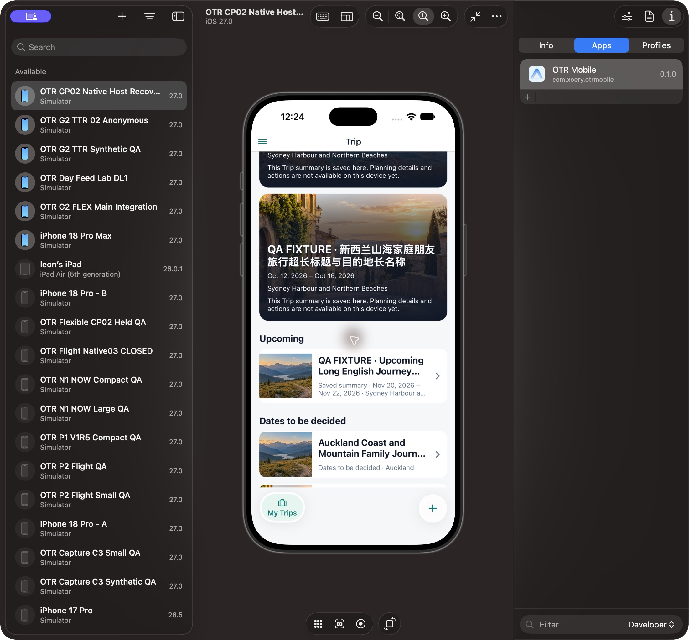

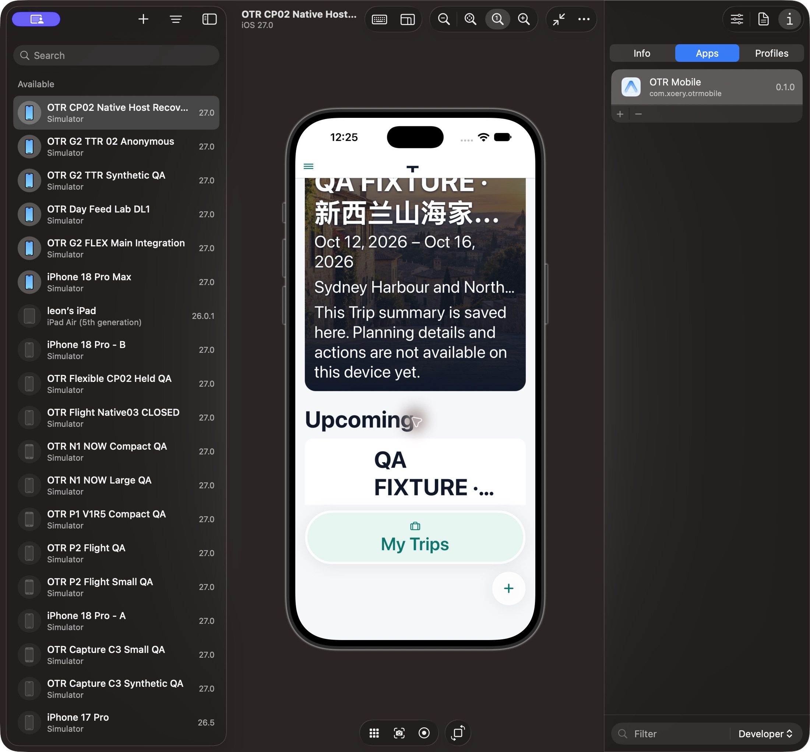

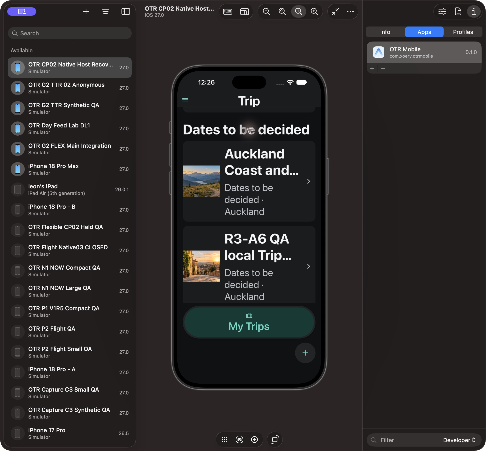

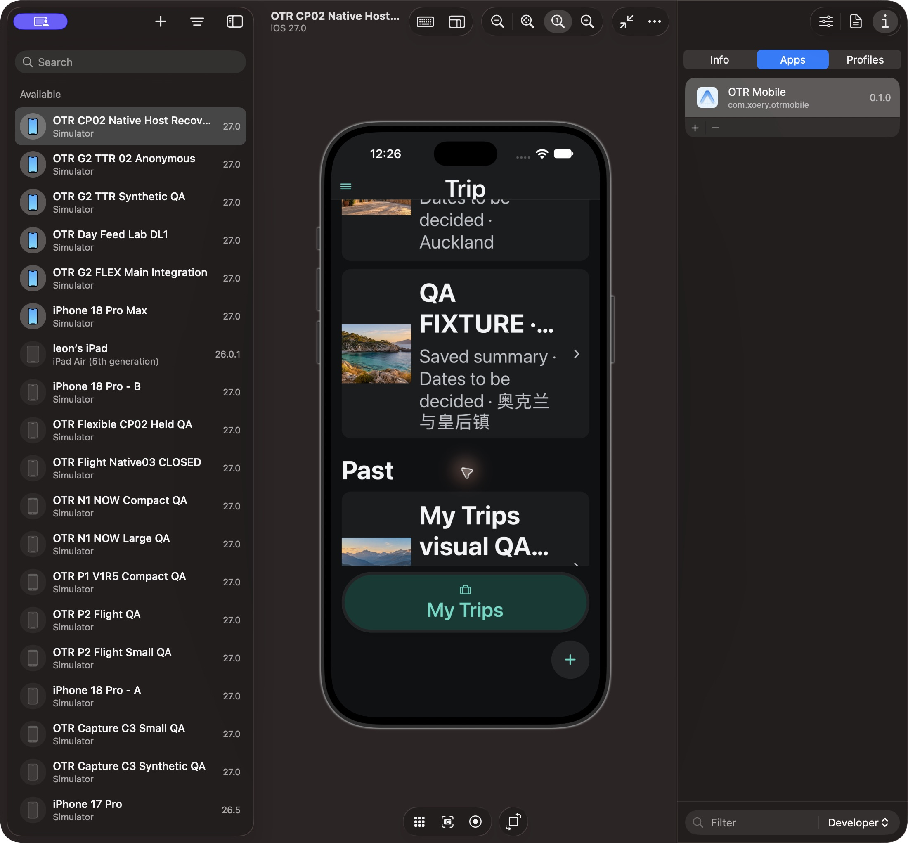

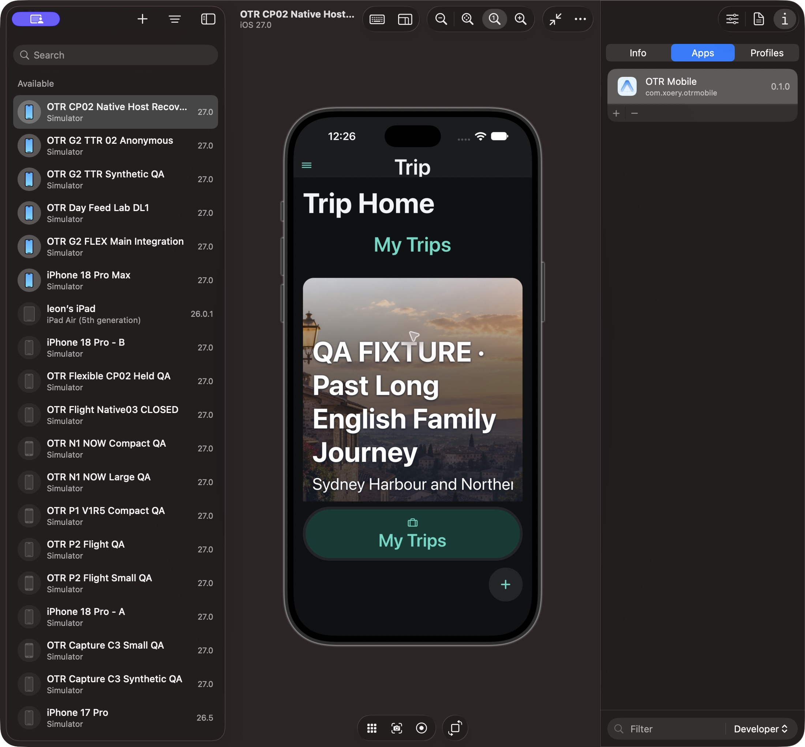

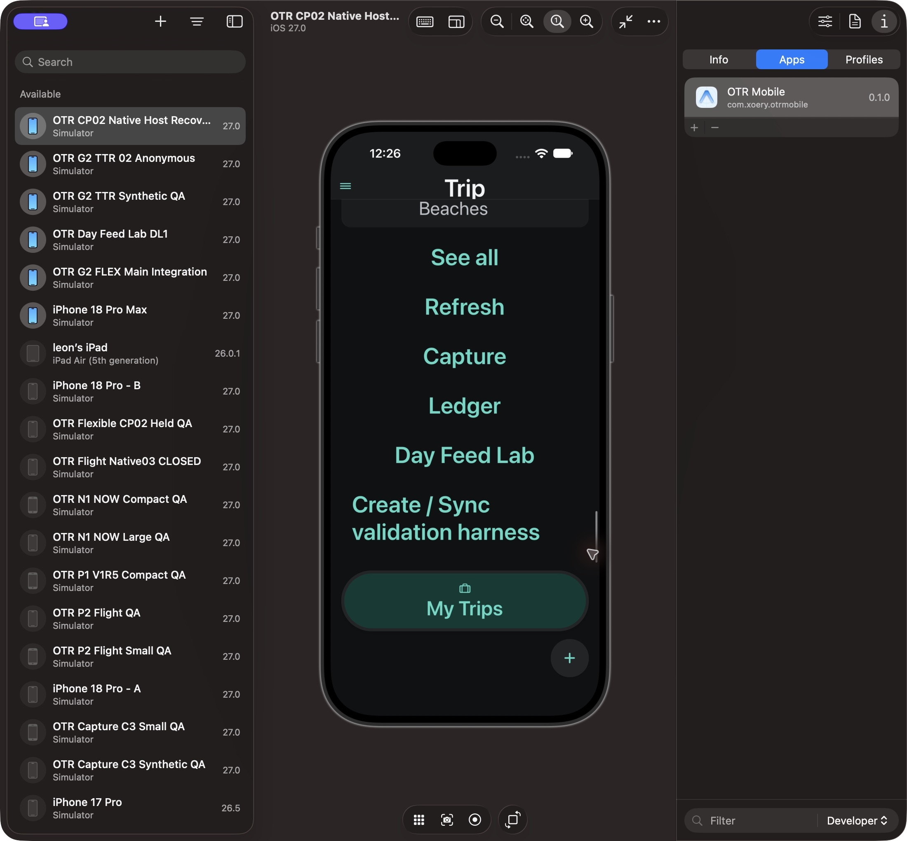

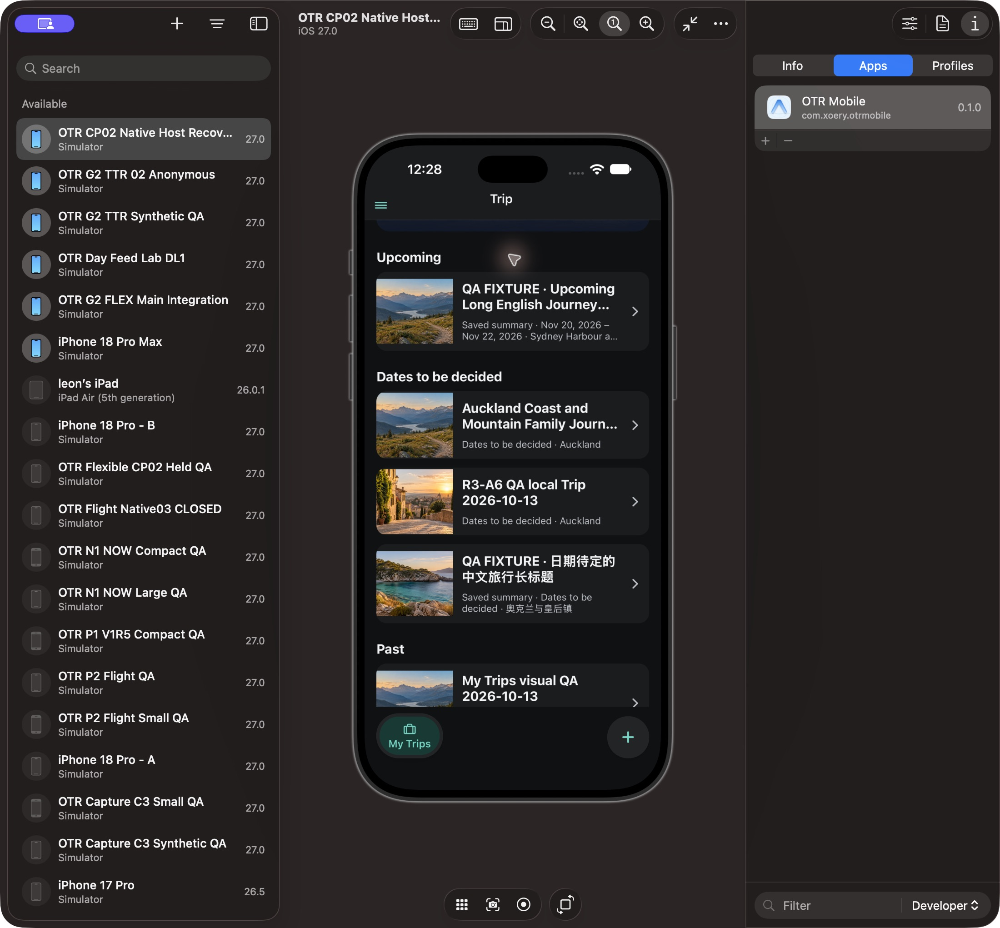
