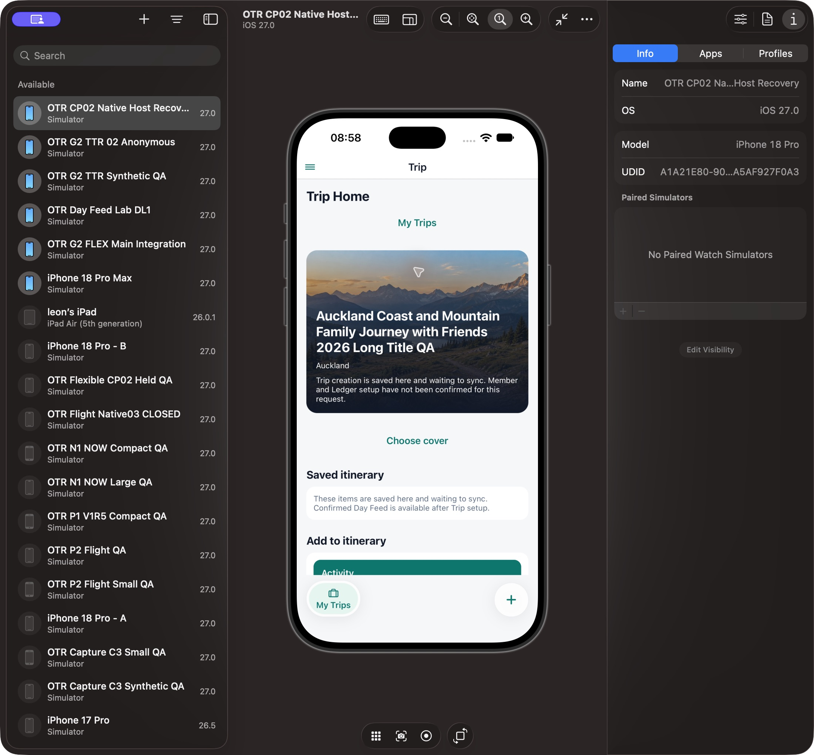
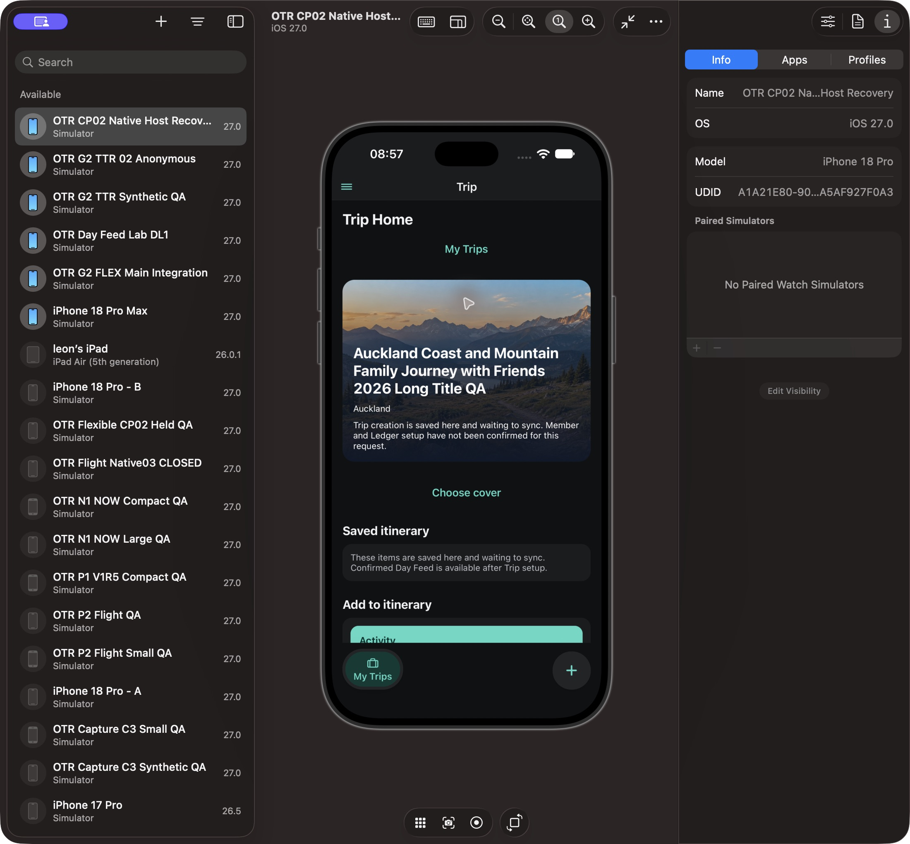
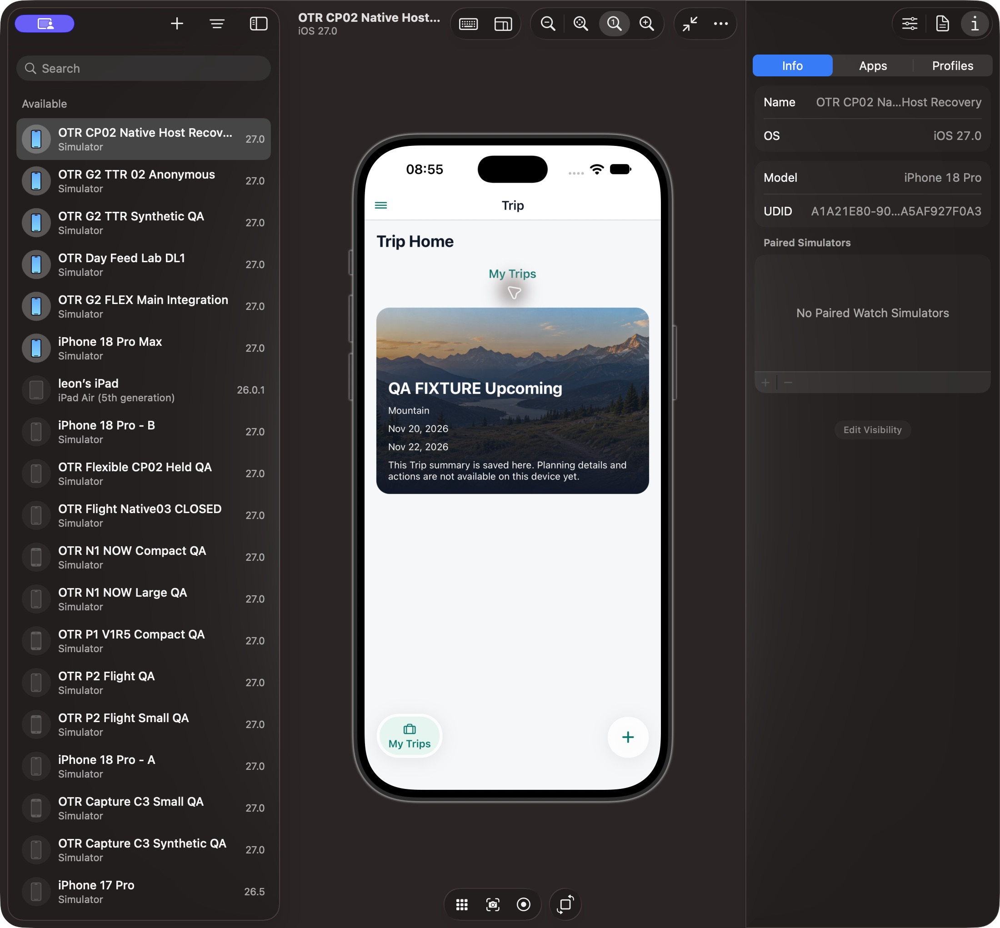
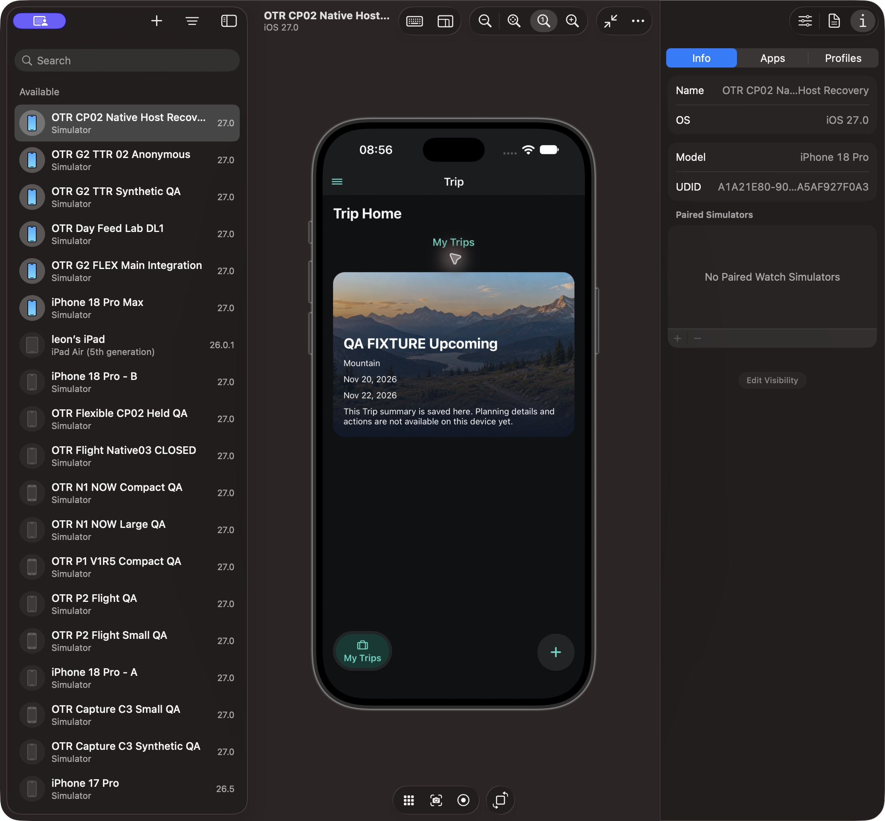

# Trips Shell / Trip Home — independent Level 1 report, 2026-10-14

**Level 1 INCOMPLETE. Native visual PARTIAL / FIX; true native glass PARTIAL; Level 2 NOT READY.**

## A. Scope and separate verdicts

Independent reviewer: p4_visual_61, not the implementation author. Snapshot 2026-10-13T20:02:12.879861+00:00. This isolated report supersedes the earlier no-pixels report only for the observations identified below. Source alone adopts reports/code.

Exact candidate: Trips/Shell revision3, base `005e35c10af3f8814bebb02d362b9b0794c2a077`, manifest SHA256 `5be10f9f0a04f19f0f3b2fb4c4f697798a005ffd76d452a5b1e431d4db1226ee`. Revision2 is preserved separately; its manifest is `5315953165d5533e5db223fbc1c01e5d04256b8c15774cfd0b4555ec01096d03`. R3 changes only TripCoverVisual Image sizing; other ten files are unchanged. All eleven hashes matched the served QA clone, and all four temporary marker/fixture overlays are restored byte-exact: [source/restoration receipt](evidence/mytrips-r3-source-restoration-20261014.json).

Existing installed OTR Mobile0.1.0 / `com.xoery.otrmobile`, A1A21E80-9007-4D69-87A4-2A5AF927F0A3, iPhone18 Pro / iOS27.0. Device Hub ordinary Info/Apps verified the identity. No newly compiled binary was installed; native build number is NOT OBSERVED. A visible `QA r2 531595` Shell label established exact r2 JS attachment, then was restored. R3's one hashed change was served by the same Metro and visibly corrected the image layout. Earlier resumed host pixels with unknown JS and pre-resume unavailable screenshots are not candidate evidence.

Real images show the existing approved account's local pending Trips. Synthetic images use Source-approved generation-fenced in-memory cached summaries with names QA FIXTURE, or a props-only zero-array empty view. Fixtures confer no Account/current rights/accepted Day, perform no business writes and are not real runtime acceptance. No originals/private gallery, Auth change, install, protected provider or Hosted activation was performed. Existing ambient app discovery timeout logs were seen; this report does not claim all startup networking was disabled.

Authority: Owner TRIPS01–14/twelve scenes, latest no-Search handoff, BD49 two-island IA, and the two Owner App Store style references. References are design directions only, never acceptance screenshots. Latest Active-card instruction requires existing lawful primary actions at the bottom overlay; no fake action is introduced.

Functional PASS is bounded to Source's trusted r2/r3 receipts. Product Conformance is PARTIAL: current local/cached Home preserves full photo and bottom text/status gradient, islands retain approved routes, and no Dashboard is added. Visual is PARTIAL with observed r3 framing corrected and hot Dynamic Type unresolved. Real accepted-Day Runtime is NOT VERIFIED. Level1 INCOMPLETE; Level2 NOT READY; ProductUXAccepted is not granted.

## B. Required state matrix

| State                                                          | Current actual evidence                                                     | Result                                              |
| -------------------------------------------------------------- | --------------------------------------------------------------------------- | --------------------------------------------------- |
| Local pending Home / long EN title Light                       | [r3 real](assets/trip-home-r3-real-longname-light.png)                      | PASS observed framing/text                          |
| Local pending Home / long EN title Dark                        | [r3 real](assets/trip-home-r3-real-longname-dark.png)                       | PASS observed framing/text                          |
| Read-only cached Home Light                                    | [r3 QA fixture](assets/trip-home-r3-fixture-cached-light.png)               | PASS synthetic; no rights/action                    |
| Read-only cached Home Dark                                     | [r3 QA fixture](assets/trip-home-r3-fixture-cached-dark.png)                | PASS synthetic                                      |
| MyTrips island selected / right + Light and Dark               | Same real list screenshots below                                            | PASS visible IA/pill/label; actual material PARTIAL |
| Create route                                                   | [r2 real form](assets/create-r2-real-dark.png), no submit                   | PARTIAL; current r3 route identical, not retaken    |
| Accepted Day island / same-Trip Today primary action           | NOT OBSERVED                                                                | NOT VERIFIED; no fake context injected              |
| Large type hot / reload                                        | Actual r2 OS five-increment images below; typography source unchanged in r3 | FIX; reload recovery not hot PASS                   |
| Large text Home / ZH / VoiceOver / exact targets / cold reopen | NOT OBSERVED                                                                | NOT VERIFIED                                        |
| Offline / revoked context / real current rights                | NOT OBSERVED                                                                | NOT VERIFIED                                        |

## C. Expected / actual product directions

| Applicable decision                        | Expected                                                                      | Actual                                                                                                    | Verdict                                                  |
| ------------------------------------------ | ----------------------------------------------------------------------------- | --------------------------------------------------------------------------------------------------------- | -------------------------------------------------------- |
| BD49 / current island IA                   | My Trips context plus eligible Day; right +                                   | My Trips selected and + visible; Day rightly absent without accepted context                              | PASS bounded / positive Day NV                           |
| Latest Shell reference / TRIPS12           | Floating capsule, stacked icon-label, inner selected pill, subtle edge/shadow | Observed themed capsule/pill/vertical icon-label/shadow                                                   | PARTIAL; semantic translucent fallback, not native glass |
| Latest Active/Home reference               | Full photo, lower gradient, bottom text and lawful primary action             | Local/cached Home photo/text/status bottom overlay visible                                                | PASS text/photo; lawful primary action NV                |
| Latest bottom action instruction / TRIPS06 | Existing eligible OpenToday stays in bottom overlay                           | Candidate code placement conforms, positive state unavailable                                             | NOT VERIFIED Native                                      |
| Existing local editing/settings            | Preserve legal Add and cover settings below Home                              | Choose cover and Add form stay below hero; these are editing/settings, not a invented card primary action | PASS bounded                                             |
| Cached metadata boundary                   | Read-only summary, no implied privileges                                      | Name/place/dates plus saved-summary status; no Add/Today/cover/privileged buttons                         | PASS synthetic                                           |
| Latest direct Search handoff               | No invalid Search / no Trips-only implementation                              | No Search entry in Native Shell                                                                           | DEFERRED / omission conforms                             |
| No new Home Dashboard                      | Keep current local/cached workspace                                           | No new Dashboard routes/controls                                                                          | PASS bounded                                             |

## D. Before / after ordinary issues

R3 fixes Image dimensions only. The cached Mountain Home below now shows its full scene rather than the r2 enlarged corner:

Hot Dynamic Type remains independently unresolved, including Shell label/native heading clipping. Same-size reload recovery is evidence of a transition problem, not successful hot acceptance:

## E. Dependencies

True native glass has no existing enabled adapter/module in this candidate; fallback is explicitly PARTIAL. A real accepted Day is unavailable and is not forged. Account/current access/owning originals remain outside this presentation fixture. No broad navigation rewrite or new provider is justified by the current findings. Author handles the separate scoped hot-size technical fix, Source functional review and independent actual after-verification remain required.

## F. Level 2

L1 INCOMPLETE, Level2 NOT READY, not WAITING_OWNER_UX_REVIEW. No acceptance implied by style references, static markup or fixture rights. Remaining product choice of native material is distinct from the ordinary hot-layout repair.

Skipped: repeated unchanged code review, generated screenshots, installation and permission expansion. Risk: unobserved positive-context and accessibility states still matter.
