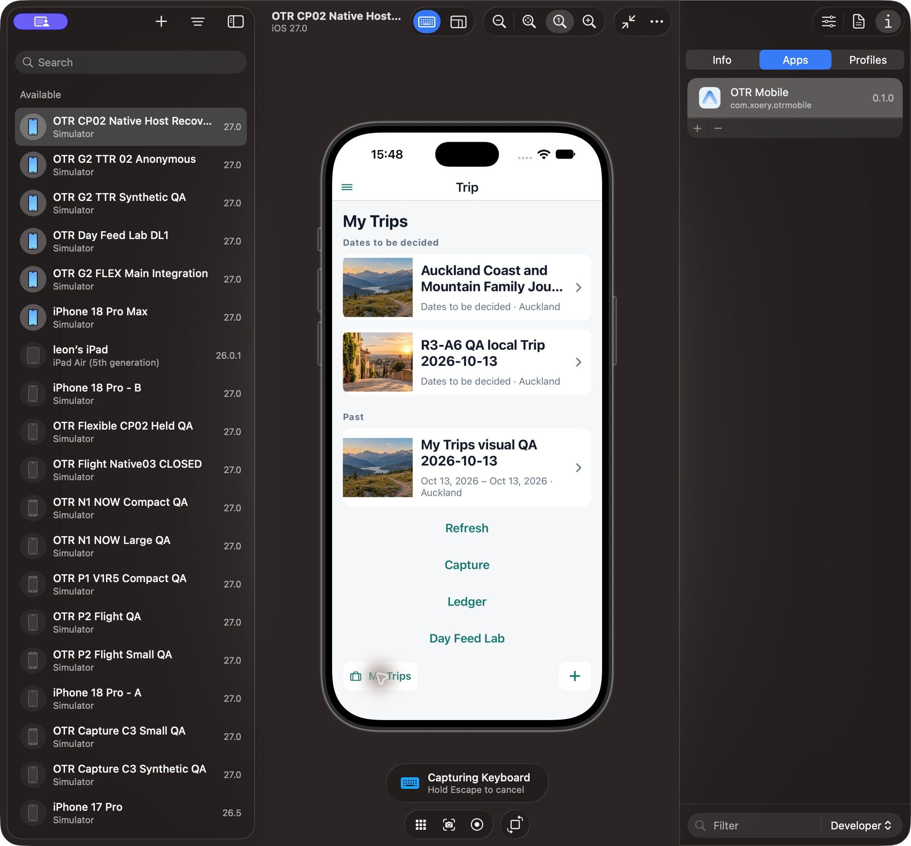

# HOME r3 independent affected Native acceptance

Snapshot: 2026-10-14. Candidate eb2b0c5f9bb5078e48dcd25a4c8ffd2f1d9f669c5b9a56ad773f63a5d2b06b58 / exact12 paths on eae4216388852d553a3da03c5ab4edcc752b197c approved current-main baseline844 b6f8b. Different-author Reference peer1d7cbea89ec0576bed2b7a6f61b9f0d1497b2a623058eca265e4fe32a0febf30 PASS39/8+lint; trusted author/staticchecks reused. Production author did not perform this Native acceptance. R2b363 actual11 images remain PRE-FIX; none reused as r3 after.

Approved existing A1A21E80-9007-4D69-87A4-2A5AF927F0A3 /com.xoery.otrmobile0.1.0/iOS27/nativebuildUNKNOWN. Existing local pending long-English Trip and R3-A6 local Trip only. Normal owning local data/UI, no new Actor/grant/cert/acceptedDay; no fixture or widget injection. SQLite62/retainedCoast association preserved; no business writes/Auth/install/account/time/gallery/picker changes. CurrentSource baseline844 verified before/after; oldP1b backup remains evidence only. Metro52896 offline/devclientlocalhost--clear; actual nativeentry correct QAcontext and corrected Hero/Shell/tabs modules captured, not filesystem-only proof.

| Verdict dimension  | Result                                 | Practical limit                                                                              |
| ------------------ | -------------------------------------- | -------------------------------------------------------------------------------------------- |
| Functional         | PASS bounded                           | actual localTrip/MyTrips return, secondlocalTrip context, existingPhotos/tools preserved     |
| ProductConformance | PASS affected correction               | fullwidth/cappedHero/no producttextabove/secondaryheadings/hotShell; missingmodules excluded |
| Visual             | PASS observed affected cases           | 402portrait/same-deviceLandscape/bothThemes/longEnglish;375/ChineseHome NV                   |
| Runtime            | PARTIAL                                | existing local normalconsumer observed, realacceptedDay/Core-positive/currentrights NV       |
| Complete Level1    | INCOMPLETE                             | owning Preparation/widgets and remaining required states absent/unobserved                   |
| Level2             | NOT READY full product /NOT UXAccepted | finite affected packet available for Owner feedback only                                     |

| Decision / required state                                        | Expected                                             | Actual evidence                                                                                                                              | Verdict                          |
| ---------------------------------------------------------------- | ---------------------------------------------------- | -------------------------------------------------------------------------------------------------------------------------------------------- | -------------------------------- |
| Home top area                                                    | no producttextabovephoto; preserve systemstatus/menu | 02/07 nativeHome titleblank, Menu retained, backafterphoto                                                                                   | PASS                             |
| Fullwidth402                                                     | photo reaches actualscreenedges                      | 02 x≈802→1454, same asviewport; nativeconsumedwidthwindow                                                                                    | PASS                             |
| Heightcap≤40%                                                    | totalHero capped evenlarge/rotation                  | 02/03 portraitH≈377px of≈1417px window (~26.6%);12 landscapeH≈172px of≈430px (~40%, ±2px screenshotrounding); consumedMath.min232/windowH*.4 | PASS boundedgeometry             |
| Bottomphoto gradient/title                                       | retainbottomoverlay                                  | 02/07/15 actualdarkbottom/readabletitle; crop/fullimage width retained                                                                       | PASS                             |
| Largefullidentity                                                | cappedphoto; fulllongcopybelow                       | 03/08/11 fullEnglish identity below, hero singlelineellipsized asapproved                                                                    | PASS                             |
| Light hotfive+samefontreload+fivedown                            | fullShelllabel throughout                            | 03/05/06                                                                                                                                     | PASS                             |
| Dark hotfive+samefontreload+fivedown                             | fullShelllabel throughout                            | 08/11/13                                                                                                                                     | PASS                             |
| Lifecycle headings                                               | smallsecondarygray                                   | 01/04 Light,10/14 Dark Dates/Past actual; Active/Upcoming nofacts onactualaccount                                                            | PASS observed /ActiveUpcoming NV |
| P03/MyTrips title/context                                        | retainTrip header outsideHome                        | 04/10 fullTrip header atlarge,14 defaultreturn; selectedlocalfacts preserved                                                                 | PASS                             |
| Today route title /real Day                                      | retainroute title, no fabricatedacceptedview         | 04-r3-reload-today-ax.txt ordinaryToday title; nopositiveDaycontext                                                                          | PASS title /acceptedDay NV       |
| ExistingPhotos/tools/zeroqualifiedfallback                       | no inventedwidgets/rights                            | 09 actualCoast image/tools;02/15 honestNo contextual workspace;productionpages0                                                              | PASS boundedfallback             |
| ActualsecondlocalTrip                                            | correctsource/context                                | 15 R3-A6 QA localTrip2026-10-13                                                                                                              | PASS                             |
| RotationSafeArea                                                 | sameapproveddevice, copyclearofcutout                | 12 landscapeDarklarge, titleafterleftcutout, portraitrestored                                                                                | PASS observed /otherrotationNV   |
| ChineseHome/cachedHome/manualwidgetswipe                         | lawfulfactsorclearlylabeledfixture only              | NOTOBSERVED; nofakecachedfacts/widgetpage injected                                                                                           | NV                               |
| 375/nativeglass/Preparation/editrights/systempicker/acceptedCore | no inventedpositive                                  | NOTOBSERVED/DEFERRED                                                                                                                         | NV/DEFERRED                      |

Font scope: five actual OS Increase Text Size actions, same-font normalCmdR, five Decrease actions in each theme. Numerical fontScale was not reprobed this turn, so this packet does not assert fresh1→2.143 measurements. Initial observed baseline was restored by symmetrical actions. Full identity belowphoto was visibly active at observed baseline as well aslarge. DefaultfontScale=1-only metadata-in-photo branch is not separately certified by a fresh numericalmarker. No fontcap/remount/probe in accepted images.

Geometry derives from actual unmodified DeviceHub PNG plus exact consumed native code. Pixel boundaries are approximate because DeviceHub resizes its presentation on rotation; this is not an onLayout measurement or new375device qualification. Portraitfullwidth/cap and landscape40% are visually consistent with consumedwindowwidth/height; use current exactimage evidence for Owner assessment.

No blocking ordinary defect was seen in this finite correction scope. Previous r2 inset/tall/producttitles and currentShellhotcutoff are repaired in r3 observed cases. Full Home delivery remains PARTIAL because no qualified Preparation/widget business pages were supplied, Chinese/cached/375 states unobserved, acceptedDay/currentrights not activated; these are not fabricated prerequisites for this finite frame/presentation packet.

SAFE: all12 candidate paths restored to currenteae baseline; newlyowned absentHome files removed, all844 hashes exact; no return to obsoleteP1b. Portrait/initialbaselinefontsize/Light/CaptureKeyboardOFF/InspectorOFF/normalMyTrips restored; DB62/Coast/account intact. ExistingMetro process availability must be verified afterexecutor lifecycle. SubsequentP456 must use separate reviewed exact composition, nevermix r3TripScreen before Source mergepeer.

