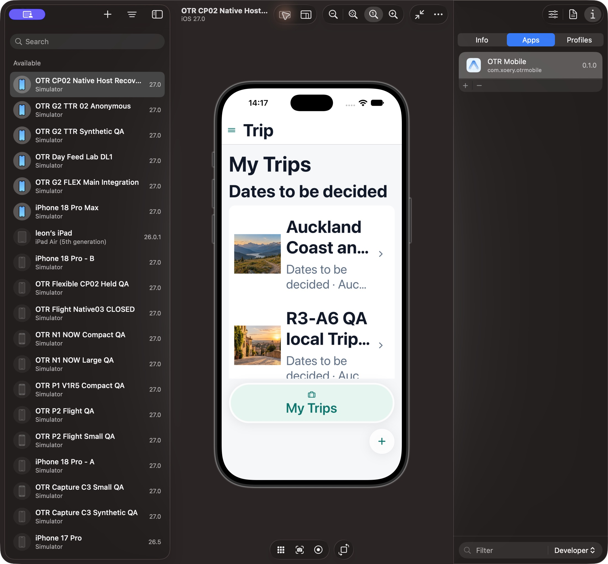
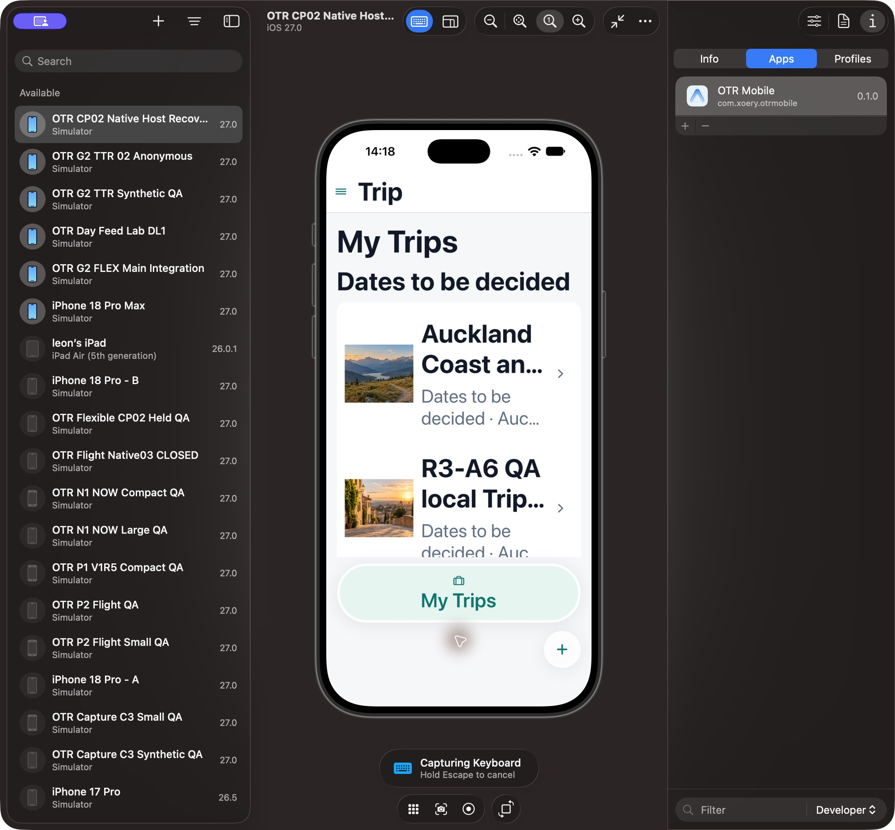
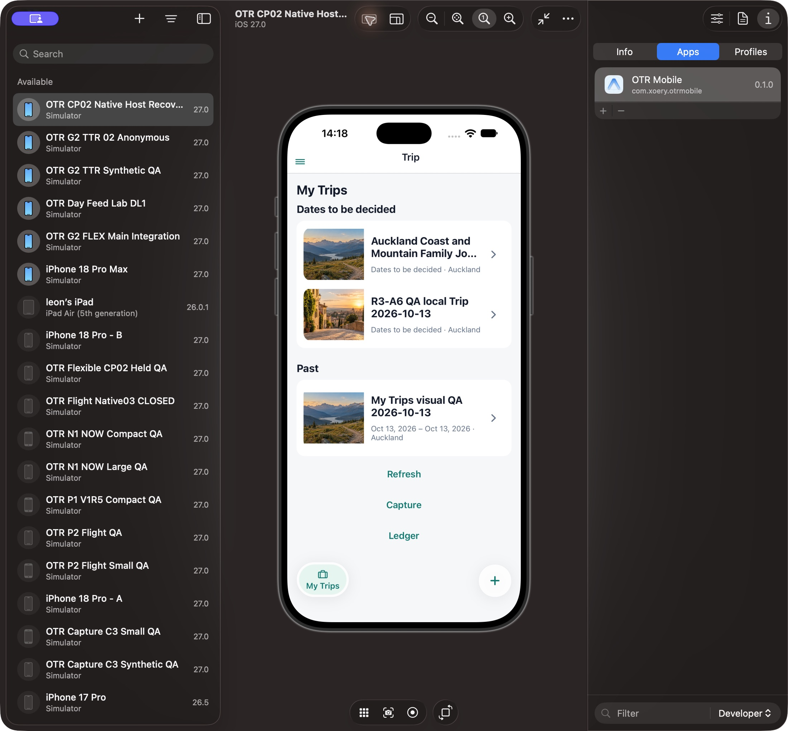
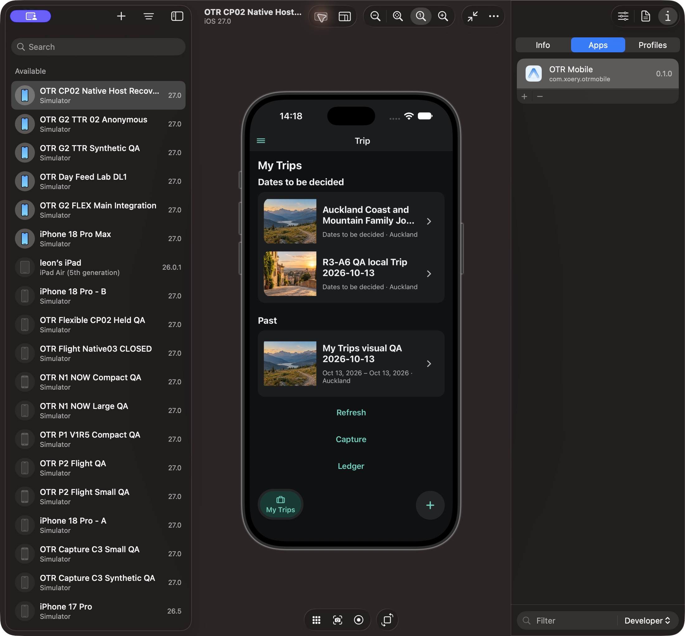
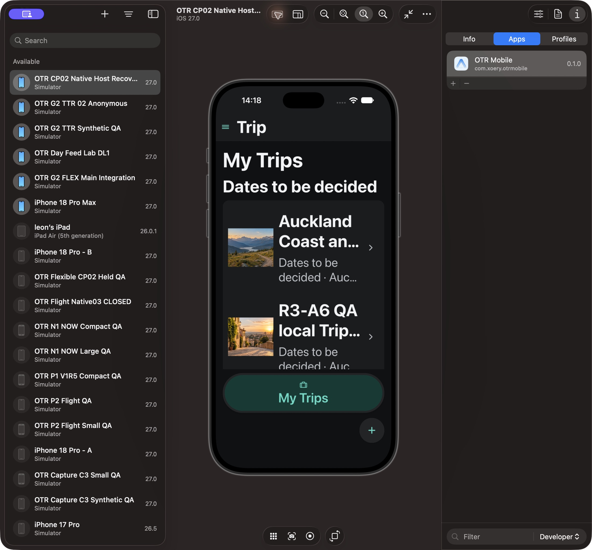
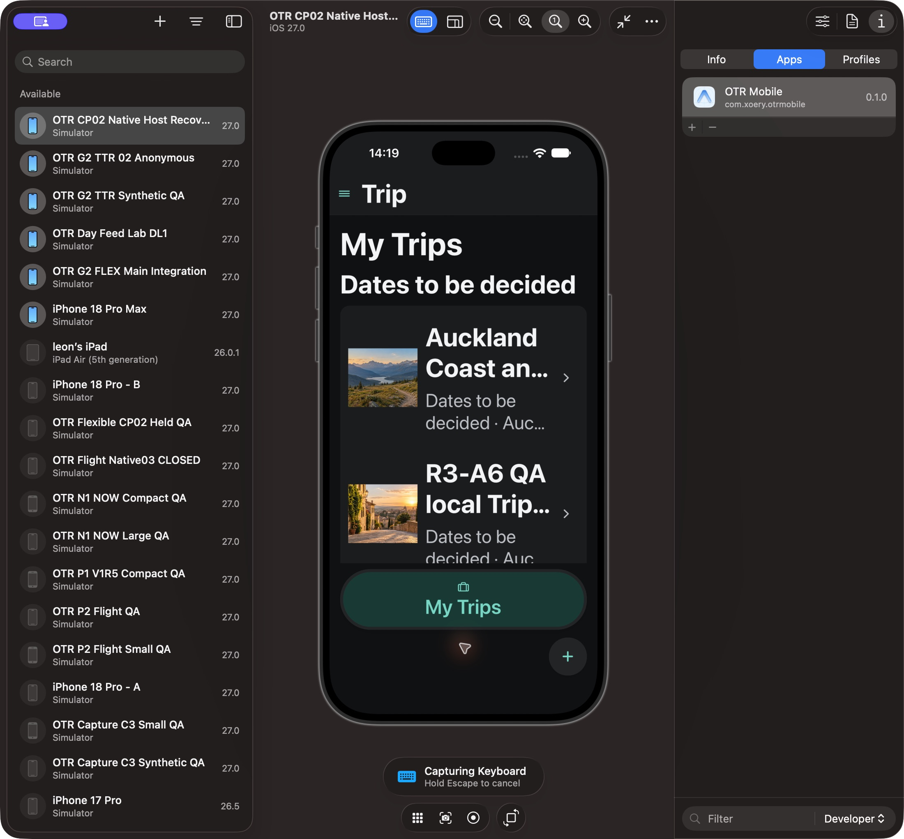
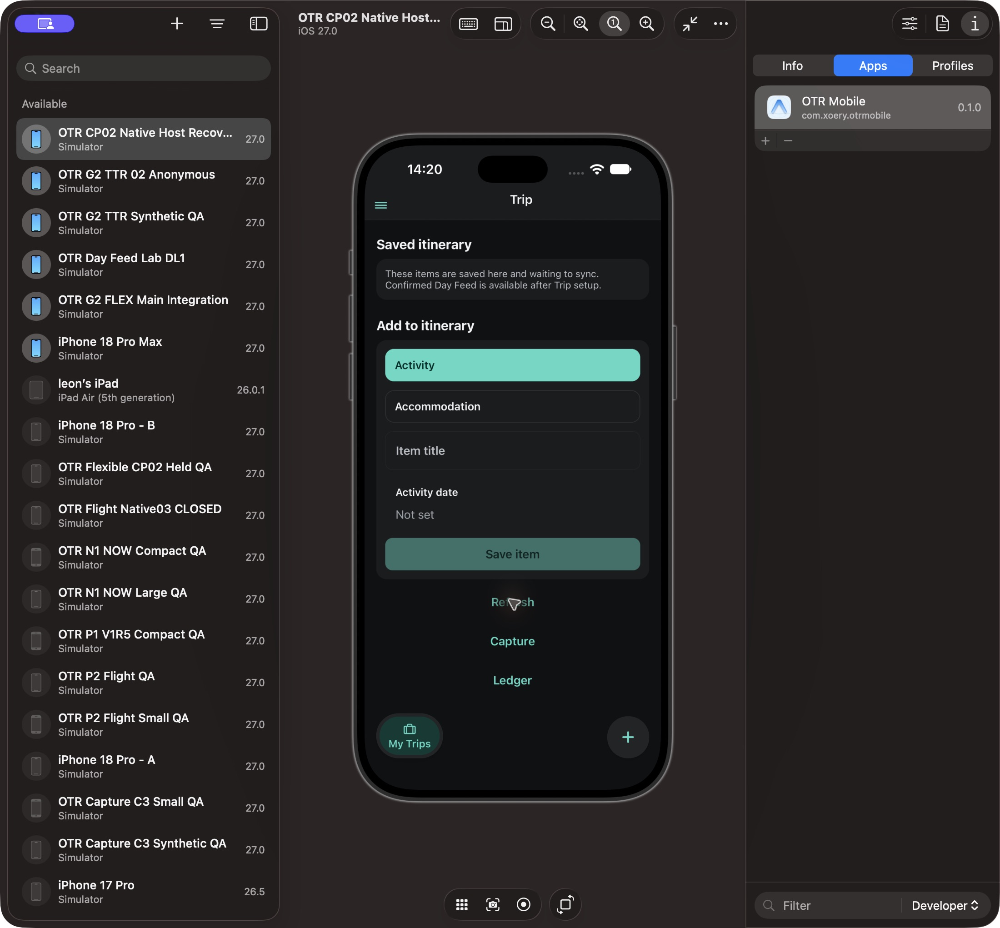

# P03 independent no-probe Native re-verification

Scope: original frozen P03 7e4b50541548b3ac2d2991b9b129e678add8e523250f6febe7cb305a304c40af, appTabs 8fe95c322304b5a2be751ba1201f5c8cd551a1f18aa3a39e216bff32c233ebd9 over exact P1b28 peer-reviewed UiText/title inputs. Approved A1A / com.xoery.otrmobile0.1.0, native build UNKNOWN; 402 logical width. SQLite62 and retained Coast association unchanged. No HeaderProbe or other UI instrumentation. Existing local Trip context, no new rights/Actor/certificate/network activation.

Actual public native development entry resolves appTabs to the owned QAclone and contains exact P03 parent header-height calculation/custom UiText title. HeaderProbe count0. Metro previous72318 expired; approved offline normal --clear restart81872. Observed listener IPv6 ::1; initial127.0.0.1 reads refused; public localhost actual native-entry read succeeded. Evidence is the consumed module, not filesystem hashes alone.

| Required affected case | Actual evidence | Verdict |
|---|---|---|
| Light baseline | 01-light-base.png | PASS |
| Light five hot increases, calibrated1→2.143 | 02-light-hot-five.png | PASS: full Trip, menu clear |
| Light same-size normal CmdR and MyTrips reopen | 03-light-reload.png | PASS: full Trip; no reload substitute for hot |
| Light five decreases | 04-light-five-down.png | PASS: default title restored |
| Dark baseline | 05-dark-base.png | PASS |
| Dark five hot increases | 06-dark-hot-five.png | PASS: full Trip |
| Dark same-size normal reload | 07-dark-reload.png | PASS: same readable title |
| Dark five decreases | 08-dark-five-down.png | PASS |
| Existing local longTrip open, scroll controls and return | 09-context-controls.png/AX | PASS: same Trip name/context and MyTrips return |

Light decrease sequence had one stale menu element error after one successful decrease; refreshed actual menu and completed remaining four, five decreases total. No force-input or user-change bypass. Previous failed P03 screenshots are retained historical observations with intended-source applicability NOT ESTABLISHED; they must not be used as current P03 failure. This result qualifies this finite P03 header presentation under the proven source. Whole MyTrips/Shell Level1 remains INCOMPLETE and Level2 NOT READY; native glass,375 width, real acceptedDay/account privileges remain separate.

Restoration final: all28 original P1b source hashes PASS; no overlays; normalMyTrips/font1/Light/CaptureKeyboardOFF/InspectorOFF, SQLite62/Coast preserved. See restored-ax.txt and minimum packet restoration.json.
