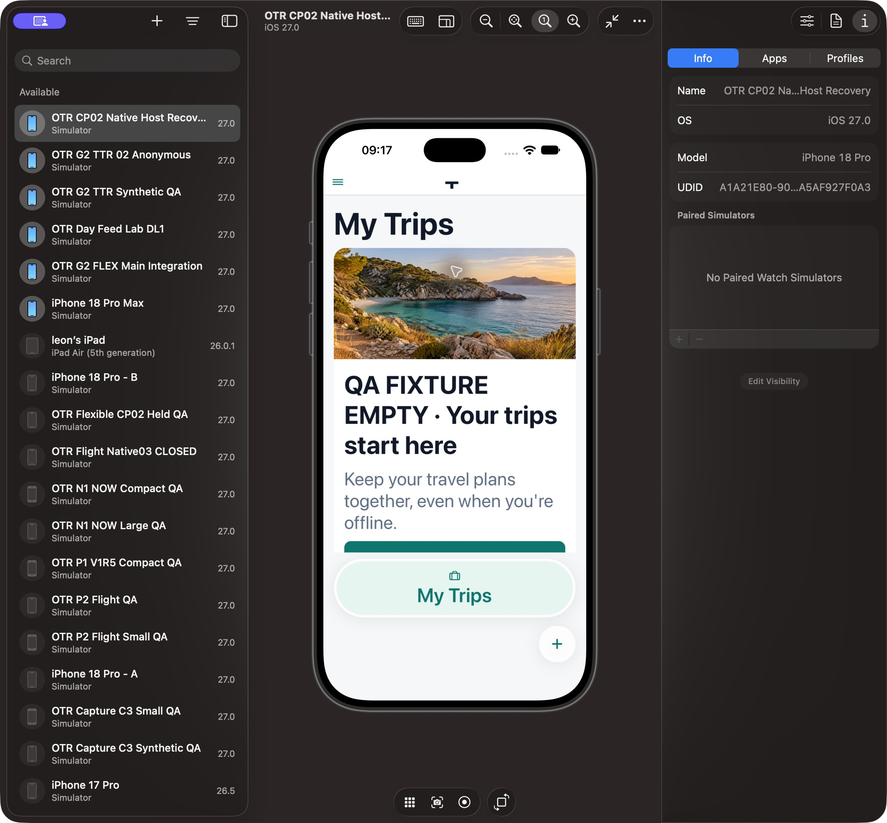
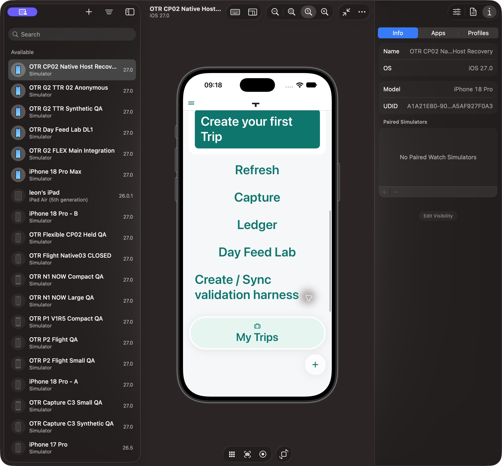
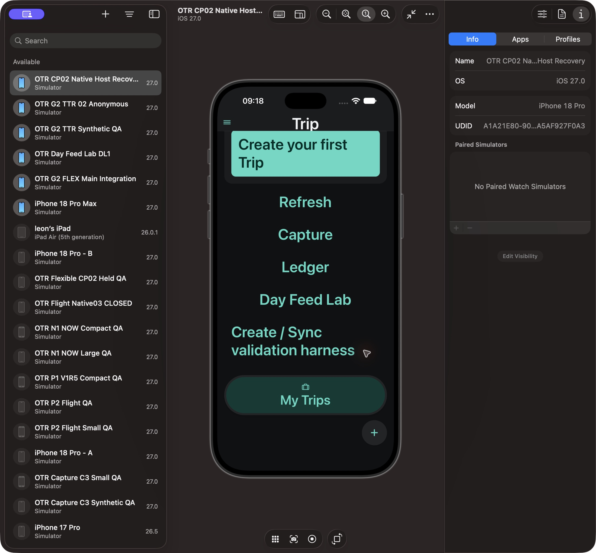
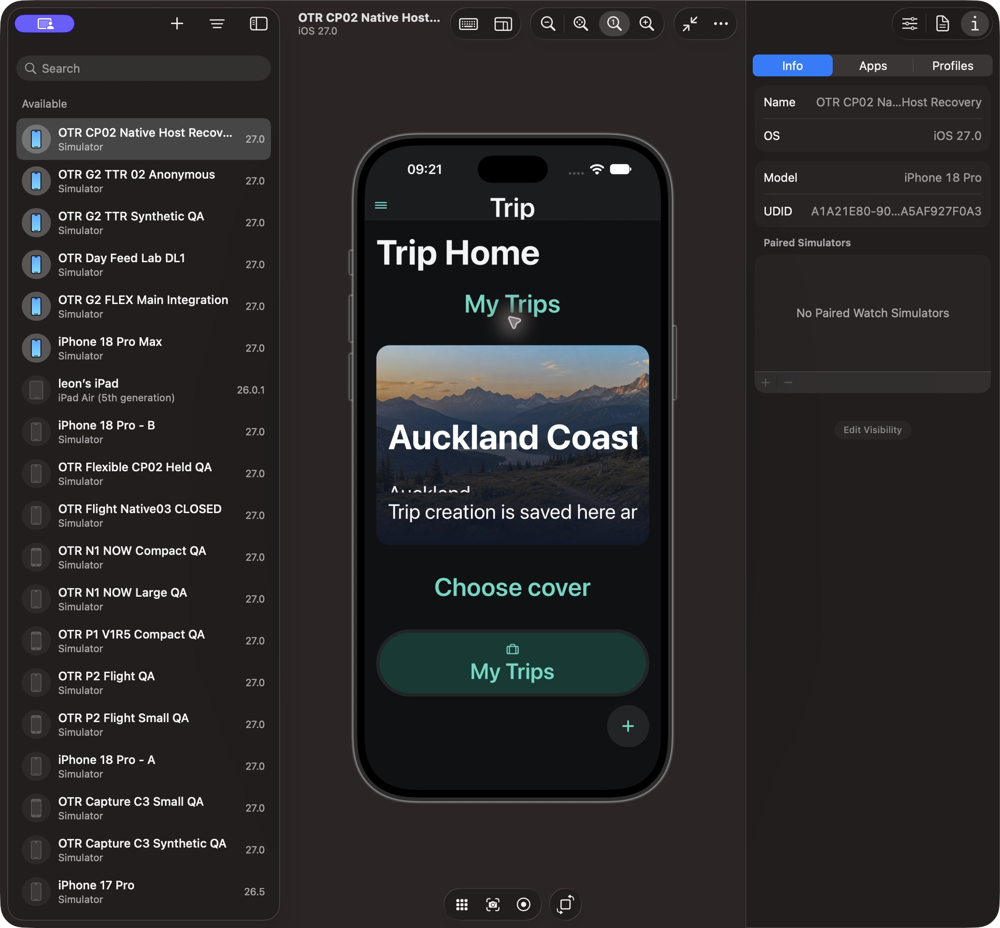
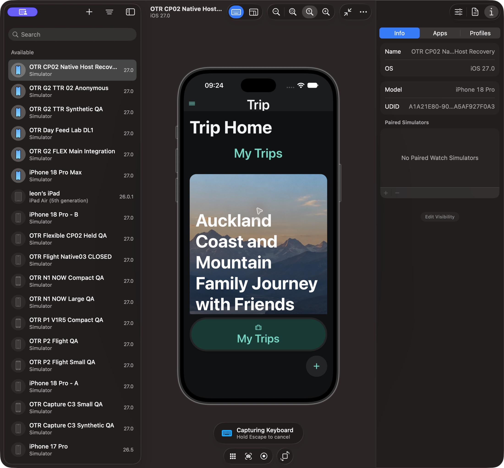

# Hot Dynamic Type — independent after-test checkpoint

Snapshot 2026-10-13T20:25:54.289841+00:00. Candidate c1a834359d09732be377f168eb0e1efc2587ce1e92e1a65a9a1945be2c431adc, composed15 hashes verified against served QA clone. Reviewer p4_visual_61 is not author; Source functional review separate. Same approved A1A/bundle and existing account. No build/install/Auth/data write.

**PARTIAL / FIX; L1 INCOMPLETE and Level2 NOT READY.** Inner native Text key-by-fontScale repairs the observed My Trips heading, empty title/body/CTA, UiButton labels and Shell labels. It does not remount parent/route/form/scroll state or disable font scaling. No broad Visual PASS.

| State                                                                     | Actual                                                                                  | Verdict                                               |
| ------------------------------------------------------------------------- | --------------------------------------------------------------------------------------- | ----------------------------------------------------- |
| Synthetic empty, baseline1→five hot increments2.143, Light                | Body/title/Shell read correctly; top header still T; CTA below fold reachable by scroll | PARTIAL/FIX                                           |
| Same hot state scrolled                                                   | Full CTA and controls readable, scroll works                                            | PASS bounded                                          |
| Same size appearance switch Dark                                          | Body/Shell still readable; top header repairs to Trip without reload                    | PASS observed, header transition remains intermittent |
| Real long-title Home, baseline1→hot2.143 Dark                             | LocalTripWorkspace native title/place/status still clip; heading/buttons/Shell read     | FIX ordinary omitted Text adoption                    |
| Same-size normal reload and ordinary matching Home reopen                 | Title wraps into growing hero; same selected Trip name preserved                        | PASS reload only, not hot PASS                        |
| See all retention, cold binary restart, Light long-title hot after repair | NOT OBSERVED in this checkpoint                                                         | NOT VERIFIED                                          |

Remaining precise cases were sent directly author: LocalTripWorkspace native Text did not adopt UiText; small further stateless custom-title-host investigation authorized by Root. At2.143 source custom-large-header branch exists; do not call the residual T a default-small-header fact. Stale native header hosting/layout is inference. App/(tabs)/_layout SHA75c236ac9e5bf13803ef3b3be0c3c7202649827efb55a7f5bf7a92fd9af52e7c matches candidate. Native measurements/actual width instrumentation unavailable; screenshot shows clipping, not a confirmed RN mechanism.

Props-only empty overlay was restored to exact candidate MyTripsList; all15 composed hashes reverified. Five decreases + normal reload restored baseline1. Metro remains the single leased process for serial QA. Original r3 25-image packet and before-fix typography diagnostics remain frozen separately; no older image substitutes for this candidate.

Skipped: broad framework changes, permission/runtime activation and duplicate trusted tests. Risk: remaining hot title cases prevent full acceptance.
