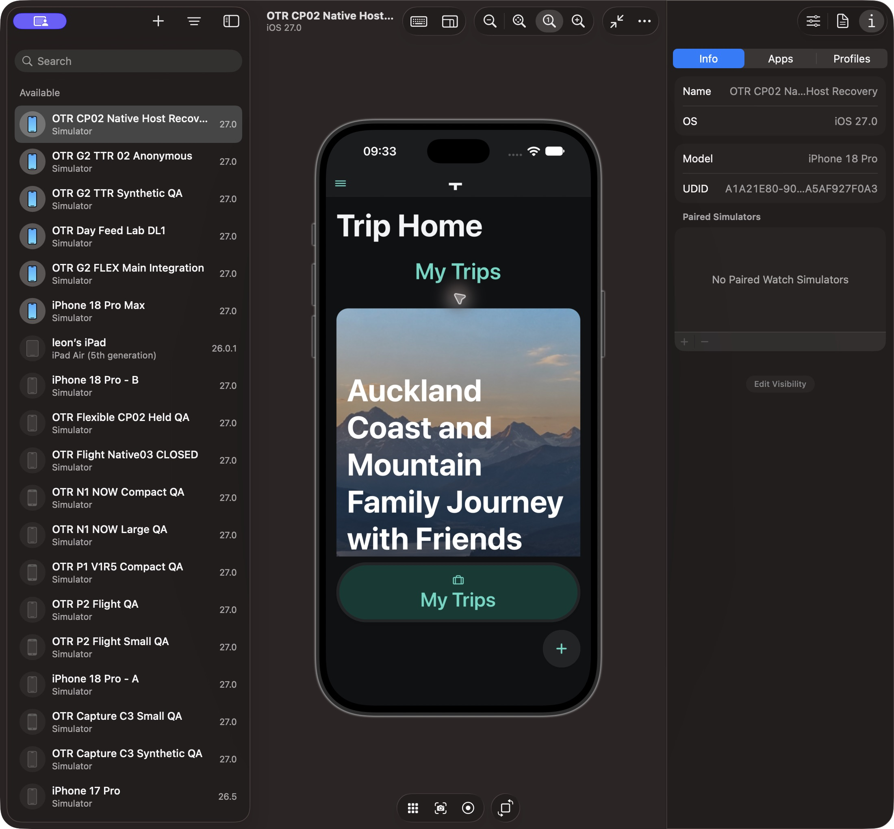
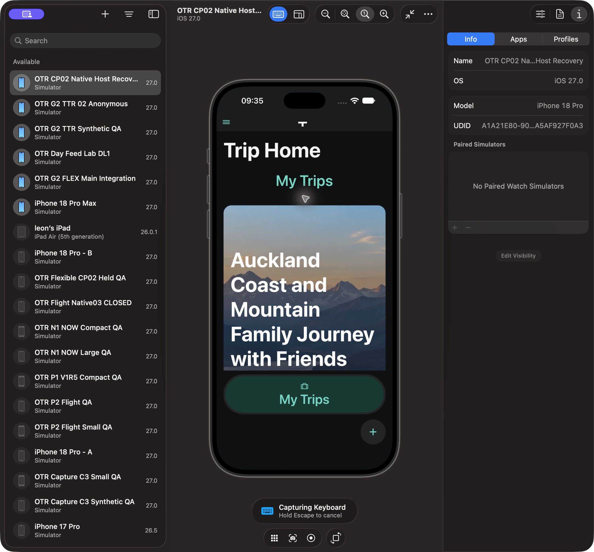
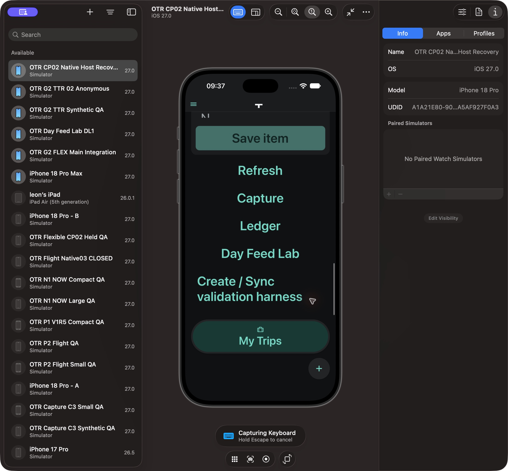
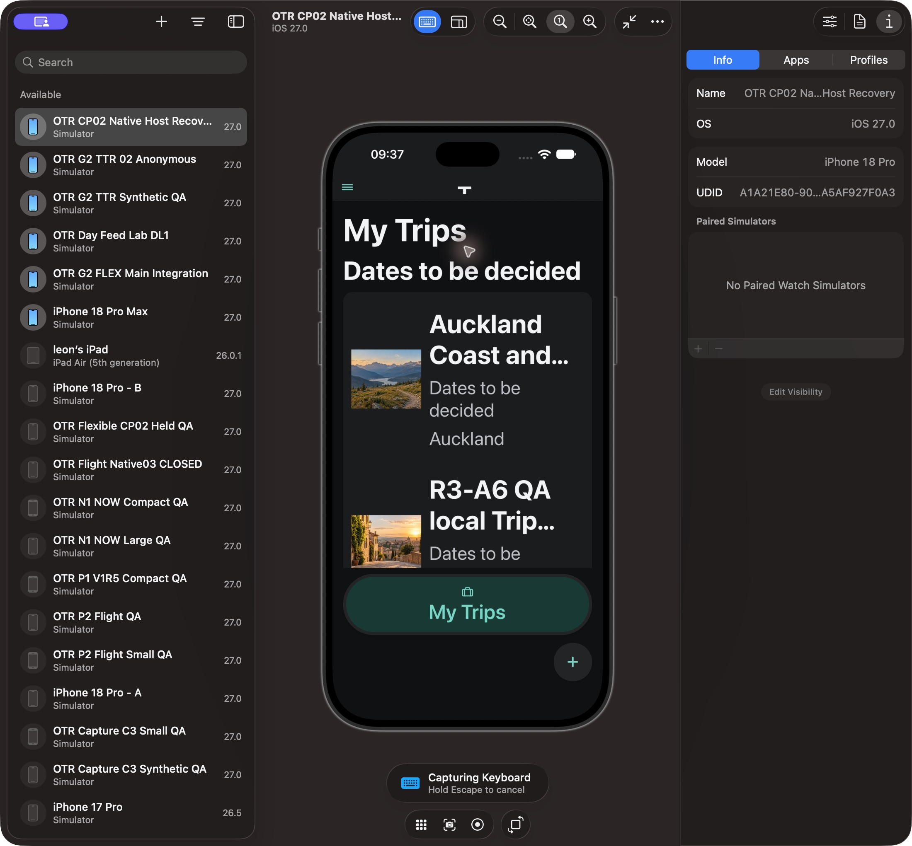
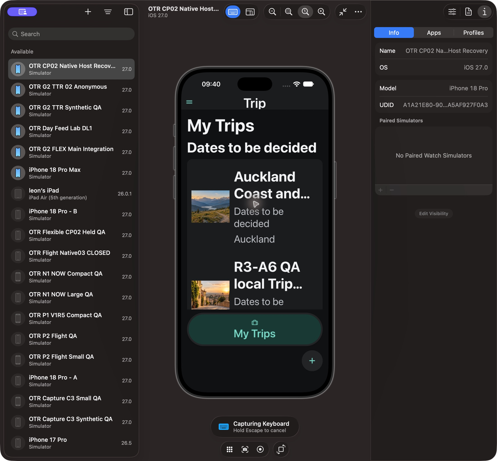

# Hot Dynamic Type revision2 — independent Native after-test

Snapshot 2026-10-13T20:41:44.793155+00:00. Exact source manifest20b82b43f47cabb3d105e385b519ffa5576c53a041b7b12b78d02388435114c5; all15 composition hashes independently verified against served QA clone. Only three deltas from prior hot revision: stateless header inner View key, Workspace UiText alias, existing mock. Reviewer p4_visual_61 is not author; Source's independent8-suite29 function receipt is separate. Existing approved A1A / com.xoery.otrmobile / app0.1.0, no newly compiled binary.

**Product Conformance PARTIAL; Native PARTIAL/FIX; Level1 INCOMPLETE; Level2 NOT READY.** Workspace repair works: real long-name pending Trip Home text grows/wraps at hot2.143 rather than retaining clipped lines. Body, buttons and Shell remain readable. Header-host repair is NOT successful in the actual hot case: Trip becomes T. One repeated check after normal baseline reload initialized the exact revised source and reproduced the header failure. Same-size reload+ordinary MyTrips reopen reads Trip fully. No additional header debug or navigation remount was attempted.

| Scene                                                                        | Actual                                                                              | Verdict          |
| ---------------------------------------------------------------------------- | ----------------------------------------------------------------------------------- | ---------------- |
| Real long-name Home baseline1→five OS increments2.143 Dark                   | Growing hero with wrapped title, retained name; native header T                     | PARTIAL/FIX      |
| Same scene after exact-source baseline initialization                        | Reproduces T; title remains readable                                                | Header FIX       |
| Home scroll and MyTrips return at same size                                  | Scroll reaches lower controls; return retains matching long-name Trip in local list | PASS bounded     |
| Same-size normal reload and MyTrips reopen                                   | Header fully Trip; long-title row readable                                          | PASS reload only |
| Light hot after revised header fix / See all retention / cold binary restart | NOT OBSERVED for this revision                                                      | NOT VERIFIED     |

R1 before Workspace adoption:

R2 after Workspace adoption; residual header T remains:

FontScale event delivery was proved separately in the three-value transient diagnostic. Header native hosting/layout remains an inference; actual clipping is the observation. We do not attribute a confirmed RN root cause or default-small-header branch to this case. No parent/screen/Navigator/route/form/cover state was keyed or scaling disabled. Photos mixed Workspace/P3 TripScreen have distinct hashes and are NOT certified by standalone success.

Five decreases restored baseline1 and appearance Light, followed by normal reload. No fixture remains. Source and Root receive this bounded failed-header result; no Owner first-check or new gate. Accepted Day, rights/offline/revocation, native glass and complete L1 remain separately unproved. Further speculative attempts are outside this bounded checkpoint; next P3/Photos composition continues.
