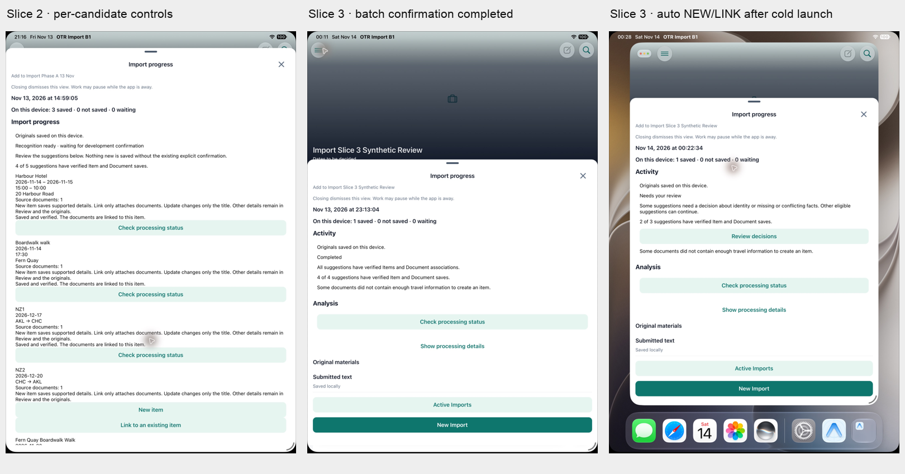

# Import V3 B2 Slice 3 — Owner review checkpoint

14 November 2026 NZDT. **SLICE_3_COMPLETE_FOR_OWNER_REVIEW.** No main merge/push.
Owner approved finite source-free IMPORT Core compatibility; accepted Slice 1/2
Capture, draft, Activity and original B1 operations remain intact.

## Delivered

- Existing Review planner, Core Queue/Sync/Wake and Receipt execute finite IMPORT
  NEW, initial P2 flight facts and add-only LOCAL_ONLY Document LINK. AI fields use
  existing PROVIDER provenance, not fabricated MANUAL confirmation. No auto UPDATE,
  Source Proof, new roles/grants/RLS, table, queue, service or Admission engine.
- Submission is durable intent in automatic mode. Development uses one durable
  Batch confirmation, not per-candidate routine confirmation. Historical Activity
  without a retained new submission intent remains read-only. Both modes use the
  same owning Core path and live ACL/version/ownership validation.
- Supplier-reference or complete flight identity can propose automatic LINK;
  proximity/title alone cannot force a merge. Conflicting/missing facts stay Review;
  empty facts ABSTAIN. Human protected fields remain unchanged.
- Exception Review follows Blueprint V2: full-screen continuous list, one expanded
  section, horizontal source tabs, one source panel, explicit NEW/LINK consequence.
  Unsupported extra facts are disclosed; no field-level UPDATE editor. UTF-8 text
  originals use the existing Documents display pattern; PDF/images use native preview.
- One batch plan hands independently eligible operations to existing Queue even
  after Activity dismissal. No iOS background execution guarantee. Receipt observation
  refreshes after exception choices; missing observations are not shown as zero saved.
- Nested native modal issue was fixed using the same Composer embedded in its existing
  route sheet and a native full-screen Review presentation. Back restores the same job.

## Actual DEV deployment and owning SQL

`backend-release.json`: compatible Backend actually deployed, image
`sha256:1f85595d88531fb6827f1e10a0bd5f440e52f8cc73051ec729bb06f5145392bc`,
source candidate `b797f9b`. Existing Host/Caddy/Auth and persistent Task SQLite retained.
No old PDF/PNG Worker or historical UNKNOWN recovery.

`dev-install-result.json`: forward SQL SHA
`253e53a8d0eeb483883758263f883cfed8bb65415cbfd3024baa083b7ecf7af9`,
six existing function bodies actually installed and independently read back. Function
OID/owner/EXECUTE ACL unchanged; no Role/Grant/RLS/schema/table/data migration. Existing
Writer released. `rollback.sql` is fixed and isolated inverse verified. **After IMPORT
receipts exist, retain compatible readers; do not blindly downgrade to a reader or
SQL contract that cannot read IMPORT history.** No inverse executed in DEV.

## Full App / synthetic Provider / real DEV Core

DeviceHub iPad simulator `1B2252F4-4F90-4F93-9223-545269EAA06C`, bundle
`com.xoery.otrmobile.b1full20261113`. Normal My Trips → Trip → Import UI, normal
existing synthetic account, new Trip `a6155477-182d-4f35-a5d3-10f3d85c1b36`.
**Provider responses only are synthetic in a temporary build copy.** Normal Auth,
Core Backend, Queue, Sync, Receipt and PostgreSQL writes are real DEV. Fixture source
and build identity are recorded here; no test fixture/allowlist is in product code.

| Scenario                                                 | Actual observed result                                                                                                                                                                             |
| -------------------------------------------------------- | -------------------------------------------------------------------------------------------------------------------------------------------------------------------------------------------------- |
| Development Batch `1e256ac9-3582-4eb5-ad8e-e26f95dadff0` | One Batch Confirm; trustworthy P1/P2 saved without per-row Confirm. Two Hotel ambiguities required user NEW/LINK choices. 4 suggestions resolved to3 Items; no forced merge. ABSTAIN created none. |
| Cold launch / same original development Batch            | Same IDs/decisions restored; Completed4/4 with formal Item and Document receipts.                                                                                                                  |
| Intermediate `5e1bf829-0ba6-4891-9fb2-f03fb78cd2b0`      | Metro reused old dev configuration; actual retained intent was unconfirmed. Preserved as-is, no Save or intent rewrite. Clean build cache plus actual-bundle assertion fixed configuration.        |
| Automatic Batch `8b3ca4ad-cb26-4d26-a9e4-e924144b680b`   | Submit alone: P6 Gallery NEW and exact-flight AA1302 LINK to existing P2. No Batch Confirm displayed/clicked. Closed Activity during Sync; queued work completed.                                  |
| Automatic cold recovery                                  | Same Batch recovered:2/3 saved, missing-date P1 stays Review, empty P4 ABSTAIN. Missing-date NEW disabled, no invented date, original UTF-8 text actually visible.                                 |
| Independent PG readback                                  | 4 Items,2 LOCAL_ONLY Documents,5 unique active associations,12 APPLIED receipts. Same AA1302 Item has two Documents; no duplicate flight or Hotel.                                                 |
| Original B1                                              | 19 original receipts retained; original file hashes match. No original B1/QA179 Analyze/Confirm/Save replay.                                                                                       |

`independent-dev-readback.json` contains authoritative rows and receipts;
`local-final-readback.json` records the same accepted SQLite items, all queue operations
COMPLETED, durable decisions and unchanged B1 files/receipts. This verifies process
cold recovery/reinstall preserving data, **not a new system-offline or physical iPad test**.

Three new synthetic-provider Batches each have one simulated dispatch (including the
unconfirmed cache-diagnostic Batch). **Real DeepSeek requests:0; real model fees:0.**
Temporary final simulator build is explicitly synthetic Provider mode for these
records; it must not be presented as a normal real-Provider build. Production untouched.

## Validation

-269 targeted tests pass (Review/planning, submission/account isolation, immutable
receipt reuse, actual Queue/Sync/HTTP contracts);21 Activity/Wake tests pass.

- Existing network-none owning PostgreSQL acceptance: finite commands, provenance,
  manual-target LINK, idempotency, invalid/unauthorized rejection, independent readback,
  forward and exact inverse pass (`isolated-pg.log`). P1–P6 valid NEW/Wake and invalid
  payload tests are isolated coverage; real App saved P1/P2/P3/P6, not all six families.
- UI guard and changed UI lint pass. Three unchanged whole-repo type errors remain:
  two continuation-fixture `presentationTier`, one browser `react-dom/client` declaration.
  No touched-source type error remains. Known instruction-scope baseline test failure
  independently reproduced on accepted Slice2; not silently counted as passing.
- Runtime discovered/fixed: metadata shared across candidate types; cloud IMPORT wake;
  Core single-connection receipt read collisions (sequential/read retained receipts);
  nested-modal navigation; original-job restoration; post-decision receipt refresh;
  text-original native-preview mismatch. No new framework.

## Screenshot review

- `development-batch-confirmation.png`: one development confirmation.
- `exception-link-choice.png`: genuine identity decision and add-only consequence.
- `development-completed.png`: completed4/4 suggestions,3 distinct Items.
- `automatic-applying-no-confirm.png`: automatic queue without Confirm.
- `automatic-cold-recovery.png`: two successful suggestions + one genuine Review.
- `missing-facts-and-original.png`: disabled NEW, no invented facts, actual local text.

Full App screenshots are real simulator captures. This is **Full App synthetic-Provider

- real DEV Core PASS**, not real-Provider E2E or Physical iPad PASS.

## Remaining / next boundary

STOP for Owner review. Slice4 owns richer saved Results and return navigation;
full field UPDATE remains B4, Documents/Updates independent UX stays Slice5/6.
Existing DEV Core receipt/snapshot round trips can take tens of seconds; current
UI shows checking/partial truth, not artificial progress. Performance work is recorded,
not silently expanded into this slice. No additional Owner decision is required now.
