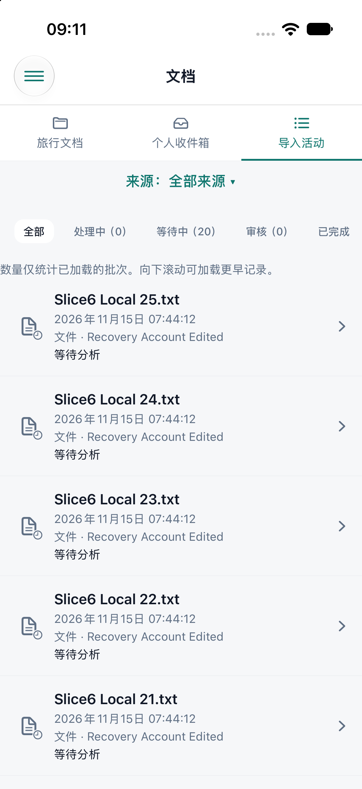
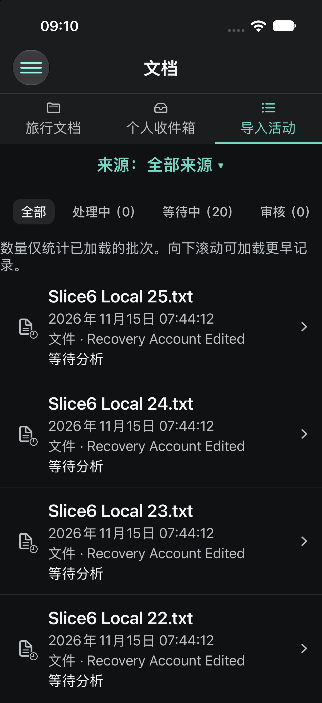
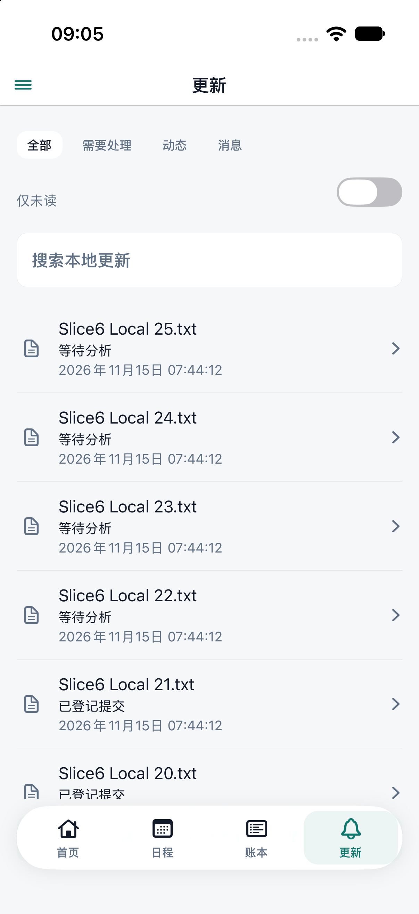
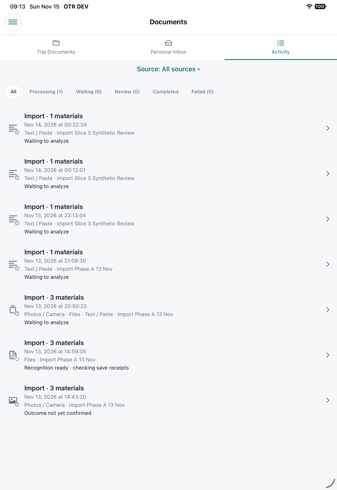

# Import V3 Slice 6 — final bounded delivery

> Final Owner-authorized Activity density closure: product39b22ea4. See [limited closure and current screenshots](FINAL_UX_DENSITY_CLOSURE.md). The original2e acceptance/evidence below remains versioned and unchanged.

15 November2026 NZDT. Product **2e75187329b231720406ee20b944c9fb86db1399**. Branch `codex/import-v3-slice6-activity`, independent worktree. Main baseline `691189669e33d6eb5399f50c11dcbddf901536a6` is an ancestor. No merge/push/deployment performed.

## Verdict

**Implementation complete for authorized Slice6 scope; GO for Owner UX/merge review, not automatic Main merge or Beta Release.** Remaining evidence limits are explicit below. Actual ordinary input failure was fixed rather than excused as an automation problem.

### Blueprint recovery and UX corrections

Full original Oct23 Product Delta (45 paragraphs), UI Blueprint (25 paragraphs), original reference image, Oct14 Updates Delta and approved B2/UX-C1/C2 were read. [Conformance comparison](UX_CONFORMANCE.md) and [Gap matrix](BLUEPRINT_GAP_MATRIX.md) map original requirements to owning code and actual evidence.

- Compact Batch rows: neutral source icon with small state overlay, original time, authorized Trip, true owning status/result count. Source chooser + quiet sticky status chips; no Activity keyword search.
- One chronological email-like Updates list, one original event time, one row action, independent Unread filter; removed repeated per-row Refresh/Mark Read/debug explanations. Ordinary Waiting/Processing/UNKNOWN do not become unread attention.
- Same Batch filtered Updates, owning semantic Review/failure recovery, native return. Real iPad found card pushed over transparent Batch Modal was visible but ignored all input. `f1590423` uses native full-screen Modal and canonical Toolbar Back; actual category change and return succeeded.
- Approved manual recovery reuses existing itinerary chooser/forms. Assigned Trip must remain authorized; unassigned requires explicit Trip selection. No invented date, no automatic Save, no AI-result counter changes.
- Existing aggregate badge now includes true unread Import attention, Batch-deduped with Intake; read/version race and incomplete observation coverage handled using existing events and device read preference. No new database, execution engine or remote polling lifecycle.
- Native hot Dynamic Type revealed clipped chip and source-button text. Canonical compact Text refresh and existing UiText reuse fix actual measurements without changing touch targets or actions.

## Native preview evidence

Full signed arm64 Release Native builds, existing bundle IDs, original data retained. Final staging matches all1673 tracked src/app files; iPhone/iPad final bundle hash is identical: `e126569271ab352c73b15ba189f532efb1500dd3a58389c68d718799548d163a`. [Build proof](evidence/build-proof.json).

| Actual exercise | Result and source |
|---|---|
| iPhone normal Trip→Updates→Documents Activity; source/status filtering, empty Review, tabs and older Batch return | PASS on full App. Cursor20→25 actual labelled local Repository Batches; loaded depth/offset retained. Final Activity screenshot2e751873 below; sticky/return interactions first recorded96474, unchanged by later native-modal/font fixes |
| iPhone cold launch and installed replacements | Normal Account/Trip and Batch rediscovery PASS; original bytes preserved. Screen filters/scroll are retained presentation state while mounted, not claimed as cross-process preferences |
| iPhone compact Updates | PASS actual full App; f159 screenshot. Final2e additionally exercises normal entry, same unchanged list implementation. No positive unresolved Review fixture is fabricated in Native |
| iPhone dark + hot text5→6 | PASS actual2e751873; source label and chip counts fully visible. Restored Light/text3 afterward |
| iPad original7 Batch history and Slice5 Document list | PASS final2e751873; original Documents and metadata still present. Normal English layout screenshot below |
| iPad original14:43 Results |96474 actual formal read settled to Created1/Linked1, unique objects and PNG/GIF/JPEG links. Later final-source reentry sometimes lacks Backend observation and truthfully shows UNKNOWN/checking, never failure/success. Earlier formal image is versioned, not claimed as a new same-SHA Save |
| iPad Results→filtered Updates→Needs Attention→Back | PASS actual f159; filter selected state changes, Back returns same original Batch. Earlier card input failure resolved. Final2e changes only canonical dynamic label measurement and test isolation |
| iPad manual recovery chooser→Close | PASS f159; existing Plan/Flight/Stay/Rental/Transport/Activity entry visible, no new Item or Save performed |

Earlier engineering-oriented Updates screenshot for direct comparison: [2424 preview](evidence/iphone-updates-before-2424.png). Formal historical Results: [96474 preview](evidence/ipad-final-results-formal.png). These earlier pictures are not substituted for final-source verification.

## Validation and independent Review

- Final product tree: **221 tests /19 files PASS** (180/15 +41/4), unchanged assertions retained. Covers sources, cursor history, true outcomes/dedup/ABSTAIN/pending association, UNKNOWN no dispatch, bounded mark-read, material versions, account generation, full-history badge, observed versus failed coverage, manual target rules and navigation callbacks.
- Initial expanded parent run found two native module suite-load failures, not product failures. Narrowly isolated independently tested Native Directory widget; all51 parent assertions then ran and passed. No skip/deleted/weakened assertion.
- ESLint scoped changes PASS; UI guard **178 checked,473 unchanged legacy occurrences**. Typecheck has exactly3 known Main errors (two fixture presentationTier, one browser react-dom/client declaration); zero new errors.
- Reused independent reviewer: S6-A, S6-B/functional closure and final modal/font deltas **static Review PASS**. Native acceptance above belongs to actual MC interaction, not reviewer or Harness inference.
- Both full Native Release builds succeed. No Backend/SQL/data-db/data-sync changes; Core/Receipt/Queue preserved. Main SQLite76–79 unchanged.

## Data and permissions

[Read-only preservation result](evidence/data-preservation.json): all9 iPhone and30 original iPad baseline file hashes match. Both keep Core Documents9/links14. Original queues remain13/33 COMPLETED. iPad7 Batches/13inputs unchanged. No Session/Keychain/SQLite copy or reset.

Phone lacked Batch history:25 explicitly labelled synthetic local Batches were prepared through existing Repository/normal file-retention path, no Provider or Core Save.24 inputs accepted; first interrupted preparation remains original PENDING/reacquire, not deleted or replaced. Phone local captures32→56. Temporary preparation hook was staging-only and removed; final source match confirms no hook/product fixture.

Account/Trip guards and stale generation covered by owning tests; actual phone PhaseA Updates excludes RecoveryTrip fixtures, Activity keeps authorized cross-Trip labels. No fresh second-user Native login/Member matrix is claimed. UNKNOWN observations retain original identities and no resend action.

## Known limits / separate backlog

- Current positive semantic Review/read→resolve, forced offline/server outage and fresh multi-account Native cases are **owning-fixture verified, Native not performed**. Physical iPad acceptance not performed. No new Provider calls or repeated B1/QA179 Save.
- Backend reads can be unavailable; current final App displays truthful UNKNOWN/checking. Existing formal results remain retained; no replay to make screenshots look successful.
- Device-local read preference does not promise cross-device notification sync. Recent Updates is bounded; older/exact Batch is reachable through Activity.
- AI/MCP/email sessions with no existing producer, new APNs/email services, Full UPDATE and AuthC04 business development are outside Slice6.
- Document Rename/Share/Add-Move/SafeRemove remain distinct owning-command backlog; Document Cloud Sync remains Owner-approved deferred.

No new product decision or runtime infrastructure is introduced. Await Owner acceptance and separate Main merge authorization.
